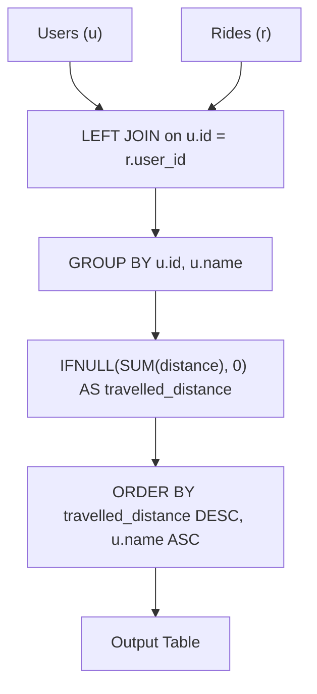

# 1407. Top Travellers

## Problem Statement

Table: `Users`
```
+---------------+---------+
| Column Name   | Type    |
+---------------+---------+
| id            | int     |
| name          | varchar |
+---------------+---------+
id is the column with unique values for this table.
name is the name of the user.
```

Table: `Rides`
```
+---------------+---------+
| Column Name   | Type    |
+---------------+---------+
| id            | int     |
| user_id       | int     |
| distance      | int     |
+---------------+---------+
id is the column with unique values for this table.
user_id is the id of the user who traveled the distance "distance".
```

Write a solution to report the distance traveled by each user.

Return the result table ordered by `travelled_distance` in **descending order**, if two or more users traveled the same distance, order them by their `name` in **ascending order**.

The result format is in the following example.

### Example 1:
```
Input: 
Users table:
+------+-----------+
| id   | name      |
+------+-----------+
| 1    | Alice     |
| 2    | Bob       |
| 3    | Alex      |
| 4    | Donald    |
| 7    | Lee       |
| 13   | Jonathan  |
| 19   | Elvis     |
+------+-----------+
Rides table:
+------+----------+----------+
| id   | user_id  | distance |
+------+----------+----------+
| 1    | 1        | 120      |
| 2    | 2        | 317      |
| 3    | 3        | 222      |
| 4    | 7        | 100      |
| 5    | 13       | 312      |
| 6    | 19       | 50       |
| 7    | 7        | 120      |
| 8    | 19       | 400      |
| 9    | 7        | 230      |
+------+----------+----------+
Output: 
+----------+--------------------+
| name     | travelled_distance |
+----------+--------------------+
| Elvis    | 450                |
| Lee      | 450                |
| Bob      | 317                |
| Jonathan | 312                |
| Alex     | 222                |
| Alice    | 120                |
| Donald   | 0                  |
+----------+--------------------+
Explanation: 
- Elvis and Lee each traveled 450 miles; Elvis comes first because "Elvis" is alphabetically smaller than "Lee".
- Bob, Jonathan, Alex, and Alice have rides and are sorted in descending order of distance.
- Donald has no logged rides, so his travelled_distance is 0.
```

---

## Approach

1. **Retain All Users via `LEFT JOIN`:**
   - Every user in `Users` must be reported, including users who have never taken a ride.
   - Performing a `LEFT JOIN` from `Users` (`u`) to `Rides` (`r`) on `u.id = r.user_id` ensures zero-ride users are not discarded.

2. **Aggregating Distance and Handling NULLs:**
   - Use `SUM(r.distance)` to total all ride distances per user.
   - For users with no matching ride records, `SUM(r.distance)` returns `NULL`. Wrap the aggregation in `IFNULL(SUM(r.distance), 0)` (or `COALESCE(SUM(r.distance), 0)`) to substitute `0`.

3. **Grouping:**
   - Group by both `u.id` and `u.name`. Grouping by `u.id` guarantees correct segregation in case distinct users share identical names.

4. **Multi-Column Sorting:**
   - Order primary sorting by `travelled_distance DESC`.
   - Tie-break secondary sorting by `u.name ASC`.



---

## Code Implementation

```sql
SELECT 
    u.name,
    IFNULL(SUM(r.distance), 0) AS travelled_distance
FROM Users u
LEFT JOIN Rides r 
    ON u.id = r.user_id
GROUP BY 
    u.id, 
    u.name
ORDER BY 
    travelled_distance DESC, 
    u.name ASC;
```

---

## Complexity Analysis

- **Time Complexity**: $O(U + R + U \log U)$ — where $U$ is the number of users and $R$ is the number of rides. Joining and grouping runs in $O(U + R)$ with hash/index lookup, followed by $O(U \log U)$ to sort the final result.
- **Space Complexity**: $O(U)$ — memory required to hold intermediate aggregated distances and produce the sorted output set.

---
