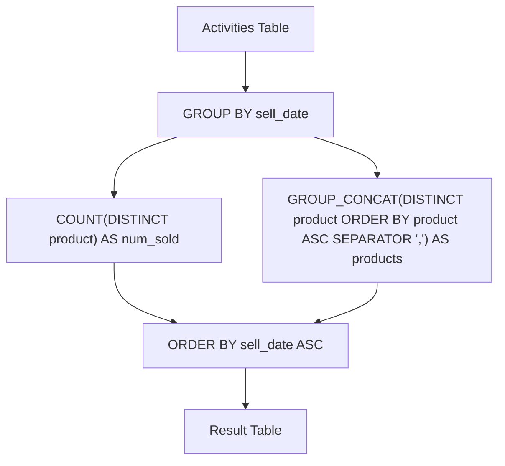

# 1484. Group Sold Products By The Date

## Problem Statement

Table: `Activities`
```
+-------------+---------+
| Column Name | Type    |
+-------------+---------+
| sell_date   | date    |
| product     | varchar |
+-------------+---------+
There is no primary key (column with unique values) for this table. It may contain duplicates.
Each row of this table contains the product name and the date it was sold in a market.
```

Write a solution to find for each date the number of different products sold and their names.

The sold products names for each date should be sorted lexicographically.

Return the result table ordered by `sell_date`.

The result format is in the following example.

### Example 1:
```
Input: 
Activities table:
+------------+------------+
| sell_date  | product     |
+------------+------------+
| 2020-05-30 | Headphone  |
| 2020-06-01 | Pencil     |
| 2020-06-02 | Mask       |
| 2020-05-30 | Basketball |
| 2020-06-01 | Bible      |
| 2020-06-02 | Mask       |
| 2020-05-30 | T-Shirt    |
+------------+------------+
Output: 
+------------+----------+------------------------------+
| sell_date  | num_sold | products                     |
+------------+----------+------------------------------+
| 2020-05-30 | 3        | Basketball,Headphone,T-Shirt |
| 2020-06-01 | 2        | Bible,Pencil                 |
| 2020-06-02 | 1        | Mask                         |
+------------+----------+------------------------------+
Explanation: 
For 2020-05-30, Sold items were (Headphone, Basketball, T-Shirt), we sort them lexicographically as (Basketball, Headphone, T-Shirt) and separate them by a comma (,).
For 2020-06-01, Sold items were (Pencil, Bible), we sort them lexicographically as (Bible, Pencil) and separate them by a comma (,).
For 2020-06-02, Sold item is (Mask), we just return it.
```

---

## Approach

1. **Deduplication within Dates:**
   - Products may be sold multiple times on the same date (e.g., `Mask` on `2020-06-02`).
   - Use `COUNT(DISTINCT product)` to count unique products per date.

2. **Lexicographical String Aggregation:**
   - Use MySQL's `GROUP_CONCAT` function with `DISTINCT product` to aggregate unique product names into a single comma-separated string.
   - Specify `ORDER BY product ASC` inside `GROUP_CONCAT` to guarantee lexicographical sorting of the product names.
   - Specify `SEPARATOR ','` (which is also the default separator).

3. **Grouping and Sorting:**
   - Group records by `sell_date`.
   - Order final output by `sell_date ASC`.



---

## Code Implementation

```sql
SELECT 
    sell_date,
    COUNT(DISTINCT product) AS num_sold,
    GROUP_CONCAT(DISTINCT product ORDER BY product ASC SEPARATOR ',') AS products
FROM Activities
GROUP BY sell_date
ORDER BY sell_date ASC;
```

---

## Complexity Analysis

- **Time Complexity**: $O(N \log N)$ — where $N$ is the number of rows in the `Activities` table. Grouping by date takes $O(N)$, and sorting distinct products for each date inside `GROUP_CONCAT` takes $O(k \log k)$ for each group of $k$ distinct products.
- **Space Complexity**: $O(N)$ — memory required for deduplication sets and aggregating concatenated string outputs.

---
