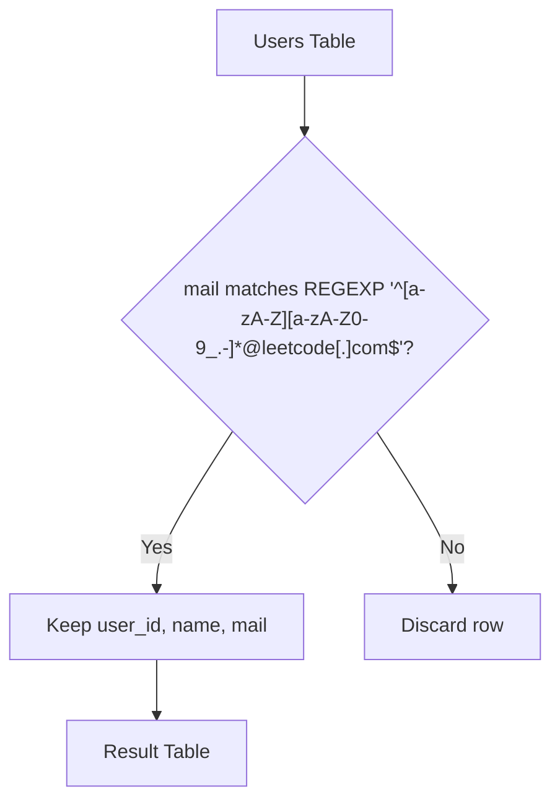

# 1517. Find Users With Valid E-Mails

## Problem Statement

Table: `Users`
```
+---------------+---------+
| Column Name   | Type    |
+---------------+---------+
| user_id       | int     |
| name          | varchar |
| mail          | varchar |
+---------------+---------+
user_id is the primary key (column with unique values) for this table.
This table contains information of the users signed up in a website. Some e-mails are invalid.
```

Write a solution to find the users who have **valid emails**.

A valid e-mail has a prefix name and a domain where:
- The **Prefix name** is a string that may contain letters (upper or lower case), digits, underscore `'_'`, period `'.'`, and/or dash `'-'`. The prefix name **must start with a letter**.
- The **Domain** is `'@leetcode.com'`.

Return the result table in **any order**.

The result format is in the following example.

### Example 1:
```
Input: 
Users table:
+---------+-----------+-------------------------+
| user_id | name      | mail                    |
+---------+-----------+-------------------------+
| 1       | Winston   | winston@leetcode.com    |
| 2       | Jonathan  | jonathanisgreat         |
| 3       | Annabelle | bella-@leetcode.com     |
| 4       | Sally     | sally.come@leetcode.com |
| 5       | Marwan    | quarshie#@leetcode.com  |
| 6       | David     | david69@gmail.com       |
| 7       | Shapiro   | .shapiro@leetcode.com   |
+---------+-----------+-------------------------+
Output: 
+---------+-----------+-------------------------+
| user_id | name      | mail                    |
+---------+-----------+-------------------------+
| 1       | Winston   | winston@leetcode.com    |
| 3       | Annabelle | bella-@leetcode.com     |
| 4       | Sally     | sally.come@leetcode.com |
+---------+-----------+-------------------------+
Explanation: 
- User 1's email has a valid prefix and domain.
- User 2's email does not have '@leetcode.com'.
- User 3's email prefix contains a valid character '-' and ends with '@leetcode.com'.
- User 4's email prefix contains a valid character '.' and ends with '@leetcode.com'.
- User 5's email prefix contains '#', which is not allowed.
- User 6's email domain is '@gmail.com' rather than '@leetcode.com'.
- User 7's email starts with a period '.', which violates the rule that prefix must start with a letter.
```

---

## Approach

1. **Regular Expression Validation (`REGEXP`):**
   - We construct a regular expression that enforces each validation constraint:
     - `^` : Anchor to the beginning of the string.
     - `[a-zA-Z]` : The prefix must begin strictly with an alphabetical letter.
     - `[a-zA-Z0-9_.-]*` : The remaining characters in the prefix may only be letters, numbers, underscores, periods, or hyphens.
     - `@leetcode[.]com$` : Must end strictly with `@leetcode.com`. Wrapping `.` in brackets `[.]` (or escaping `\\.`) ensures it is interpreted as a literal period rather than a wildcard character.



---

## Code Implementation

```sql
SELECT 
    user_id,
    name,
    mail
FROM Users
WHERE mail REGEXP '^[a-zA-Z][a-zA-Z0-9_.-]*@leetcode[.]com$';
```

---

## Complexity Analysis

- **Time Complexity**: $O(N)$ — where $N$ is the number of rows in the `Users` table. The regular expression engine evaluates each email string in linear time with respect to the string length.
- **Space Complexity**: $O(K)$ — where $K$ is the number of valid user records returned in the final result.

---
