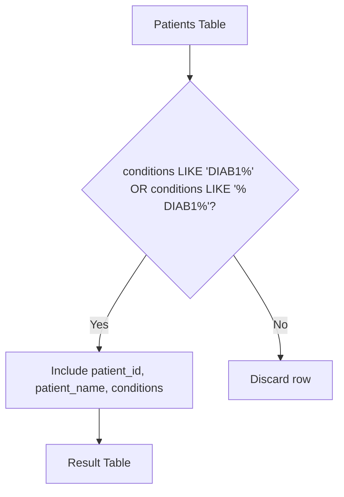

# 1527. Patients With a Condition

## Problem Statement

Table: `Patients`
```
+--------------+---------+
| Column Name  | Type    |
+--------------+---------+
| patient_id   | int     |
| patient_name | varchar |
| conditions   | varchar |
+--------------+---------+
patient_id is the primary key (column with unique values) for this table.
'conditions' contains 0 or more code separated by spaces. 
This table contains information of the patients in the hospital.
```

Write a solution to find the `patient_id`, `patient_name`, and `conditions` of the patients who have Type I Diabetes. Type I Diabetes always starts with `DIAB1` prefix.

Return the result table in **any order**.

The result format is in the following example.

### Example 1:
```
Input: 
Patients table:
+------------+--------------+--------------+
| patient_id | patient_name | conditions   |
+------------+--------------+--------------+
| 1          | Daniel       | YFEV FOW     |
| 2          | Alice        |              |
| 3          | Bob          | DIAB100 MYOP |
| 4          | George       | ACNE DIAB100 |
| 5          | Alain        | DIAB201      |
+------------+--------------+--------------+
Output: 
+------------+--------------+--------------+
| patient_id | patient_name | conditions   |
+------------+--------------+--------------+
| 3          | Bob          | DIAB100 MYOP |
| 4          | George       | ACNE DIAB100 | 
+------------+--------------+--------------+
Explanation: 
- Bob has conditions 'DIAB100 MYOP', which starts with DIAB100 (Type I Diabetes).
- George has conditions 'ACNE DIAB100', where the second code starts with DIAB100 (Type I Diabetes).
- Alain has 'DIAB201', which is Type II Diabetes and does not match the 'DIAB1' prefix.
```

---

## Approach

1. **Space-Separated Code Boundaries:**
   - The diagnosis codes in `conditions` are separated by spaces.
   - A patient has Type I Diabetes if ANY code starts with `DIAB1`.
   - This occurs in two positions:
     1. At the very beginning of the `conditions` string: `conditions LIKE 'DIAB1%'`.
     2. Anywhere later in the string, preceded by a space delimiter: `conditions LIKE '% DIAB1%'`.

2. **Avoiding False Positives:**
   - Searching for `LIKE '%DIAB1%'` without a leading space would incorrectly match codes like `SUDIAB100` where `DIAB1` is embedded inside another word. Requiring `LIKE 'DIAB1%' OR LIKE '% DIAB1%'` preserves strict token-prefix semantics.



---

## Code Implementation

```sql
SELECT 
    patient_id,
    patient_name,
    conditions
FROM Patients
WHERE conditions LIKE 'DIAB1%' 
   OR conditions LIKE '% DIAB1%';
```

---

## Complexity Analysis

- **Time Complexity**: $O(N \cdot L)$ — where $N$ is the number of rows in the `Patients` table and $L$ is the maximum length of the `conditions` string. Evaluating pattern matching per row takes linear time with respect to string length.
- **Space Complexity**: $O(K)$ — where $K$ is the number of matched patients returned.

---
