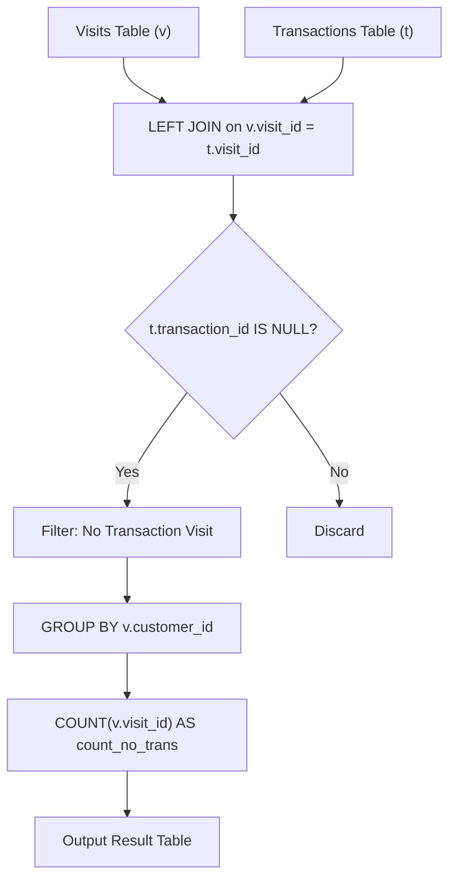

# 1581. Customer Who Visited but Did Not Make Any Transactions

## Problem Statement

Table: `Visits`
```
+-------------+---------+
| Column Name | Type    |
+-------------+---------+
| visit_id    | int     |
| customer_id | int     |
+-------------+---------+
visit_id is the column with unique values for this table.
This table contains information about the customers who visited the mall.
```

Table: `Transactions`
```
+----------------+---------+
| Column Name    | Type    |
+----------------+---------+
| transaction_id | int     |
| visit_id       | int     |
| amount         | int     |
+----------------+---------+
transaction_id is the column with unique values for this table.
This table contains information about the transactions made during the visit_id.
```

Write a solution to find the IDs of the users who visited without making any transactions and the number of times they made these types of visits.

Return the result table in **any order**.

The result format is in the following example.

### Example 1:
```
Input: 
Visits
+----------+-------------+
| visit_id | customer_id |
+----------+-------------+
| 1        | 23          |
| 2        | 9           |
| 4        | 30          |
| 5        | 54          |
| 6        | 96          |
| 7        | 54          |
| 8        | 54          |
+----------+-------------+
Transactions
+----------------+----------+--------+
| transaction_id | visit_id | amount |
+----------------+----------+--------+
| 2              | 5        | 310    |
| 3              | 5        | 300    |
| 9              | 5        | 200    |
| 12             | 1        | 910    |
| 13             | 2        | 970    |
+----------------+----------+--------+
Output: 
+-------------+----------------+
| customer_id | count_no_trans |
+-------------+----------------+
| 54          | 2              |
| 30          | 1              |
| 96          | 1              |
+-------------+----------------+
Explanation: 
- Customer 23 visited the mall once and made a transaction (visit_id = 1).
- Customer 9 visited the mall once and made a transaction (visit_id = 2).
- Customer 30 visited the mall once and did not make any transactions (visit_id = 4).
- Customer 54 visited the mall three times (visit_ids 5, 7, 8). Visit 5 had 3 transactions, but visits 7 and 8 had no transactions, totaling 2 visits with no transactions.
- Customer 96 visited the mall once and did not make any transactions (visit_id = 6).
```

---

## Approach

1. **Identifying Non-Transaction Visits (`LEFT JOIN ... WHERE IS NULL`):**
   - Perform a `LEFT JOIN` from `Visits` (`v`) to `Transactions` (`t`) on `v.visit_id = t.visit_id`.
   - If a visit generated transactions, matching rows appear with non-null `transaction_id`.
   - If no transaction occurred during the visit, `t.transaction_id` will be `NULL`.
   - Filtering with `WHERE t.transaction_id IS NULL` isolates exactly the visits where no purchase occurred.

2. **Aggregating by Customer:**
   - Group the filtered records by `customer_id`.
   - Use `COUNT(v.visit_id)` (or `COUNT(*)`) to compute the total number of transaction-free visits for each customer, aliased as `count_no_trans`.



---

## Code Implementation

```sql
SELECT 
    v.customer_id,
    COUNT(v.visit_id) AS count_no_trans
FROM Visits v
LEFT JOIN Transactions t 
    ON v.visit_id = t.visit_id
WHERE t.transaction_id IS NULL
GROUP BY v.customer_id;
```

---

## Complexity Analysis

- **Time Complexity**: $O(V + T)$ — where $V$ is the number of rows in `Visits` and $T$ is the number of rows in `Transactions`. Hash-joining on `visit_id` followed by grouping on `customer_id` executes in linear time.
- **Space Complexity**: $O(C)$ — where $C$ is the number of unique customers with zero-transaction visits stored in the grouping and output buffers.

---
