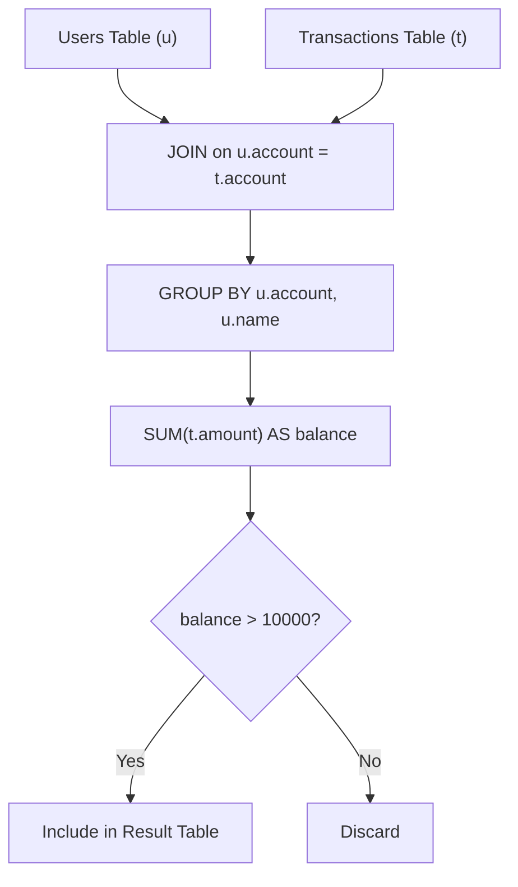

# 1587. Bank Account Summary II

## Problem Statement

Table: `Users`
```
+--------------+---------+
| Column Name  | Type    |
+--------------+---------+
| account      | int     |
| name         | varchar |
+--------------+---------+
account is the primary key (column with unique values) for this table.
Each row of this table contains the account number of each user in the bank.
There will be no two users having the same name in the table.
```

Table: `Transactions`
```
+---------------+---------+
| Column Name   | Type    |
+---------------+---------+
| trans_id      | int     |
| account       | int     |
| amount        | int     |
| transacted_on | date    |
+---------------+---------+
trans_id is the primary key (column with unique values) for this table.
Each row of this table contains all changes in account balance and the date of transaction.
amount is positive if the user received money and negative if they transferred money.
```

Write a solution to report the name and balance of users with a balance higher than `10000`. The balance of an account is equal to the sum of the amounts of all transactions associated with that account.

Return the result table in **any order**.

The result format is in the following example.

### Example 1:
```
Input: 
Users table:
+------------+--------------+
| account    | name         |
+------------+--------------+
| 900001     | Alice        |
| 900002     | Bob          |
| 900003     | Charlie      |
+------------+--------------+
Transactions table:
+------------+------------+------------+---------------+
| trans_id   | account    | amount     | transacted_on |
+------------+------------+------------+---------------+
| 1          | 900001     | 7000       | 2020-08-01    |
| 2          | 900001     | 7000       | 2020-09-01    |
| 3          | 900001     | -3000      | 2020-09-02    |
| 4          | 900002     | 1000       | 2020-09-12    |
| 5          | 900003     | 6000       | 2020-08-07    |
| 6          | 900003     | 6000       | 2020-09-07    |
| 7          | 900003     | -4000      | 2020-09-11    |
+------------+------------+------------+---------------+
Output: 
+------------+------------+
| name       | balance    |
+------------+------------+
| Alice      | 11000      |
+------------+------------+
Explanation: 
- Alice's balance is 7000 + 7000 - 3000 = 11000.
- Bob's balance is 1000.
- Charlie's balance is 6000 + 6000 - 4000 = 8000.
Only Alice has a balance strictly greater than 10000.
```

---

## Approach

1. **Relating Transactions to Users:**
   - Join `Users` (`u`) and `Transactions` (`t`) on `u.account = t.account`. Since we are only interested in users with a balance $> 10000$, users with no transactions (balance = 0) cannot qualify, so an `INNER JOIN` suffices.

2. **Aggregating Account Balance:**
   - Group records by `u.account` (and include `u.name`).
   - Compute total balance using `SUM(t.amount) AS balance`.

3. **Filtering via `HAVING`:**
   - Filter the grouped balances with `HAVING SUM(t.amount) > 10000` to retain only qualifying high-balance accounts.



---

## Code Implementation

```sql
SELECT 
    u.name,
    SUM(t.amount) AS balance
FROM Users u
JOIN Transactions t 
    ON u.account = t.account
GROUP BY 
    u.account, 
    u.name
HAVING SUM(t.amount) > 10000;
```

---

## Complexity Analysis

- **Time Complexity**: $O(U + T)$ — where $U$ is the number of users and $T$ is the number of transactions. The join and hash-based group aggregation execute in linear time.
- **Space Complexity**: $O(U)$ — memory required for intermediate hash aggregation buffers holding distinct user accounts.

---
