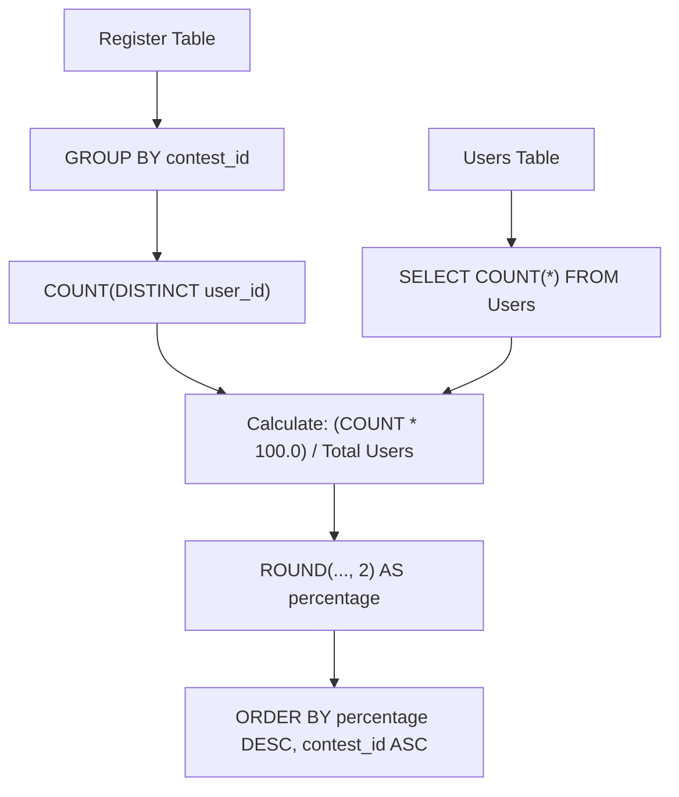

# 1633. Percentage of Users Attended a Contest

## Problem Statement

Table: `Users`
```
+-------------+---------+
| Column Name | Type    |
+-------------+---------+
| user_id     | int     |
| user_name   | varchar |
+-------------+---------+
user_id is the primary key (column with unique values) for this table.
Each row of this table contains the name and the id of a user.
```

Table: `Register`
```
+-------------+---------+
| Column Name | Type    |
+-------------+---------+
| contest_id  | int     |
| user_id     | int     |
+-------------+---------+
(contest_id, user_id) is the primary key (combination of columns with unique values) for this table.
Each row of this table contains the id of a user and the contest they registered into.
```

Write a solution to find the percentage of the users registered in each contest rounded to **two decimals**.

Return the result table ordered by `percentage` in **descending order**. In case of a tie, order it by `contest_id` in **ascending order**.

The result format is in the following example.

### Example 1:
```
Input: 
Users table:
+---------+-----------+
| user_id | user_name |
+---------+-----------+
| 6       | Alice     |
| 2       | Bob       |
| 7       | Alex      |
+---------+-----------+
Register table:
+------------+---------+
| contest_id | user_id |
+------------+---------+
| 215        | 6       |
| 209        | 2       |
| 208        | 2       |
| 210        | 6       |
| 208        | 6       |
| 209        | 7       |
| 209        | 1       |
| 215        | 7       |
| 208        | 7       |
| 210        | 2       |
| 207        | 2       |
| 210        | 7       |
+------------+---------+
Output: 
+------------+------------+
| contest_id | percentage |
+------------+------------+
| 208        | 100.0      |
| 209        | 100.0      |
| 210        | 100.0      |
| 215        | 66.67      |
| 207        | 33.33      |
+------------+------------+
Explanation: 
All users registered in contests 208, 209, and 210. The percentage is 100% and we sort them in the ascending order of contest_id.
Alice and Alex registered in contest 215 and the percentage is ((2/3) * 100) = 66.67%
Bob registered in contest 207 and the percentage is ((1/3) * 100) = 33.33%
```

---

## Approach

1. **Calculating Total Users:**
   - The total number of registered platform users is obtained by querying the total count from the `Users` table:
     $$\text{Total Users} = \text{(SELECT COUNT(*) FROM Users)}$$

2. **Aggregating Registrations by Contest:**
   - Group the `Register` table records by `contest_id`.
   - Count the distinct users registered for each contest: `COUNT(DISTINCT user_id)`.

3. **Percentage Formula and Rounding:**
   - Compute the registration percentage as:
     $$\text{percentage} = \text{ROUND}\left(\frac{\text{COUNT(DISTINCT user\_id)} \times 100.0}{\text{Total Users}}, 2\right)$$
   - Multiplying by `100.0` ensures floating-point precision before division and rounding.

4. **Multi-Column Sorting:**
   - Order results by `percentage DESC`.
   - Break ties by ordering by `contest_id ASC`.



---

## Code Implementation

```sql
SELECT 
    contest_id,
    ROUND(
        COUNT(DISTINCT user_id) * 100.0 / (SELECT COUNT(*) FROM Users), 
        2
    ) AS percentage
FROM Register
GROUP BY contest_id
ORDER BY 
    percentage DESC, 
    contest_id ASC;
```

---

## Complexity Analysis

- **Time Complexity**: $O(R \log K + U)$ — where $R$ is the number of rows in `Register`, $K$ is the number of distinct contests, and $U$ is the number of rows in `Users`. The scalar subquery takes $O(U)$ to count users, grouping and counting takes $O(R)$, and sorting the $K$ contests takes $O(K \log K)$.
- **Space Complexity**: $O(K)$ — memory required to maintain the intermediate hash grouping for the $K$ distinct contests.

---
