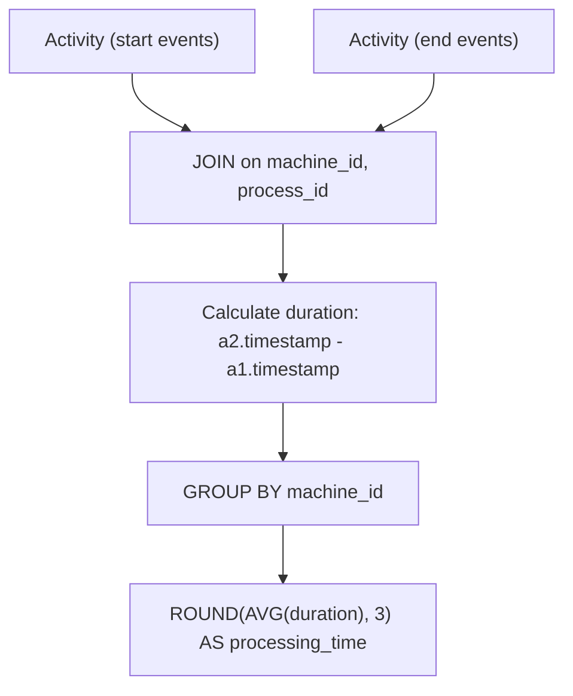

# 1661. Average Time of Process per Machine

## Problem Statement

Table: `Activity`
```
+----------------+---------+
| Column Name    | Type    |
+----------------+---------+
| machine_id     | int     |
| process_id     | int     |
| activity_type  | enum    |
| timestamp      | float   |
+----------------+---------+
The table shows the user activities for a factory website.
(machine_id, process_id, activity_type) is the primary key (combination of columns with unique values) of this table.
machine_id is the ID of a machine.
process_id is the ID of a process for that machine_id.
activity_type is an ENUM (category) of type ('start', 'end').
timestamp is a float representing the current time in seconds.
'start' means the machine starts the process at the given timestamp and 'end' means the machine ends the process at the given timestamp.
'start' timestamp will always be before the 'end' timestamp for every (machine_id, process_id) pair.
It is guaranteed that each (machine_id, process_id) pair has both 'start' and 'end' activities.
```

There is a factory website that has several machines each running the same number of processes. Write a solution to find the **average time** each machine takes to complete a process.

The time to complete a process is `'end' timestamp` - `'start' timestamp`. The average time is calculated by the total time to complete every process on the machine divided by the number of processes that were run.

The resulting table should have the `machine_id` along with the `processing_time` that is **rounded to 3 decimal places**.

Return the result table in **any order**.

The result format is in the following example.

### Example 1:
```
Input: 
Activity table:
+------------+------------+---------------+-----------+
| machine_id | process_id | activity_type | timestamp |
+------------+------------+---------------+-----------+
| 0          | 0          | start         | 0.712     |
| 0          | 0          | end           | 1.520     |
| 0          | 1          | start         | 3.140     |
| 0          | 1          | end           | 4.120     |
| 1          | 0          | start         | 0.550     |
| 1          | 0          | end           | 1.550     |
| 1          | 1          | start         | 0.430     |
| 1          | 1          | end           | 1.420     |
| 2          | 0          | start         | 4.100     |
| 2          | 0          | end           | 4.512     |
| 2          | 1          | start         | 2.500     |
| 2          | 1          | end           | 5.000     |
+------------+------------+---------------+-----------+
Output: 
+------------+-----------------+
| machine_id | processing_time |
+------------+-----------------+
| 0          | 0.894           |
| 1          | 0.995           |
| 2          | 1.456           |
+------------+-----------------+
Explanation: 
There are 3 machines running 2 processes each:
- Machine 0: ((1.520 - 0.712) + (4.120 - 3.140)) / 2 = (0.808 + 0.980) / 2 = 0.894
- Machine 1: ((1.550 - 0.550) + (1.420 - 0.430)) / 2 = (1.000 + 0.990) / 2 = 0.995
- Machine 2: ((4.512 - 4.100) + (5.000 - 2.500)) / 2 = (0.412 + 2.500) / 2 = 1.456
```

---

## Approach

### Method 1: Self-Join
1. **Join Matching Events:**
   - Join `Activity` table with itself (`a1` and `a2`) matching on `machine_id` and `process_id`.
   - Constrain `a1.activity_type = 'start'` and `a2.activity_type = 'end'`.
2. **Compute Duration and Average:**
   - The execution duration of each process is `(a2.timestamp - a1.timestamp)`.
   - Group records by `a1.machine_id` and calculate `ROUND(AVG(a2.timestamp - a1.timestamp), 3)`.

### Method 2: Conditional Aggregation (Single Scan)
1. **Signed Timestamps:**
   - Instead of a self-join, treat `'end'` timestamps as positive and `'start'` timestamps as negative:
     $$\text{net\_time} = \sum (\text{CASE WHEN } activity\_type = \text{'end'} \text{ THEN } timestamp \text{ ELSE } -timestamp \text{ END})$$
2. **Divide by Process Count:**
   - Divide by `COUNT(DISTINCT process_id)` per machine and round to 3 decimal places. This avoids joining the table to itself and operates in a single pass.



---

## Code Implementation

### Solution 1: Self-Join (Clean & Readable)
```sql
SELECT 
    a1.machine_id,
    ROUND(AVG(a2.timestamp - a1.timestamp), 3) AS processing_time
FROM Activity a1
JOIN Activity a2
    ON a1.machine_id = a2.machine_id
    AND a1.process_id = a2.process_id
    AND a1.activity_type = 'start'
    AND a2.activity_type = 'end'
GROUP BY 
    a1.machine_id;
```

### Solution 2: Conditional Aggregation (Single Table Scan)
```sql
SELECT 
    machine_id,
    ROUND(
        SUM(CASE WHEN activity_type = 'end' THEN timestamp ELSE -timestamp END) 
        / COUNT(DISTINCT process_id),
        3
    ) AS processing_time
FROM Activity
GROUP BY 
    machine_id;
```

---

## Complexity Analysis

- **Time Complexity**: 
  - **Method 1 (Self-Join)**: $O(N)$ — with index on `(machine_id, process_id, activity_type)` where $N$ is the number of rows in `Activity`.
  - **Method 2 (Single Pass)**: $O(N)$ — single sequential scan and hash aggregation.
- **Space Complexity**: $O(M)$ — where $M$ is the number of distinct machines stored in the grouping buffer.

---
