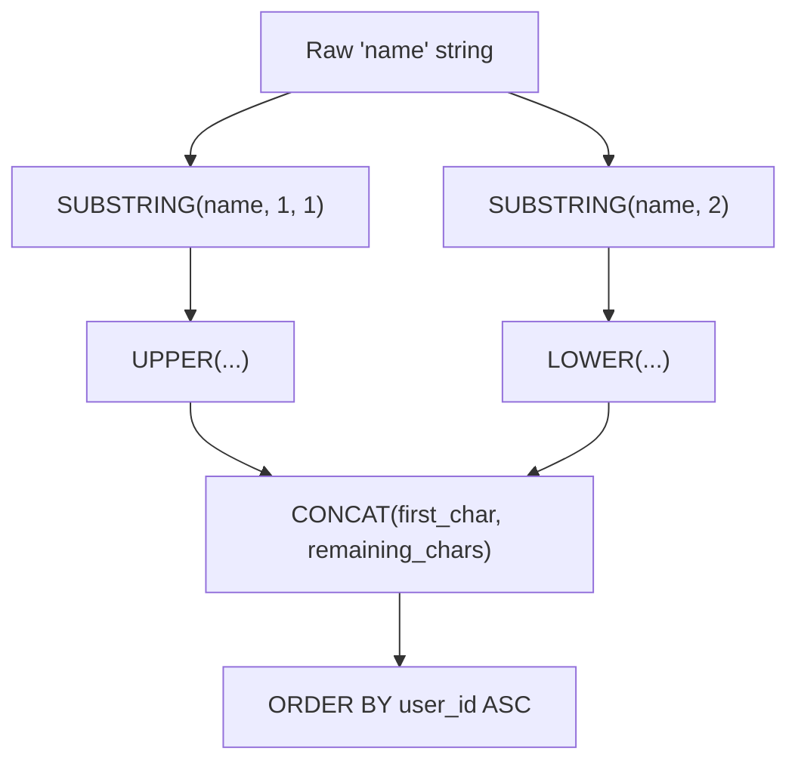

# 1667. Fix Names in a Table

## Problem Statement

Table: `Users`
```
+----------------+---------+
| Column Name    | Type    |
+----------------+---------+
| user_id        | int     |
| name           | varchar |
+----------------+---------+
user_id is the primary key (column with unique values) for this table.
This table contains the ID and the name of the user. The name consists of only lowercase and uppercase characters.
```

Write a solution to fix the names so that only the first character is uppercase and the rest are lowercase.

Return the result table ordered by `user_id`.

The result format is in the following example.

### Example 1:
```
Input: 
Users table:
+---------+-------+
| user_id | name  |
+---------+-------+
| 1       | aLice |
| 2       | bOB   |
+---------+-------+
Output: 
+---------+-------+
| user_id | name  |
+---------+-------+
| 1       | Alice |
| 2       | Bob   |
+---------+-------+
```

---

## Approach

1. **Extracting and Transforming the First Character:**
   - Use `SUBSTRING(name, 1, 1)` (or `LEFT(name, 1)`) to extract the initial character.
   - Convert it to uppercase using `UPPER(...)`.

2. **Extracting and Transforming the Remaining Characters:**
   - Use `SUBSTRING(name, 2)` to extract from the second character to the end of the string.
   - Convert all subsequent characters to lowercase using `LOWER(...)`.

3. **Concatenation:**
   - Combine the two parts together using `CONCAT(...)`.

4. **Ordering:**
   - Sort the output table by `user_id ASC` as required.



---

## Code Implementation

```sql
SELECT 
    user_id,
    CONCAT(
        UPPER(SUBSTRING(name, 1, 1)), 
        LOWER(SUBSTRING(name, 2))
    ) AS name
FROM Users
ORDER BY user_id ASC;
```

---

## Complexity Analysis

- **Time Complexity**: $O(N \log N + N \cdot L)$ — where $N$ is the number of rows in `Users` and $L$ is the average length of `name`. Extracting and modifying string cases takes $O(L)$ per row, and sorting by `user_id` takes $O(N \log N)$ (or $O(N)$ if indexed by clustered PK).
- **Space Complexity**: $O(N \cdot L)$ — to store the transformed output result set.

---
