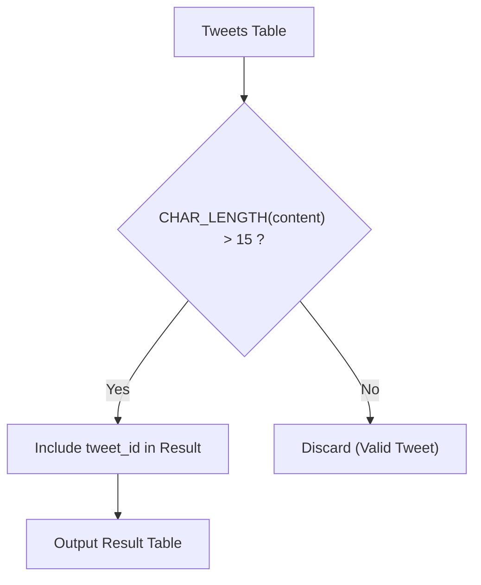

# 1683. Invalid Tweets

## Problem Statement

Table: `Tweets`
```
+----------------+---------+
| Column Name    | Type    |
+----------------+---------+
| tweet_id       | int     |
| content        | varchar |
+----------------+---------+
tweet_id is the primary key (column with unique values) for this table.
This table contains all the tweets in a social media app.
```

Write a solution to find the IDs of the invalid tweets. The tweet is invalid if the number of characters used in the content of the tweet is strictly greater than `15`.

Return the result table in **any order**.

The result format is in the following example.

### Example 1:

```
Input: 
Tweets table:
+----------+-----------------------------------+
| tweet_id | content                           |
+----------+-----------------------------------+
| 1        | Let us Code                       |
| 2        | More than fifteen chars are here! |
+----------+-----------------------------------+
Output: 
+----------+
| tweet_id |
+----------+
| 2        |
+----------+
Explanation: 
Tweet 1 has length = 11. It is a valid tweet.
Tweet 2 has length = 33. It is an invalid tweet.
```

---

## Approach

### 1. Character Length vs. Byte Length
- In SQL databases (like MySQL), `LENGTH(str)` calculates the length of the string in **bytes**.
- Conversely, `CHAR_LENGTH(str)` (or `CHARACTER_LENGTH(str)`) measures the number of **characters / code points**.
- For standard ASCII text, both functions produce the same result. However, using `CHAR_LENGTH(content)` is the most robust and accurate practice to correctly account for multi-byte UTF-8 encodings (such as emojis or accented characters).

### 2. Filtering Criterion
- Filter rows with the predicate:
  $$\text{CHAR\_LENGTH}(content) > 15$$
- Project only the `tweet_id` column as requested by the output schema.



---

## Code Implementation

### SQL (MySQL)

```sql
SELECT 
    tweet_id
FROM Tweets
WHERE CHAR_LENGTH(content) > 15;
```

### Alternative (PostgreSQL / SQL Server / Pandas)

```sql
-- PostgreSQL / SQL Server equivalent
SELECT 
    tweet_id
FROM Tweets
WHERE LENGTH(content) > 15;
```

```python
import pandas as pd

def invalid_tweets(tweets: pd.DataFrame) -> pd.DataFrame:
    # Filter rows where character count of content is strictly greater than 15
    invalid = tweets[tweets['content'].str.len() > 15]
    return invalid[['tweet_id']]
```

---

## Complexity Analysis

- **Time Complexity**: $O(N \cdot L)$ — where $N$ is the number of records in the `Tweets` table and $L$ is the average length of the `content` string. The query performs a linear scan through the table, computing string length for each row.

- **Space Complexity**: $O(K)$ — where $K$ is the number of invalid tweets returned in the output. Memory overhead is minimal and proportional to the filtered result set.

---
