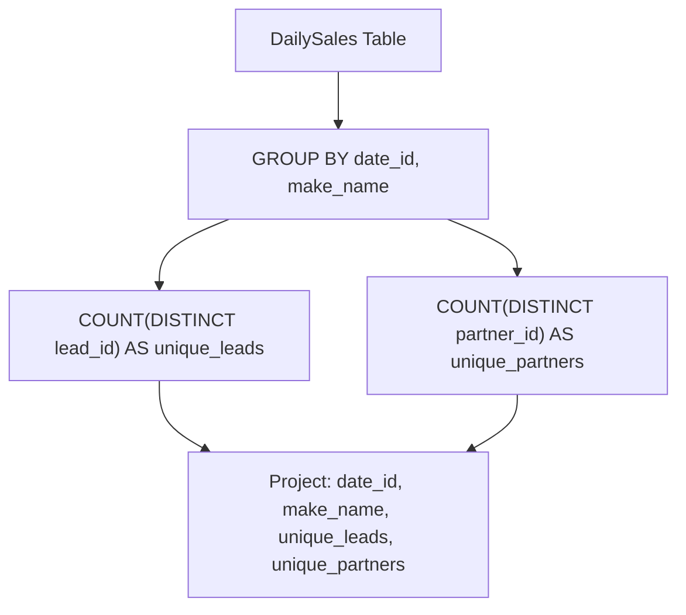

# 1693. Daily Leads and Partners

## Problem Statement

Table: `DailySales`
```
+-------------+---------+
| Column Name | Type    |
+-------------+---------+
| date_id     | date    |
| make_name   | varchar |
| lead_id     | int     |
| partner_id  | int     |
+-------------+---------+
This table does not have a primary key (it may contain duplicates).
This table contains the date and the name of the product sold and the IDs of the lead and partner it was sold to.
The name consists of only lowercase English letters.
```

For each `date_id` and `make_name`, find the number of **distinct** `lead_id`'s and **distinct** `partner_id`'s.

Return the result table in **any order**.

The result format is in the following example.

### Example 1:

```
Input: 
DailySales table:
+-----------+-----------+---------+------------+
| date_id   | make_name | lead_id | partner_id |
+-----------+-----------+---------+------------+
| 2020-12-8 | toyota    | 0       | 1          |
| 2020-12-8 | toyota    | 1       | 0          |
| 2020-12-8 | toyota    | 1       | 2          |
| 2020-12-7 | toyota    | 0       | 2          |
| 2020-12-7 | toyota    | 0       | 1          |
| 2020-12-8 | honda     | 1       | 2          |
| 2020-12-8 | honda     | 2       | 1          |
| 2020-12-7 | honda     | 0       | 1          |
| 2020-12-7 | honda     | 1       | 2          |
| 2020-12-7 | honda     | 2       | 1          |
+-----------+-----------+---------+------------+
Output: 
+-----------+-----------+--------------+-----------------+
| date_id   | make_name | unique_leads | unique_partners |
+-----------+-----------+--------------+-----------------+
| 2020-12-8 | toyota    | 2            | 3               |
| 2020-12-7 | toyota    | 1            | 2               |
| 2020-12-8 | honda     | 2            | 2               |
| 2020-12-7 | honda     | 3            | 2               |
+-----------+-----------+--------------+-----------------+
Explanation: 
For 2020-12-8, toyota:
leads are [0, 1] -> 2 unique leads.
partners are [1, 0, 2] -> 3 unique partners.
For 2020-12-7, toyota:
leads are [0] -> 1 unique lead.
partners are [2, 1] -> 2 unique partners.
For 2020-12-8, honda:
leads are [1, 2] -> 2 unique leads.
partners are [2, 1] -> 2 unique partners.
For 2020-12-7, honda:
leads are [0, 1, 2] -> 3 unique leads.
partners are [1, 2] -> 2 unique partners.
```

---

## Approach

### 1. Grouping by Composite Keys
- Each sales entry is attributed to a specific day (`date_id`) and car brand (`make_name`).
- We group rows using `GROUP BY date_id, make_name` so aggregate functions compute metrics independently for each date-and-make pair.

### 2. Counting Unique Identifiers
- Since a lead or partner may have multiple interactions for the same brand on the same date, a simple `COUNT(...)` would overcount duplicates.
- We use `COUNT(DISTINCT lead_id)` to count unique leads (`unique_leads`).
- We use `COUNT(DISTINCT partner_id)` to count unique partners (`unique_partners`).



---

## Code Implementation

### SQL (MySQL / PostgreSQL / SQL Server)

```sql
SELECT 
    date_id,
    make_name,
    COUNT(DISTINCT lead_id) AS unique_leads,
    COUNT(DISTINCT partner_id) AS unique_partners
FROM DailySales
GROUP BY 
    date_id,
    make_name;
```

### Python (Pandas)

```python
import pandas as pd

def daily_leads_and_partners(daily_sales: pd.DataFrame) -> pd.DataFrame:
    # Group by date_id and make_name, computing unique counts for lead_id and partner_id
    result = daily_sales.groupby(['date_id', 'make_name']).agg(
        unique_leads=('lead_id', 'nunique'),
        unique_partners=('partner_id', 'nunique')
    ).reset_index()
    
    return result
```

---

## Complexity Analysis

- **Time Complexity**: $O(N)$ — where $N$ is the total number of rows in `DailySales`. Grouping and hashing distinct elements takes linear time on average.

- **Space Complexity**: $O(U)$ — where $U$ is the number of distinct `(date_id, make_name)` groups materialized for the output.

---
