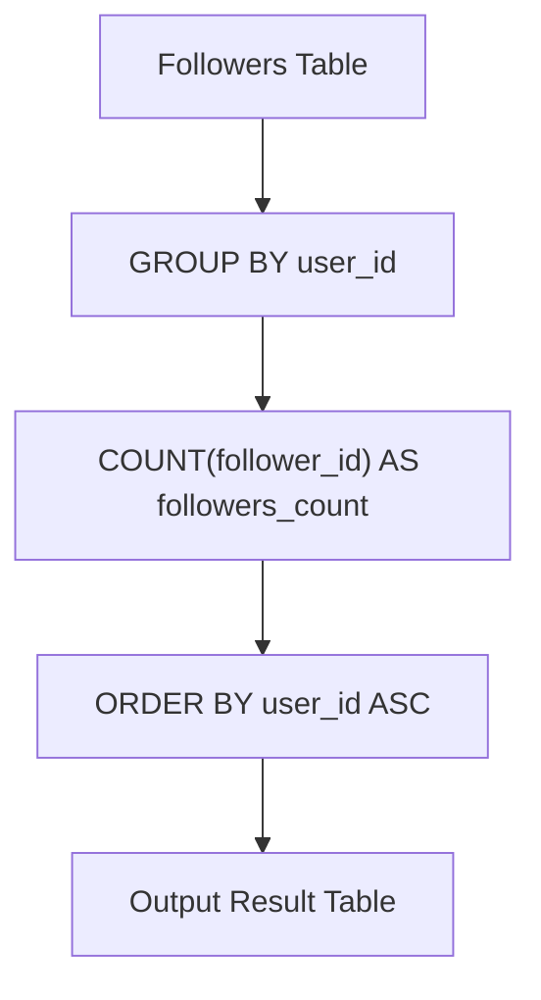

# 1729. Find Followers Count

## Problem Statement

Table: `Followers`
```
+-------------+------+
| Column Name | Type |
+-------------+------+
| user_id     | int  |
| follower_id | int  |
+-------------+------+
(user_id, follower_id) is the primary key (combination of columns with unique values) for this table.
This table contains the IDs of a user and a follower in a social media app where the follower follows the user.
```

Write a solution that will, for each user, return the number of followers.

Return the result table ordered by `user_id` in **ascending order**.

The result format is in the following example.

### Example 1:

```
Input: 
Followers table:
+---------+-------------+
| user_id | follower_id |
+---------+-------------+
| 0       | 1           |
| 1       | 0           |
| 2       | 0           |
| 2       | 1           |
+---------+-------------+
Output: 
+---------+-----------------+
| user_id | followers_count |
+---------+-----------------+
| 0       | 1               |
| 1       | 1               |
| 2       | 2               |
+---------+-----------------+
Explanation: 
The followers of 0 are {1} -> count = 1
The followers of 1 are {0} -> count = 1
The followers of 2 are {0, 1} -> count = 2
```

---

## Approach

### 1. Grouping and Aggregation
- Each row represents a directed following relationship: `follower_id` follows `user_id`.
- By applying `GROUP BY user_id`, we partition all follow events under each user.
- Because `(user_id, follower_id)` is the primary key, each pair is guaranteed to be unique. Thus, a straightforward `COUNT(follower_id)` accurately computes the number of followers without needing a costly `DISTINCT` check.

### 2. Output Ordering
- The problem explicitly specifies returning the result ordered by `user_id` in ascending order (`ORDER BY user_id ASC`).



---

## Code Implementation

### SQL (MySQL / PostgreSQL / SQL Server)

```sql
SELECT 
    user_id,
    COUNT(follower_id) AS followers_count
FROM Followers
GROUP BY 
    user_id
ORDER BY 
    user_id ASC;
```

### Python (Pandas)

```python
import pandas as pd

def count_followers(followers: pd.DataFrame) -> pd.DataFrame:
    # Group by user_id and count unique follower_ids
    result = followers.groupby('user_id')['follower_id'].count().reset_index()
    result.rename(columns={'follower_id': 'followers_count'}, inplace=True)
    return result.sort_values(by='user_id', ascending=True)
```

---

## Complexity Analysis

- **Time Complexity**: $O(N \log U)$ — where $N$ is the number of rows in the `Followers` table and $U$ is the number of distinct users. The linear aggregation takes $O(N)$ and sorting the grouped output takes $O(U \log U)$.

- **Space Complexity**: $O(U)$ — to store the grouped follower counts and sort the output table.

---
