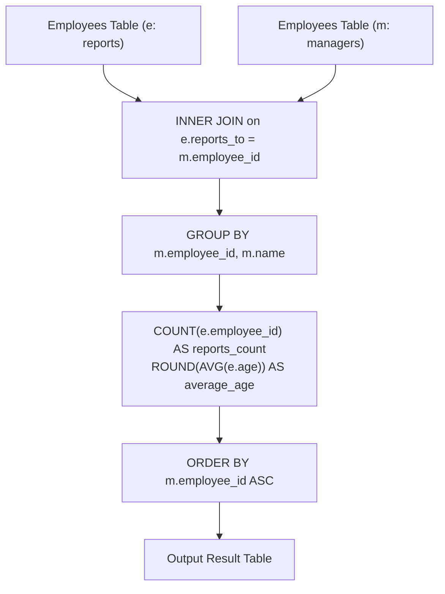

# 1731. The Number of Employees Which Report to Each Employee

## Problem Statement

Table: `Employees`
```
+-------------+----------+
| Column Name | Type     |
+-------------+----------+
| employee_id | int      |
| name        | varchar  |
| reports_to  | int      |
| age         | int      |
+-------------+----------+
employee_id is the column with unique values for this table.
This table contains information about the employees and the id of the manager they report to. Some employees do not report to anyone (reports_to is null).
```

For this problem, we will consider a manager an employee who has at least 1 other employee reporting to them.

Write a solution to report the ids and the names of all managers, the number of employees who report directly to them, and the average age of the reports rounded to the nearest integer.

Return the result table ordered by `employee_id`.

The result format is in the following example.

### Example 1:

```
Input: 
Employees table:
+-------------+---------+------------+-----+
| employee_id | name    | reports_to | age |
+-------------+---------+------------+-----+
| 9           | Hercy   | null       | 43  |
| 6           | Alice   | 9          | 41  |
| 4           | Bob     | 9          | 36  |
| 2           | Winston | null       | 37  |
+-------------+---------+------------+-----+
Output: 
+-------------+-------+---------------+-------------+
| employee_id | name  | reports_count | average_age |
+-------------+-------+---------------+-------------+
| 9           | Hercy | 2             | 39          |
+-------------+-------+---------------+-------------+
Explanation: 
Hercy has 2 people report towards him, Alice and Bob. Their average age is (41 + 36) / 2 = 38.5, which rounds up to 39.
```

---

## Approach

### 1. Relational Self-Join
- The `Employees` table contains both individual contributors and their managers.
- An employee $e$ reports to a manager $m$ if $e.\text{reports\_to} = m.\text{employee\_id}$.
- Performing an `INNER JOIN` between `Employees e` (subordinates) and `Employees m` (managers) on `e.reports_to = m.employee_id` naturally filters out employees without managers (`reports_to IS NULL`) and employees who have no direct reports.

### 2. Grouping and Aggregations
- Group the joined rows by manager: `GROUP BY m.employee_id, m.name`.
- Compute the number of subordinates reporting to each manager:
  $$\text{reports\_count} = \text{COUNT}(e.\text{employee\_id})$$
- Compute the average age of subordinates, rounded to the nearest integer:
  $$\text{average\_age} = \text{ROUND}(\text{AVG}(e.\text{age}))$$
- Finally, sort the result in ascending order by manager ID:
  $$\text{ORDER BY } m.\text{employee\_id}$$



---

## Code Implementation

### SQL (MySQL / PostgreSQL / SQL Server)

```sql
SELECT 
    m.employee_id,
    m.name,
    COUNT(e.employee_id) AS reports_count,
    ROUND(AVG(e.age)) AS average_age
FROM Employees e
JOIN Employees m ON e.reports_to = m.employee_id
GROUP BY 
    m.employee_id, 
    m.name
ORDER BY 
    m.employee_id;
```

### Python (Pandas)

```python
import pandas as pd

def count_reports(employees: pd.DataFrame) -> pd.DataFrame:
    # Filter rows where reports_to is not null
    reports = employees.dropna(subset=['reports_to'])
    
    # Merge reports with managers
    merged = reports.merge(
        employees[['employee_id', 'name']],
        left_on='reports_to',
        right_on='employee_id',
        suffixes=('_rep', '_mgr')
    )
    
    # Group by manager and aggregate metrics
    result = merged.groupby(['employee_id_mgr', 'name_mgr']).agg(
        reports_count=('employee_id_rep', 'count'),
        average_age=('age', lambda x: round(x.mean()))
    ).reset_index()
    
    # Format columns and sort
    result.rename(columns={'employee_id_mgr': 'employee_id', 'name_mgr': 'name'}, inplace=True)
    return result.sort_values(by='employee_id')
```

---

## Complexity Analysis

- **Time Complexity**: $O(N \log N)$ — where $N$ is the number of employees in the table. The self-join and grouping can be performed via hash/merge join in $O(N)$, followed by sorting the aggregated managers in $O(M \log M)$ where $M \le N$.

- **Space Complexity**: $O(N)$ — To store intermediate joined rows and the aggregated manager output.

---
