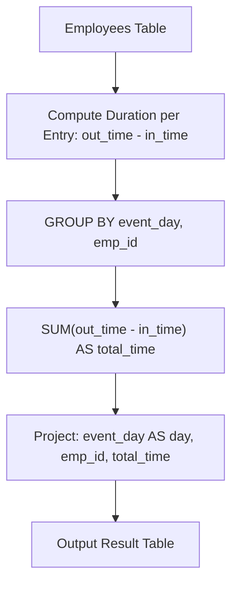

# 1741. Find Total Time Spent by Each Employee

## Problem Statement

Table: `Employees`
```
+-------------+------+
| Column Name | Type |
+-------------+------+
| emp_id      | int  |
| event_day   | date |
| in_time     | int  |
| out_time    | int  |
+-------------+------+
(emp_id, event_day, in_time) is the primary key (combination of columns with unique values) of this table.
The table shows the employees' entries and exits in an office.
event_day is the day at which this event happened, in_time is the minute at which the employee entered the office, and out_time is the minute at which they left the office.
in_time and out_time are between 1 and 1440.
It is guaranteed that in_time < out_time and no two events of the same employee on the same day overlap.
```

Write a solution to calculate the total time in minutes spent by each employee on each day at the office. Note that within one day, an employee can enter and leave more than once. The time spent in the office for a single entry is `out_time - in_time`.

Return the result table in **any order**.

The result format is in the following example.

### Example 1:

```
Input: 
Employees table:
+--------+------------+---------+----------+
| emp_id | event_day  | in_time | out_time |
+--------+------------+---------+----------+
| 1      | 2020-11-28 | 4       | 32       |
| 1      | 2020-11-28 | 55      | 200      |
| 1      | 2020-12-03 | 1       | 42       |
| 2      | 2020-11-28 | 3       | 33       |
| 2      | 2020-12-09 | 47      | 74       |
+--------+------------+---------+----------+
Output: 
+------------+--------+------------+
| day        | emp_id | total_time |
+------------+--------+------------+
| 2020-11-28 | 1      | 173        |
| 2020-12-03 | 1      | 41         |
| 2020-11-28 | 2      | 30         |
| 2020-12-09 | 2      | 27         |
+------------+--------+------------+
Explanation: 
Employee 1 has three events: two on day 2020-11-28 with total time (32 - 4) + (200 - 55) = 173, and one on day 2020-12-03 with total time (42 - 1) = 41.
Employee 2 has two events: one on day 2020-11-28 with total time (33 - 3) = 30, and one on day 2020-12-09 with total time (74 - 47) = 27.
```

---

## Approach

### 1. Grouping by Day and Employee
- An employee can have multiple entry/exit records throughout the same day.
- To compute the daily total duration per employee, we group records using `GROUP BY event_day, emp_id`.

### 2. Time Delta Aggregation
- Each record represents an entry duration of $(\text{out\_time} - \text{in\_time})$ minutes.
- We aggregate all durations within each group using:
  $$\text{total\_time} = \sum (\text{out\_time} - \text{in\_time})$$
- Rename `event_day` as `day` in the projection to match the desired output schema.



---

## Code Implementation

### SQL (MySQL / PostgreSQL / SQL Server)

```sql
SELECT 
    event_day AS day,
    emp_id,
    SUM(out_time - in_time) AS total_time
FROM Employees
GROUP BY 
    event_day,
    emp_id;
```

### Python (Pandas)

```python
import pandas as pd

def total_time(employees: pd.DataFrame) -> pd.DataFrame:
    # Compute duration for each entry
    employees['total_time'] = employees['out_time'] - employees['in_time']
    
    # Group by event_day and emp_id and sum durations
    result = employees.groupby(['event_day', 'emp_id'])['total_time'].sum().reset_index()
    
    # Rename event_day to day
    result.rename(columns={'event_day': 'day'}, inplace=True)
    return result[['day', 'emp_id', 'total_time']]
```

---

## Complexity Analysis

- **Time Complexity**: $O(N)$ — where $N$ is the total number of rows in the `Employees` table. Grouping by `(event_day, emp_id)` and accumulating sums executes in a single pass using hash-based aggregation.

- **Space Complexity**: $O(U)$ — where $U \le N$ is the number of distinct `(day, emp_id)` pairs returned in the output table.

---
