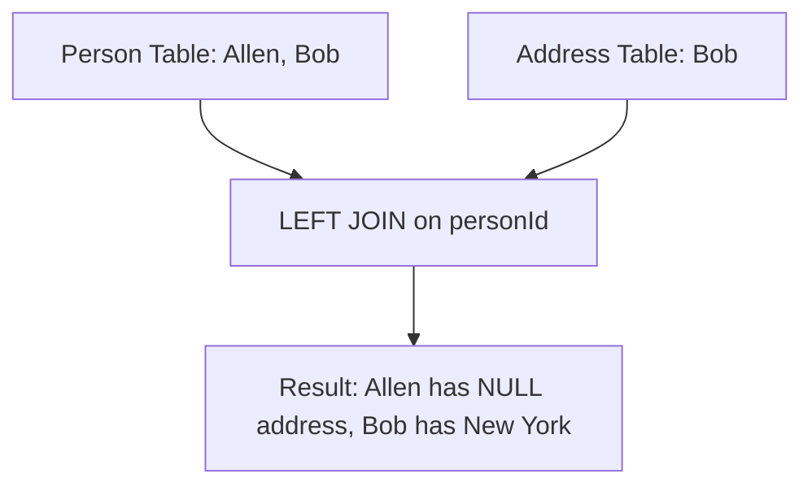

# 175. Combine Two Tables

## Problem Statement

Table: `Person`
```
+-------------+---------+
| Column Name | Type    |
+-------------+---------+
| personId    | int     |
| lastName    | varchar |
| firstName   | varchar |
+-------------+---------+
personId is the primary key column for this table.
```

Table: `Address`
```
+-------------+---------+
| Column Name | Type    |
+-------------+---------+
| addressId   | int     |
| personId    | int     |
| city        | varchar |
| state       | varchar |
+-------------+---------+
addressId is the primary key column for this table.
```

Write a solution to report the `firstName`, `lastName`, `city`, and `state` of each person in the `Person` table. If the address of a `personId` is not present in the `Address` table, report `null` instead.

Return the result table in **any order**.

### Example 1:
```
Input: 
Person table:
+----------+----------+-----------+
| personId | lastName | firstName |
+----------+----------+-----------+
| 1        | Wang     | Allen     |
| 2        | Alice    | Bob       |
+----------+----------+-----------+
Address table:
+-----------+----------+---------------+----------+
| addressId | personId | city          | state    |
+-----------+----------+---------------+----------+
| 1         | 2        | New York City | New York |
+-----------+----------+---------------+----------+
Output: 
+-----------+----------+---------------+----------+
| firstName | lastName | city          | state    |
+-----------+----------+---------------+----------+
| Allen     | Wang     | null          | null     |
| Bob       | Alice    | New York City | New York |
+-----------+----------+---------------+----------+
```

---

## Approach

Since we must return all rows from the `Person` table regardless of whether there is a corresponding row in the `Address` table, an **`INNER JOIN`** would discard persons who do not have an address.

Instead, we use a **`LEFT JOIN`**:
1. Select from `Person p` as the left table.
2. `LEFT JOIN Address a ON p.personId = a.personId`.
3. If no matching `personId` exists in `Address`, MySQL will automatically fill `city` and `state` with `NULL`.



---

## Code Implementation

```sql
SELECT 
    p.firstName, 
    p.lastName, 
    a.city, 
    a.state
FROM Person p
LEFT JOIN Address a 
    ON p.personId = a.personId;
```

---

## Complexity Analysis

- **Time Complexity**: $O(N + M)$ — where $N$ is the number of records in `Person` and $M$ is the number of records in `Address`. The join can leverage an index on `personId`.

- **Space Complexity**: $O(N)$ — To materialize and output the resulting rows.

---
