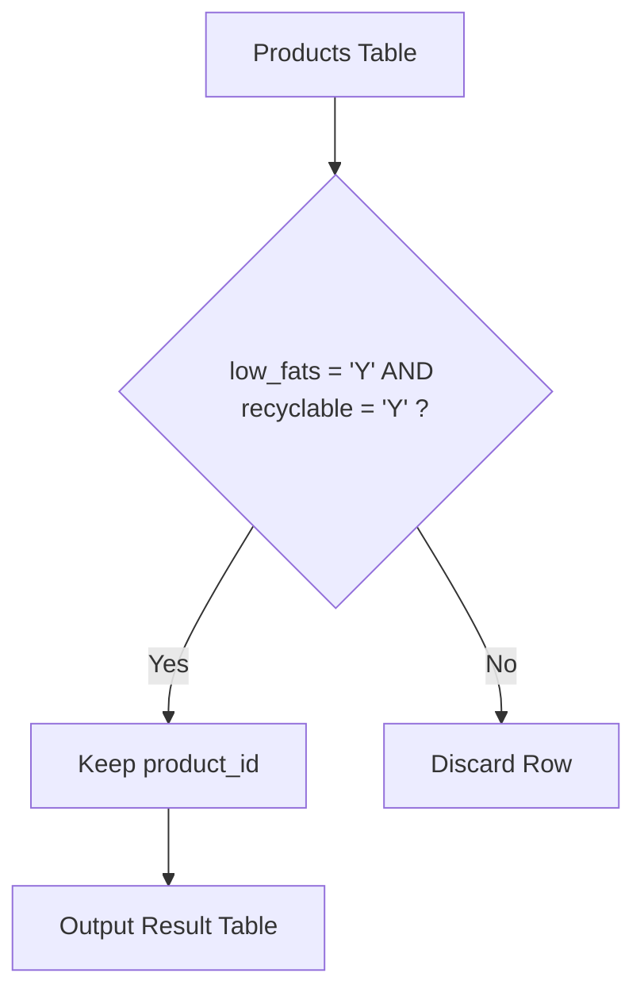

# 1757. Recyclable and Low Fat Products

## Problem Statement

Table: `Products`
```
+-------------+---------+
| Column Name | Type    |
+-------------+---------+
| product_id  | int     |
| low_fats    | enum    |
| recyclable  | enum    |
+-------------+---------+
product_id is the primary key (column with unique values) for this table.
low_fats is an ENUM (category) of type ('Y', 'N') where 'Y' means this product is low fat and 'N' means it is not.
recyclable is an ENUM (category) of types ('Y', 'N') where 'Y' means this product is recyclable and 'N' means it is not.
```

Write a solution to find the ids of products that are both low fat and recyclable.

Return the result table in **any order**.

The result format is in the following example.

### Example 1:

```
Input: 
Products table:
+-------------+----------+------------+
| product_id  | low_fats | recyclable |
+-------------+----------+------------+
| 0           | Y        | N          |
| 1           | Y        | Y          |
| 2           | N        | Y          |
| 3           | Y        | Y          |
| 4           | N        | N          |
+-------------+----------+------------+
Output: 
+-------------+
| product_id  |
+-------------+
| 1           |
| 3           |
+-------------+
Explanation: Only products 1 and 3 are both low fat and recyclable.
```

---

## Approach

### 1. Filtering with Multiple Conditions
- We need to identify rows where both conditions are satisfied simultaneously:
  1. The product is low fat: `low_fats = 'Y'`
  2. The product is recyclable: `recyclable = 'Y'`
- In SQL, multiple boolean predicates are combined using the `AND` operator:
  $$\text{low\_fats} = \text{'Y'} \land \text{recyclable} = \text{'Y'}$$
- The output table only requires the `product_id` column, so we project solely `product_id`.



---

## Code Implementation

### SQL (MySQL / PostgreSQL / SQL Server / Oracle)

```sql
SELECT 
    product_id
FROM Products
WHERE low_fats = 'Y' 
  AND recyclable = 'Y';
```

### Python (Pandas)

```python
import pandas as pd

def find_products(products: pd.DataFrame) -> pd.DataFrame:
    # Filter rows where both low_fats and recyclable are 'Y'
    filtered = products[(products['low_fats'] == 'Y') & (products['recyclable'] == 'Y')]
    
    # Return only the product_id column
    return filtered[['product_id']]
```

---

## Complexity Analysis

- **Time Complexity**: $O(N)$ — where $N$ is the number of rows in the `Products` table. The query performs a single scan evaluating both conditions for each record in constant time.
- **Space Complexity**: $O(K)$ — where $K$ is the number of products meeting both criteria ($0 \le K \le N$). No additional auxiliary structures or sorting are required beyond returning the filtered result set.

---
