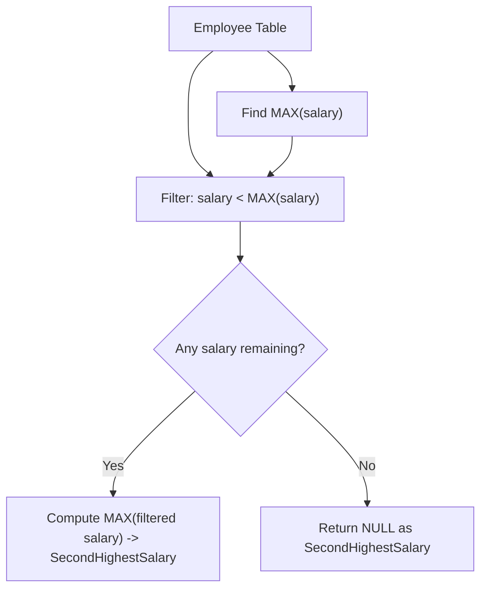

# 176. Second Highest Salary

## Problem Statement

Table: `Employee`
```
+-------------+------+
| Column Name | Type |
+-------------+------+
| id          | int  |
| salary      | int  |
+-------------+------+
id is the primary key (column with unique values) for this table.
Each row of this table contains information about the salary of an employee.
```

Write a solution to find the second highest distinct salary from the `Employee` table. If there is no second highest salary, return `null` (return `None` in Pandas).

The result format is in the following example.

### Example 1:

```
Input: 
Employee table:
+----+--------+
| id | salary |
+----+--------+
| 1  | 100    |
| 2  | 200    |
| 3  | 300    |
+----+--------+
Output: 
+---------------------+
| SecondHighestSalary |
+---------------------+
| 200                 |
+---------------------+
```

### Example 2:

```
Input: 
Employee table:
+----+--------+
| id | salary |
+----+--------+
| 1  | 100    |
+----+--------+
Output: 
+---------------------+
| SecondHighestSalary |
+---------------------+
| null                |
+---------------------+
```

---

## Approach

### 1. Distinct Salaries & Sorting
- We want the second largest **distinct** salary value. If multiple employees share the top salary, they should not prevent finding the second distinct salary.
- Sorting salaries descending with `DISTINCT` yields:
  $$\text{Salaries} = [s_1, s_2, s_3, \dots], \quad s_1 > s_2 > s_3 > \dots$$
- The second highest salary is $s_2$.

### 2. Handling the `NULL` Fallback
- If the table contains fewer than 2 distinct salaries (e.g., empty table, or all employees have the exact same salary), the query must produce a row containing `NULL` rather than returning an empty result set (0 rows).
- **Technique 1: Scalar Subquery Wrapping**
  - Evaluating `SELECT (subquery) AS SecondHighestSalary` converts an empty subquery result into a SQL `NULL` value automatically.
  - Subquery: `SELECT DISTINCT salary FROM Employee ORDER BY salary DESC LIMIT 1 OFFSET 1`.
- **Technique 2: Subquery with `MAX()`**
  - Find the maximum salary that is strictly less than the overall maximum:
    $$\text{SecondHighestSalary} = \max \{ s \in \text{Employee} \mid s < \max(\text{Employee}) \}$$
  - The aggregate function `MAX()` evaluates to `NULL` if no elements satisfy the condition.



---

## Code Implementation

### SQL (MySQL / PostgreSQL / SQL Server / Oracle)

#### Method 1: Scalar Subquery with `LIMIT / OFFSET` (Recommended)

```sql
SELECT (
    SELECT DISTINCT salary
    FROM Employee
    ORDER BY salary DESC
    LIMIT 1 OFFSET 1
) AS SecondHighestSalary;
```

#### Method 2: Aggregate `MAX` with Subquery

```sql
SELECT MAX(salary) AS SecondHighestSalary
FROM Employee
WHERE salary < (
    SELECT MAX(salary) 
    FROM Employee
);
```

#### Method 3: Window Function (`DENSE_RANK`)

```sql
WITH RankedSalaries AS (
    SELECT 
        salary, 
        DENSE_RANK() OVER (ORDER BY salary DESC) AS rnk
    FROM Employee
)
SELECT (
    SELECT DISTINCT salary
    FROM RankedSalaries
    WHERE rnk = 2
) AS SecondHighestSalary;
```

### Python (Pandas)

```python
import pandas as pd

def second_highest_salary(employee: pd.DataFrame) -> pd.DataFrame:
    # Drop duplicates and sort descending
    unique_salaries = employee['salary'].drop_duplicates().sort_values(ascending=False)
    
    # Check if a 2nd highest salary exists
    if len(unique_salaries) < 2:
        return pd.DataFrame({'SecondHighestSalary': [None]})
    
    return pd.DataFrame({'SecondHighestSalary': [unique_salaries.iloc[1]]})
```

---

## Complexity Analysis

- **Time Complexity**: $O(N \log N)$ using sorting/indexing, or $O(N)$ using two linear `MAX` passes.
- **Space Complexity**: $O(U)$ where $U \le N$ is the number of distinct salaries tracked.

---
