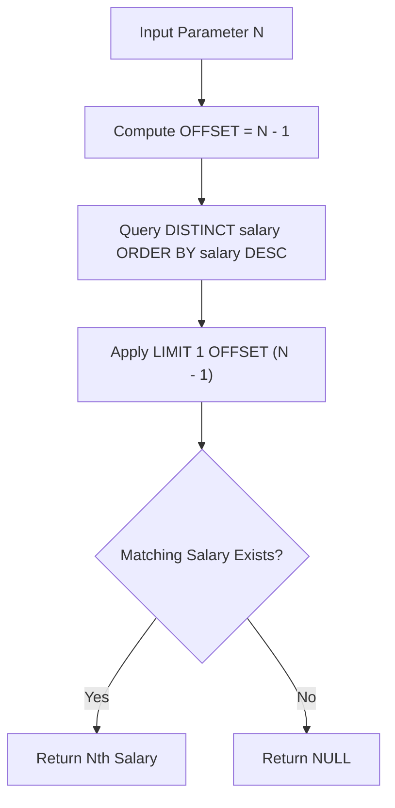

# 177. Nth Highest Salary

## Problem Statement

Table: `Employee`
```
+-------------+------+
| Column Name | Type |
+-------------+------+
| id          | int  |
| salary      | int  |
+-------------+------+
id is the primary key (column with unique values) for this table.
Each row of this table contains information about the salary of an employee.
```

Write a solution to find the $n^{\text{th}}$ highest distinct salary from the `Employee` table. If there is no $n^{\text{th}}$ highest salary, return `null`.

The result format is in the following examples.

### Example 1:

```
Input: 
Employee table:
+----+--------+
| id | salary |
+----+--------+
| 1  | 100    |
| 2  | 200    |
| 3  | 300    |
+----+--------+
n = 2
Output: 
+------------------------+
| getNthHighestSalary(2) |
+------------------------+
| 200                    |
+------------------------+
```

### Example 2:

```
Input: 
Employee table:
+----+--------+
| id | salary |
+----+--------+
| 1  | 100    |
+----+--------+
n = 2
Output: 
+------------------------+
| getNthHighestSalary(2) |
+------------------------+
| null                   |
+------------------------+
```

---

## Approach

### 1. Generalizing Rank Retrieval
- We need the $N^{\text{th}}$ distinct salary in descending order.
- In SQL, retrieving the $N^{\text{th}}$ item can be achieved with `LIMIT 1 OFFSET (N - 1)`.
- However, SQL syntax inside stored functions (e.g., MySQL) does not permit direct arithmetic in the `OFFSET` clause like `OFFSET N - 1`. Therefore, we must pre-decrement $N$:
  $$\text{SET } N = N - 1;$$
- The scalar query becomes:
  ```sql
  SELECT DISTINCT salary
  FROM Employee
  ORDER BY salary DESC
  LIMIT 1 OFFSET N;
  ```
- If $N < 0$ or exceeds the count of unique salaries, the subquery produces 0 rows, which automatically evaluates to `NULL` in the return statement.

### 2. Alternative: `DENSE_RANK()` Window Function
- Assign each unique salary a descending rank using `DENSE_RANK() OVER (ORDER BY salary DESC)`.
- Filter for the row where `rnk = N`.



---

## Code Implementation

### SQL (MySQL Stored Function)

```sql
CREATE FUNCTION getNthHighestSalary(N INT) RETURNS INT
BEGIN
  SET N = N - 1;
  RETURN (
      SELECT DISTINCT salary
      FROM Employee
      ORDER BY salary DESC
      LIMIT 1 OFFSET N
  );
END
```

### SQL (Window Function - PostgreSQL / SQL Server / Oracle)

```sql
CREATE FUNCTION getNthHighestSalary(N INT) RETURNS INT
BEGIN
  RETURN (
      WITH RankedSalaries AS (
          SELECT 
              salary,
              DENSE_RANK() OVER (ORDER BY salary DESC) AS rnk
          FROM Employee
      )
      SELECT DISTINCT salary
      FROM RankedSalaries
      WHERE rnk = N
  );
END
```

### Python (Pandas)

```python
import pandas as pd

def nth_highest_salary(employee: pd.DataFrame, N: int) -> pd.DataFrame:
    # Drop duplicates and sort descending
    unique_salaries = employee['salary'].drop_duplicates().sort_values(ascending=False)
    
    col_name = f'getNthHighestSalary({N})'
    
    # Check if N is valid and within bounds
    if N <= 0 or len(unique_salaries) < N:
        return pd.DataFrame({col_name: [None]})
    
    return pd.DataFrame({col_name: [unique_salaries.iloc[N - 1]]})
```

---

## Complexity Analysis

- **Time Complexity**: $O(N \log N)$ where $N$ is the number of records in the `Employee` table (dominated by sorting or indexing over unique salaries).
- **Space Complexity**: $O(U)$ where $U \le N$ is the number of unique salaries stored during execution.

---
