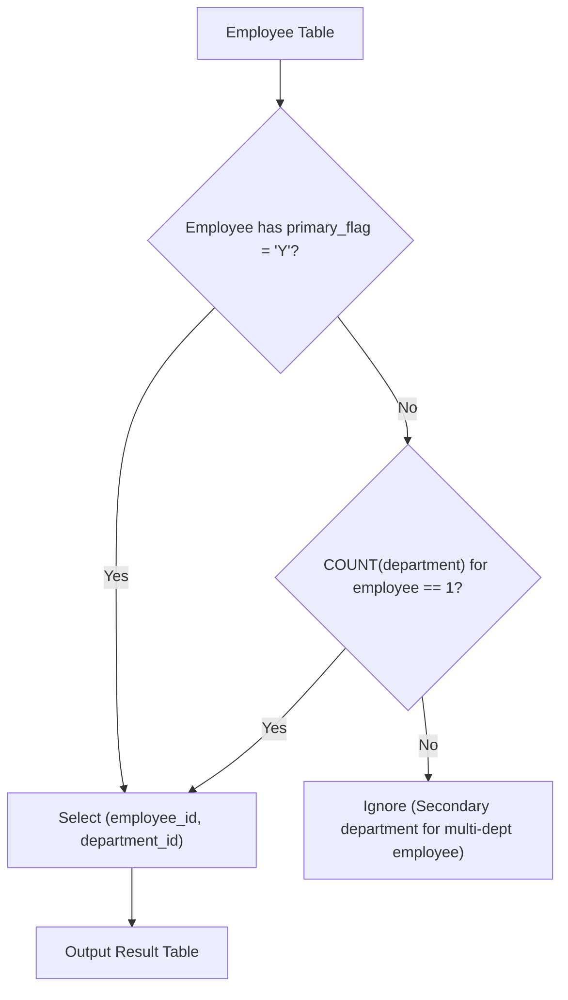

# 1789. Primary Department for Each Employee

## Problem Statement

Table: `Employee`
```
+---------------+---------+
| Column Name   | Type    |
+---------------+---------+
| employee_id   | int     |
| department_id | int     |
| primary_flag  | varchar |
+---------------+---------+
(employee_id, department_id) is the primary key (combination of columns with unique values) for this table.
employee_id is the id of the employee.
department_id is the id of the department to which the employee belongs.
primary_flag is an ENUM (category) of type ('Y', 'N'). If the flag is 'Y', the department is the primary department for the employee. If the flag is 'N', the department is not the primary.
```

Employees can belong to multiple departments. When the employee joins other departments, they need to decide which department is their primary department. Note that when an employee belongs to only one department, their primary column is `'N'`.

Write a solution to report all the employees with their primary department. For employees who belong to one department, report their only department.

Return the result table in **any order**.

The result format is in the following example.

### Example 1:

```
Input: 
Employee table:
+-------------+---------------+--------------+
| employee_id | department_id | primary_flag |
+-------------+---------------+--------------+
| 1           | 1             | N            |
| 2           | 1             | Y            |
| 2           | 2             | N            |
| 3           | 3             | N            |
| 4           | 2             | N            |
| 4           | 3             | Y            |
| 4           | 4             | N            |
+-------------+---------------+--------------+
Output: 
+-------------+---------------+
| employee_id | department_id |
+-------------+---------------+
| 1           | 1             |
| 2           | 1             |
| 3           | 3             |
| 4           | 3             |
+-------------+---------------+
Explanation: 
- The Primary department for employee 1 is 1.
- The Primary department for employee 2 is 1.
- The Primary department for employee 3 is 3.
- The Primary department for employee 4 is 3.
```

---

## Approach

### 1. Understanding Employee Department Classifications
Each employee belongs to one of two distinct categories:
1. **Multi-Department Employees**:
   - The employee belongs to two or more departments.
   - Exactly one of these records is flagged with `primary_flag = 'Y'`.
2. **Single-Department Employees**:
   - The employee belongs to exactly one department (`COUNT(*) = 1`).
   - The record has `primary_flag = 'N'` (or could be `'Y'`), but since there is only one department, that sole department must be returned.

### 2. Query Strategies

#### Strategy A: `WHERE` with `OR` Subquery
- Select records where:
  $$\text{primary\_flag} = \text{'Y'} \quad \lor \quad \text{employee\_id} \in (\text{employees with } \text{COUNT}(*) = 1)$$
- We obtain the list of employees belonging to only one department via:
  ```sql
  SELECT employee_id
  FROM Employee
  GROUP BY employee_id
  HAVING COUNT(*) = 1
  ```

#### Strategy B: Window Function (`COUNT(*) OVER`)
- We can compute the total department count per employee using the analytic function `COUNT(*) OVER (PARTITION BY employee_id)`.
- We then filter rows where `primary_flag = 'Y' OR dept_count = 1`.



---

## Code Implementation

### SQL (MySQL / PostgreSQL / SQL Server / Oracle)

#### Method 1: Subquery with `IN` (Recommended)

```sql
SELECT 
    employee_id,
    department_id
FROM Employee
WHERE primary_flag = 'Y'
   OR employee_id IN (
       SELECT employee_id
       FROM Employee
       GROUP BY employee_id
       HAVING COUNT(*) = 1
   );
```

#### Method 2: Window Function

```sql
WITH DepartmentCounts AS (
    SELECT 
        employee_id,
        department_id,
        primary_flag,
        COUNT(*) OVER (PARTITION BY employee_id) AS total_depts
    FROM Employee
)
SELECT 
    employee_id,
    department_id
FROM DepartmentCounts
WHERE primary_flag = 'Y' 
   OR total_depts = 1;
```

### Python (Pandas)

```python
import pandas as pd

def find_primary_department(employee: pd.DataFrame) -> pd.DataFrame:
    # Condition 1: Direct primary flag
    primary_depts = employee[employee['primary_flag'] == 'Y']
    
    # Condition 2: Employees with only one department
    single_depts = employee.groupby('employee_id').filter(lambda x: len(x) == 1)
    
    # Combine both and drop duplicates if any
    result = pd.concat([primary_depts, single_depts]).drop_duplicates(subset=['employee_id', 'department_id'])
    
    return result[['employee_id', 'department_id']]
```

---

## Complexity Analysis

- **Time Complexity**: $O(N)$ — where $N$ is the number of rows in the `Employee` table. The aggregation or window partitioning scans $N$ records in linear time, and the outer filter checks $N$ rows against the aggregated hash set / conditions in $O(1)$ per row.
- **Space Complexity**: $O(U)$ — where $U$ is the number of unique employees ($U \le N$). The subquery/window hash map stores employee counts, and the final output contains exactly $U$ rows (one row per employee).

---
