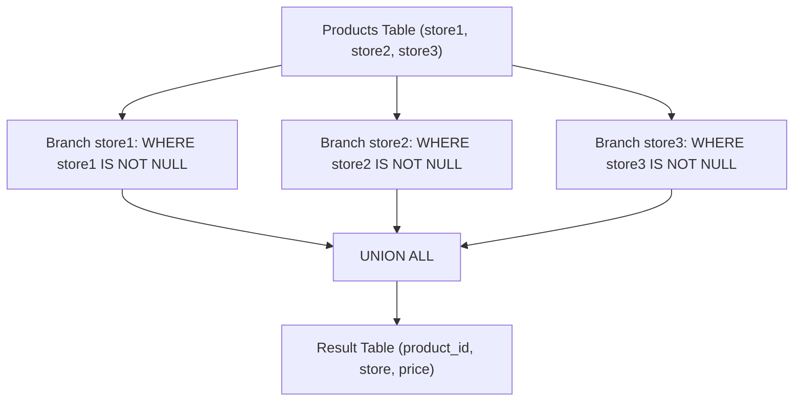

# 1795. Rearrange Products Table

## Problem Statement

Table: `Products`
```
+-------------+---------+
| Column Name | Type    |
+-------------+---------+
| product_id  | int     |
| store1      | int     |
| store2      | int     |
| store3      | int     |
+-------------+---------+
product_id is the primary key (column with unique values) for this table.
Each row in this table indicates the product's price in 3 different stores: store1, store2, and store3.
If the product is not available in a store, the price will be null in that store's column.
```

Write a solution to rearrange the `Products` table so that each row has `(product_id, store, price)`. If a product is not available in a store, do not include a row with that `product_id` and `store` combination in the result table.

Return the result table in **any order**.

The result format is in the following example.

### Example 1:

```
Input: 
Products table:
+------------+--------+--------+--------+
| product_id | store1 | store2 | store3 |
+------------+--------+--------+--------+
| 0          | 95     | 100    | 105    |
| 1          | 70     | null   | 80     |
+------------+--------+--------+--------+
Output: 
+------------+--------+-------+
| product_id | store  | price |
+------------+--------+-------+
| 0          | store1 | 95    |
| 0          | store2 | 100   |
| 0          | store3 | 105   |
| 1          | store1 | 70    |
| 1          | store3 | 80    |
+------------+--------+-------+
Explanation: 
Product 0 is available in all three stores with prices 95, 100, and 105 respectively.
Product 1 is available in store1 with price 70 and store3 with price 80. The product is not available in store2.
```

---

## Approach

### 1. Unpivoting Columns to Rows
- The given `Products` table is stored in a **wide format** (horizontal layout where each store is a column).
- We need to transform it into a **long format** (vertical layout where each observation has `product_id`, `store`, and `price`).
- This operation is known as **unpivoting** (or melting in data frames).

### 2. Method 1: `UNION ALL` (Universal SQL)
- We can query each store separately, generating a literal string column for `'store1'`, `'store2'`, and `'store3'`:
  - `SELECT product_id, 'store1' AS store, store1 AS price FROM Products WHERE store1 IS NOT NULL`
  - `SELECT product_id, 'store2' AS store, store2 AS price FROM Products WHERE store2 IS NOT NULL`
  - `SELECT product_id, 'store3' AS store, store3 AS price FROM Products WHERE store3 IS NOT NULL`
- Combining the queries with `UNION ALL` preserves all valid rows without the deduplication overhead of `UNION`.

### 3. Method 2: Native `UNPIVOT` (SQL Server / Oracle)
- Relational engines such as SQL Server provide an `UNPIVOT` clause that pivots column values into rows and automatically filters out `NULL`s.



---

## Code Implementation

### SQL (MySQL / PostgreSQL / SQL Server / Oracle)

```sql
SELECT 
    product_id, 
    'store1' AS store, 
    store1 AS price
FROM Products
WHERE store1 IS NOT NULL

UNION ALL

SELECT 
    product_id, 
    'store2' AS store, 
    store2 AS price
FROM Products
WHERE store2 IS NOT NULL

UNION ALL

SELECT 
    product_id, 
    'store3' AS store, 
    store3 AS price
FROM Products
WHERE store3 IS NOT NULL;
```

### Python (Pandas)

```python
import pandas as pd

def rearrange_products_table(products: pd.DataFrame) -> pd.DataFrame:
    # Unpivot DataFrame from wide to long format
    melted = pd.melt(
        products,
        id_vars=['product_id'],
        value_vars=['store1', 'store2', 'store3'],
        var_name='store',
        value_name='price'
    )
    # Drop rows where price is NaN/null
    return melted.dropna(subset=['price'])
```

---

## Complexity Analysis

- **Time Complexity**: $O(N)$ — where $N$ is the number of rows in `Products`. Each row is scanned for the 3 store columns, taking linear time.
- **Space Complexity**: $O(M)$ — where $M \le 3N$ is the total count of non-null `(product_id, store)` price entries in the final output.

---
