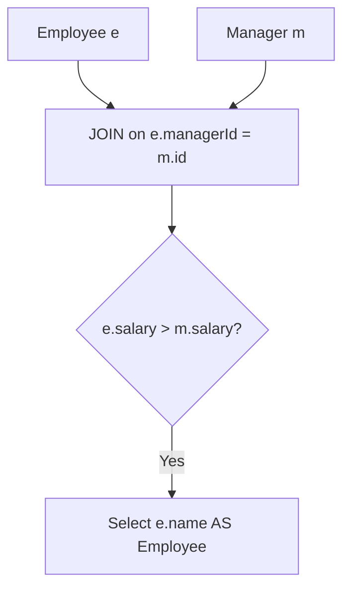

# 181. Employees Earning More Than Their Managers

## Problem Statement

Table: `Employee`
```
+-------------+---------+
| Column Name | Type    |
+-------------+---------+
| id          | int     |
| name        | varchar |
| salary      | int     |
| managerId   | int     |
+-------------+---------+
id is the primary key column for this table.
managerId is the id of the manager for that employee.
```

Write a solution to find the employees who earn more than their managers.

Return the result table in **any order**.

### Example 1:
```
Input: 
Employee table:
+----+-------+--------+-----------+
| id | name  | salary | managerId |
+----+-------+--------+-----------+
| 1  | Joe   | 70000  | 3         |
| 2  | Henry | 80000  | 4         |
| 3  | Sam   | 60000  | Null      |
| 4  | Max   | 90000  | Null      |
+----+-------+--------+-----------+
Output: 
+----------+
| Employee |
+----------+
| Joe      |
+----------+
Explanation: Joe is the only employee who earns more than his manager (Sam, 60000).
```

---

## Approach

We can join the `Employee` table to itself (Self-Join):

1. Let `e` represent the employee row and `m` represent the manager row.
2. Join condition: `e.managerId = m.id`.
3. Filter condition: `e.salary > m.salary`.
4. Select `e.name AS Employee`.



---

## Code Implementation

```sql
SELECT 
    e.name AS Employee
FROM Employee e
JOIN Employee m 
    ON e.managerId = m.id
WHERE e.salary > m.salary;
```

---

## Complexity Analysis

- **Time Complexity**: $O(N)$ — where $N$ is the number of rows in the `Employee` table, as primary key lookups on `m.id` run in $O(1)$ time with standard B-tree indexing.

- **Space Complexity**: $O(N)$ — To hold matching join records in memory.

---
