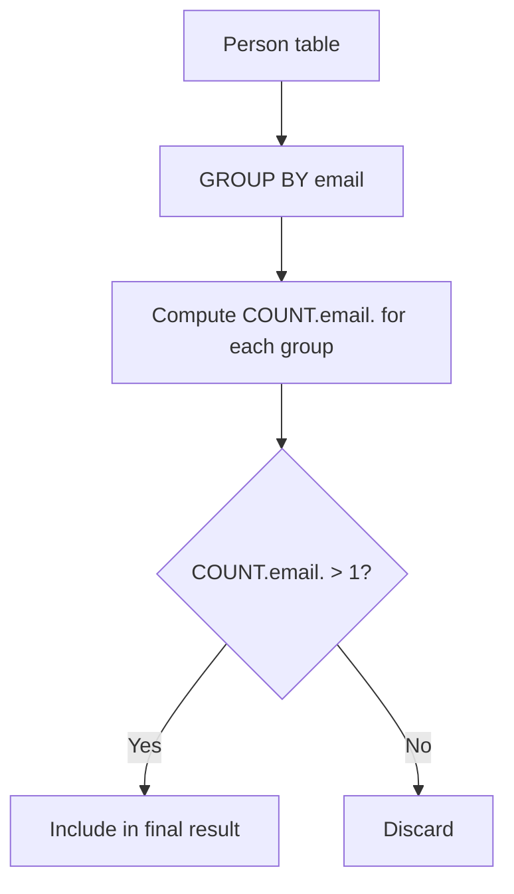

# 182. Duplicate Emails

## Problem Statement

Table: `Person`
```
+-------------+---------+
| Column Name | Type    |
+-------------+---------+
| id          | int     |
| email       | varchar |
+-------------+---------+
id is the primary key column for this table.
Each row of this table contains an email. The emails will not contain uppercase letters.
```

Write a solution to report all the duplicate emails. Note that it's guaranteed that the email field is not NULL.

Return the result table in **any order**.

### Example 1:
```
Input: 
Person table:
+----+---------+
| id | email   |
+----+---------+
| 1  | a@b.com |
| 2  | c@d.com |
| 3  | a@b.com |
+----+---------+
Output: 
+---------+
| Email   |
+---------+
| a@b.com |
+---------+
Explanation: a@b.com is repeated two times.
```

---

## Approach

To find duplicated entries:

1. Group the records by `email` using `GROUP BY email`.
2. Count the occurrences of each email using the aggregate function `COUNT(email)`.
3. Filter out groups that only appear once using the `HAVING` clause: `HAVING COUNT(email) > 1`.



---

## Code Implementation

```sql
SELECT 
    email AS Email
FROM Person
GROUP BY email
HAVING COUNT(email) > 1;
```

---

## Complexity Analysis

- **Time Complexity**: $O(N)$ — Where $N$ is the number of rows in `Person`. The database engine scans all rows and groups them via hash/sort table.

- **Space Complexity**: $O(U)$ — Where $U$ is the number of distinct email addresses stored in the grouping hash table.

---
