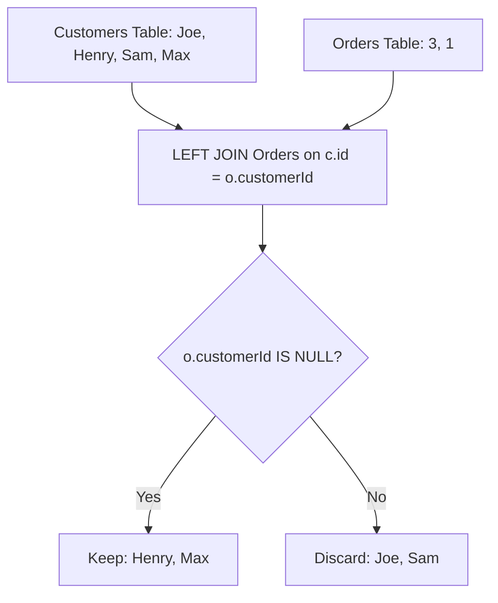

# 183. Customers Who Never Order

## Problem Statement

Table: `Customers`
```
+-------------+---------+
| Column Name | Type    |
+-------------+---------+
| id          | int     |
| name        | varchar |
+-------------+---------+
id is the primary key column for this table.
```

Table: `Orders`
```
+-------------+---------+
| Column Name | Type    |
+-------------+---------+
| id          | int     |
| customerId  | int     |
+-------------+---------+
id is the primary key column for this table.
customerId is a foreign key of the ID from the Customers table.
```

Write a solution to find all customers who never order anything.

Return the result table in **any order**.

### Example 1:
```
Input: 
Customers table:
+----+-------+
| id | name  |
+----+-------+
| 1  | Joe   |
| 2  | Henry |
| 3  | Sam   |
| 4  | Max   |
+----+-------+
Orders table:
+----+------------+
| id | customerId |
+----+------------+
| 1  | 3          |
| 2  | 1          |
+----+------------+
Output: 
+-----------+
| Customers |
+-----------+
| Henry     |
| Max       |
+-----------+
```

---

## Approach

This is a classic **Anti-Join** pattern:

1. Perform a `LEFT JOIN` between `Customers c` and `Orders o` on `c.id = o.customerId`.
2. For customers who placed orders, `o.customerId` will contain their customer ID.
3. For customers who never placed an order, `o.customerId` will be `NULL`.
4. Filter by adding the condition `WHERE o.customerId IS NULL`.
5. Select `c.name AS Customers`.



---

## Code Implementation

```sql
SELECT 
    c.name AS Customers
FROM Customers c
LEFT JOIN Orders o 
    ON c.id = o.customerId
WHERE o.customerId IS NULL;
```

---

## Complexity Analysis

- **Time Complexity**: $O(C + O)$ — where $C$ is the number of customers and $O$ is the number of orders. A hash or index-based outer join processes both tables linearly.

- **Space Complexity**: $O(C)$ — For the outer join state and resultant rows.

---
