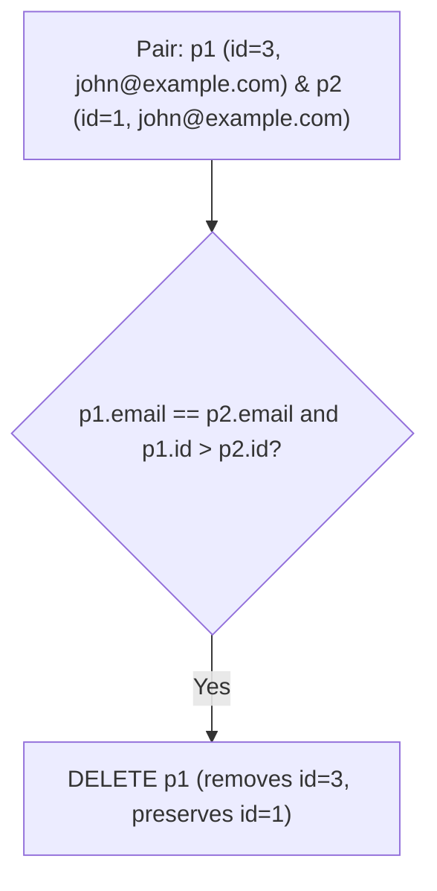

# 196. Delete Duplicate Emails

## Problem Statement

Table: `Person`
```
+-------------+---------+
| Column Name | Type    |
+-------------+---------+
| id          | int     |
| email       | varchar |
+-------------+---------+
id is the primary key column for this table.
Each row of this table contains an email. The emails will not contain uppercase letters.
```

Write a solution to **delete** all duplicate emails, keeping only one unique email with the smallest `id`.

For SQL users, please note that you are supposed to write a `DELETE` statement and not a `SELECT` one.

### Example 1:
```
Input: 
Person table:
+----+------------------+
| id | email            |
+----+------------------+
| 1  | john@example.com |
| 2  | bob@example.com  |
| 3  | john@example.com |
+----+------------------+
Output: 
+----+------------------+
| id | email            |
+----+------------------+
| 1  | john@example.com |
| 2  | bob@example.com  |
+----+------------------+
Explanation: john@example.com is repeated two times. We keep the row with the smallest Id = 1.
```

---

## Approach

We can perform a **Self-Join within a `DELETE` statement**:

1. Refer to the table `Person` twice as `p1` and `p2`.
2. Match rows that have identical emails: `p1.email = p2.email`.
3. To ensure we preserve the record with the minimum `id`, we specify that `p1` should have a strictly larger ID than `p2`: `p1.id > p2.id`.
4. Delete `p1`, which removes every duplicate occurrence having a larger ID while preserving the original occurrence with the lowest ID.



---

## Code Implementation

```sql
DELETE p1 
FROM Person p1, Person p2
WHERE p1.email = p2.email 
  AND p1.id > p2.id;
```

---

## Complexity Analysis

- **Time Complexity**: $O(N^2)$ worst case without indexes, or $O(N \log N)$ when an index exists on `(email, id)`.

- **Space Complexity**: $O(1)$ — Performs the deletion directly in-place without generating a persistent intermediate table.

---
