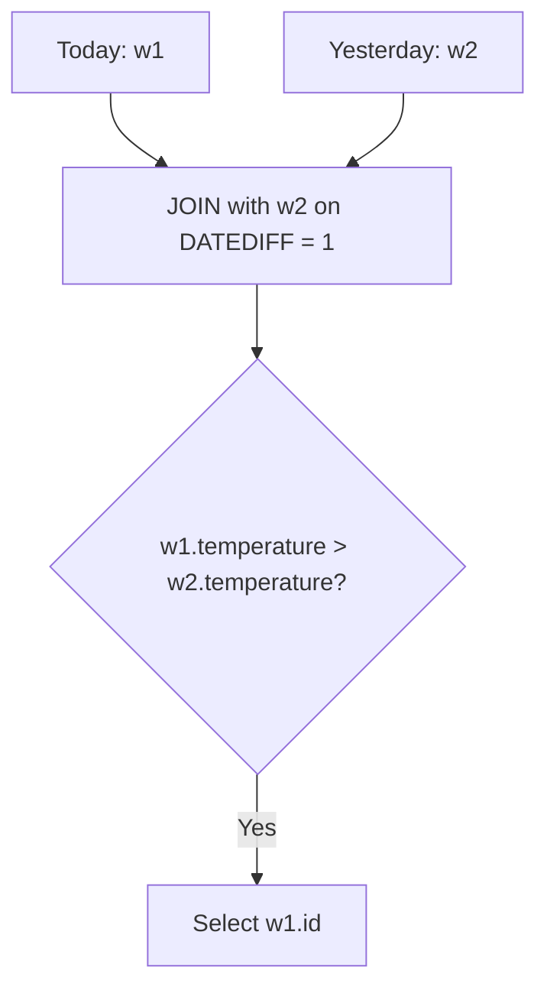

# 197. Rising Temperature

## Problem Statement

Table: `Weather`
```
+---------------+---------+
| Column Name   | Type    |
+---------------+---------+
| id            | int     |
| recordDate    | date    |
| temperature   | int     |
+---------------+---------+
id is the column with unique values for this table.
There are no different rows with the same recordDate.
This table contains information about the temperature on a certain day.
```

Write a solution to find all dates' `Id` with higher temperatures compared to its previous dates (yesterday).

Return the result table in **any order**.

### Example 1:
```
Input: 
Weather table:
+----+------------+-------------+
| id | recordDate | temperature |
+----+------------+-------------+
| 1  | 2015-01-01 | 10          |
| 2  | 2015-01-02 | 25          |
| 3  | 2015-01-03 | 20          |
| 4  | 2015-01-04 | 30          |
+----+------------+-------------+
Output: 
+----+
| id |
+----+
| 2  |
| 4  |
+----+
Explanation: 
In 2015-01-02, the temperature was higher than the previous day (10 -> 25).
In 2015-01-04, the temperature was higher than the previous day (20 -> 30).
```

---

## Approach

We can join the `Weather` table to itself:

1. Let `w1` represent "today" and `w2` represent "yesterday".
2. Use MySQL's `DATEDIFF(w1.recordDate, w2.recordDate) = 1` function to verify that `w1` is exactly 1 calendar day after `w2`.
   *(Note: Subtraction like `w1.recordDate - w2.recordDate` is unreliable across month/year boundaries, so `DATEDIFF` is essential).*
3. Add the condition `w1.temperature > w2.temperature` to ensure today was warmer than yesterday.
4. Select `w1.id`.



---

## Code Implementation

```sql
SELECT 
    w1.id
FROM Weather w1
JOIN Weather w2 
    ON DATEDIFF(w1.recordDate, w2.recordDate) = 1
WHERE w1.temperature > w2.temperature;
```

---

## Complexity Analysis

- **Time Complexity**: $O(N)$ with an index on `recordDate`, as the engine can lookup yesterday's date in $O(1)$ time for each row.

- **Space Complexity**: $O(N)$ — To hold matching join records in memory.

---
