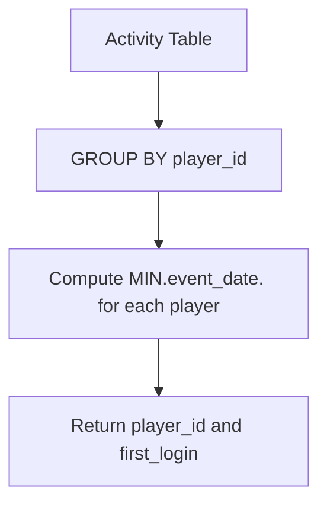

# 511. Game Play Analysis I

## Problem Statement

Table: `Activity`
```
+--------------+---------+
| Column Name  | Type    |
+--------------+---------+
| player_id    | int     |
| device_id    | int     |
| event_date   | date    |
| games_played | int     |
+--------------+---------+
(player_id, event_date) is the primary key of this table.
This table shows the activity of players of some games.
Each row is a record of a player who logged in and played a number of games (possibly 0) before logging out on somedate using some device.
```

Write a solution to find the **first login date** for each player.

Return the result table in **any order**.

### Example 1:
```
Input: 
Activity table:
+-----------+-----------+------------+--------------+
| player_id | device_id | event_date | games_played |
+-----------+-----------+------------+--------------+
| 1         | 2         | 2016-03-01 | 5            |
| 1         | 2         | 2016-05-02 | 6            |
| 2         | 3         | 2017-06-25 | 1            |
| 3         | 1         | 2016-03-02 | 0            |
| 3         | 4         | 2018-07-03 | 5            |
+-----------+-----------+------------+--------------+
Output: 
+-----------+-------------+
| player_id | first_login |
+-----------+-------------+
| 1         | 2016-03-01  |
| 2         | 2017-06-25  |
| 3         | 2016-03-02  |
+-----------+-------------+
```

---

## Approach

This is a direct grouping and aggregation query:

1. Group all records by `player_id` using `GROUP BY player_id`.
2. Compute the earliest login date for each group using the aggregate function `MIN(event_date)`.
3. Alias the result as `first_login`.



---

## Code Implementation

```sql
SELECT 
    player_id, 
    MIN(event_date) AS first_login
FROM Activity
GROUP BY player_id;
```

---

## Complexity Analysis

- **Time Complexity**: $O(N)$ — Where $N$ is the number of rows in `Activity`. With the compound primary key `(player_id, event_date)`, the database can scan the index directly in linear time.

- **Space Complexity**: $O(P)$ — Where $P$ is the number of distinct players, stored in the grouping hash or aggregation buffer.

---
