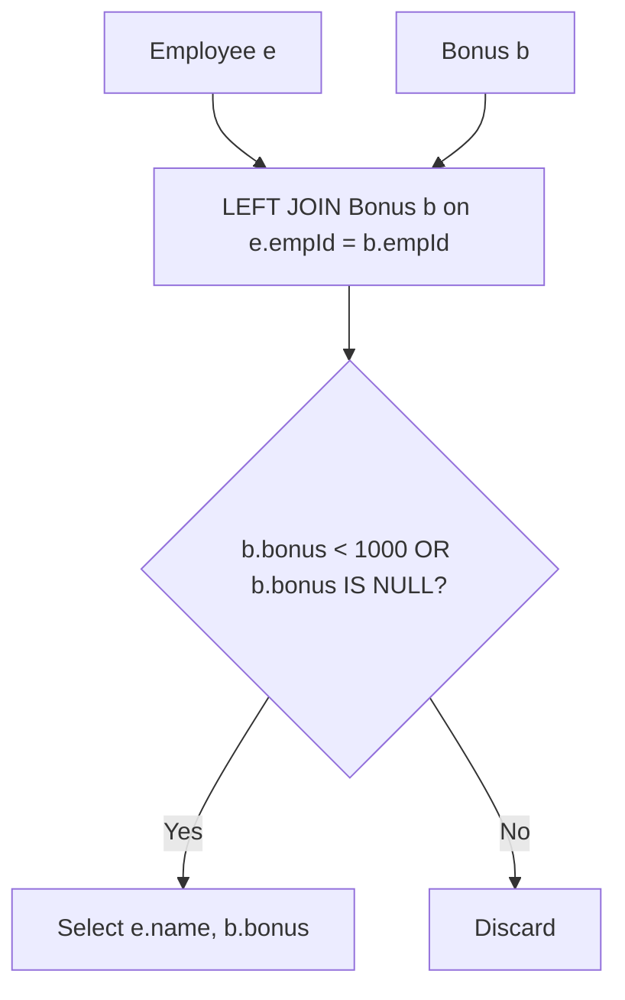

# 577. Employee Bonus

## Problem Statement

Table: `Employee`
```
+-------------+---------+
| Column Name | Type    |
+-------------+---------+
| empId       | int     |
| name        | varchar |
| supervisor  | int     |
| salary      | int     |
+-------------+---------+
empId is the column with unique values for this table.
Each row of this table indicates the name and the ID of an employee in addition to their salary and the id of their manager.
```

Table: `Bonus`
```
+-------------+---------+
| Column Name | Type    |
+-------------+---------+
| empId       | int     |
| bonus       | int     |
+-------------+---------+
empId is the column of unique values for this table.
empId is a foreign key to empId from the Employee table.
Each row of this table contains the id of an employee and their respective bonus.
```

Write a solution to report the `name` and `bonus` amount of each employee with a bonus **less than 1000**.

Return the result table in **any order**.

### Example 1:
```
Input: 
Employee table:
+-------+--------+------------+--------+
| empId | name   | supervisor | salary |
+-------+--------+------------+--------+
| 3     | Brad   | null       | 4000   |
| 1     | John   | 3          | 1000   |
| 2     | Dan    | 3          | 2000   |
| 4     | Thomas | 3          | 4000   |
+-------+--------+------------+--------+
Bonus table:
+-------+-------+
| empId | bonus |
+-------+-------+
| 2     | 500   |
| 4     | 2000  |
+-------+-------+
Output: 
+------+-------+
| name | bonus |
+------+-------+
| Brad | null  |
| John | null  |
| Dan  | 500   |
+------+-------+
```

---

## Approach

1. We need to display employees whose bonus is less than 1000. Employees who have no bonus at all must also be included in the output.
2. An `INNER JOIN` would drop employees without an entry in `Bonus`. Therefore, we use a **`LEFT JOIN`** between `Employee e` and `Bonus b` on `e.empId = b.empId`.
3. In SQL three-valued logic, `NULL < 1000` evaluates to `UNKNOWN` (falsy in a `WHERE` filter). To retain employees without a bonus record, we must explicitly check `b.bonus < 1000 OR b.bonus IS NULL`.
4. Select `e.name` and `b.bonus`.



---

## Code Implementation

```sql
SELECT 
    e.name, 
    b.bonus
FROM Employee e
LEFT JOIN Bonus b 
    ON e.empId = b.empId
WHERE b.bonus < 1000 OR b.bonus IS NULL;
```

---

## Complexity Analysis

- **Time Complexity**: $O(E + B)$ — where $E$ is the number of rows in `Employee` and $B$ is the number of rows in `Bonus`. The outer join operates linearly with indexed foreign key lookups.

- **Space Complexity**: $O(E)$ — To store and output matching rows.

---
