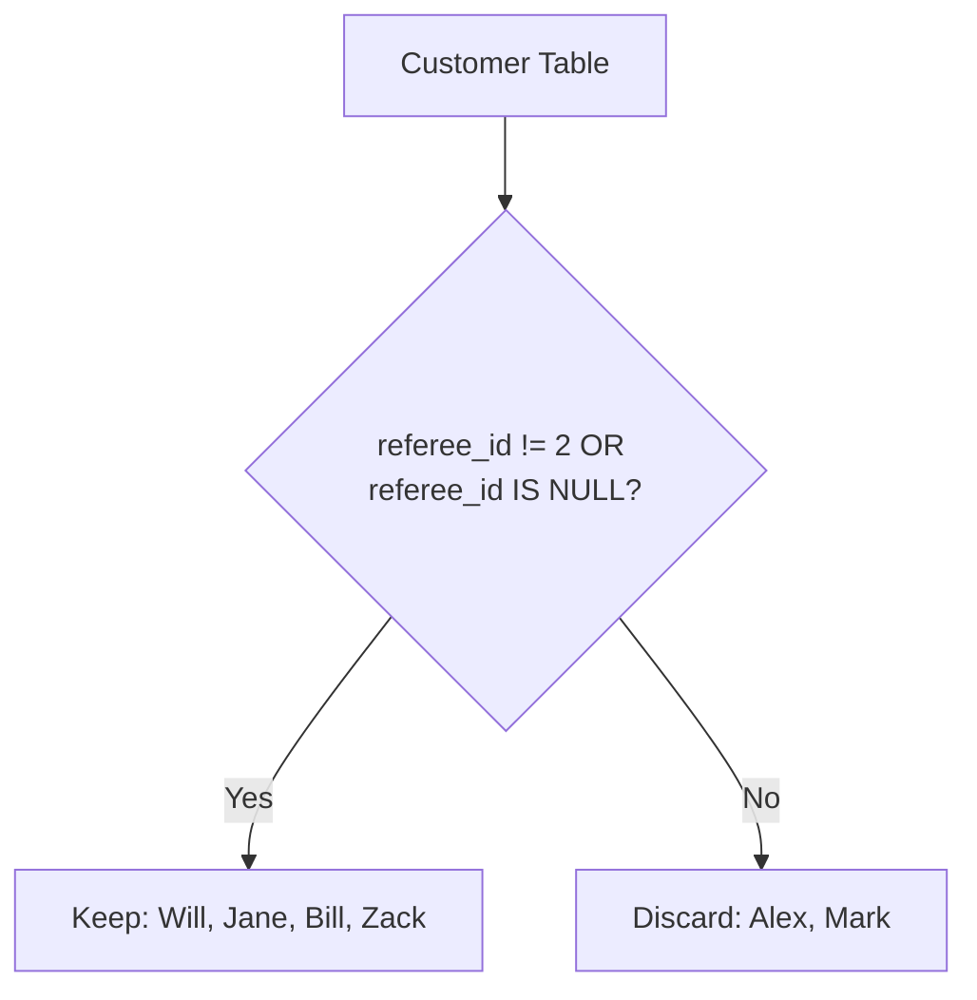

# 584. Find Customer Referee

## Problem Statement

Table: `Customer`
```
+-------------+---------+
| Column Name | Type    |
+-------------+---------+
| id          | int     |
| name        | varchar |
| referee_id  | int     |
+-------------+---------+
In SQL, id is the primary key column for this table.
Each row of this table indicates the id of a customer, their name, and the id of the customer who referred them.
```

Write a solution to find the names of the customer that are **not referred by** the customer with `id = 2`.

Return the result table in **any order**.

### Example 1:
```
Input: 
Customer table:
+----+------+------------+
| id | name | referee_id |
+----+------+------------+
| 1  | Will | null       |
| 2  | Jane | null       |
| 3  | Alex | 2          |
| 4  | Bill | null       |
| 5  | Zack | 1          |
| 6  | Mark | 2          |
+----+------+------------+
Output: 
+------+
| name |
+------+
| Will |
| Jane |
| Bill |
| Zack |
+------+
```

---

## Approach

1. We must filter for customers who were not referred by customer `2`.
2. In SQL's three-valued logic (3VL), evaluating `NULL != 2` results in `UNKNOWN`, not `TRUE`. Therefore, writing only `WHERE referee_id != 2` inadvertently discards customers with `referee_id` as `NULL`.
3. To correctly include customers without a referee as well as those referred by someone other than `2`, we explicitly condition on `referee_id != 2 OR referee_id IS NULL`.
4. Select the `name` column from `Customer`.



---

## Code Implementation

```sql
SELECT 
    name
FROM Customer
WHERE referee_id != 2 OR referee_id IS NULL;
```

---

## Complexity Analysis

- **Time Complexity**: $O(N)$ — where $N$ is the number of rows in the `Customer` table, as each row is evaluated by the filter condition.

- **Space Complexity**: $O(N)$ — To materialize and output matching rows ($O(1)$ auxiliary memory).

---
