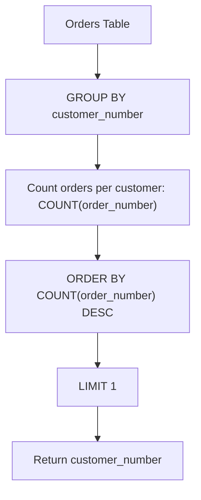

# 586. Customer Placing the Largest Number of Orders

## Problem Statement

Table: `Orders`
```
+-----------------+----------+
| Column Name     | Type     |
+-----------------+----------+
| order_number    | int      |
| customer_number | int      |
| order_date      | date     |
| required_date   | date     |
| shipped_date    | date     |
| status          | varchar  |
| comment         | varchar  |
+-----------------+----------+
order_number is the primary key (column with unique values) for this table.
This table contains information about the order ID and the customer ID.
```

Write a solution to find the `customer_number` for the customer who has placed the **largest number of orders**.

The test cases are generated so that **exactly one customer** will have placed more orders than any other customer.

### Example 1:
```
Input: 
Orders table:
+--------------+-----------------+
| order_number | customer_number |
+--------------+-----------------+
| 1            | 1               |
| 2            | 2               |
| 3            | 3               |
| 4            | 3               |
+--------------+-----------------+
Output: 
+-----------------+
| customer_number |
+-----------------+
| 3               |
+-----------------+
Explanation: 
The customer with number 3 has two orders, which is greater than either customer 1 or 2 because each of them only has one order. 
So result is customer_number 3.
```

**Follow up:** What if more than one customer has the largest number of orders, can you find all the `customer_number` in this case?

---

## Approach

1. **Aggregation:** We need to aggregate orders by `customer_number` to count how many orders each customer has placed.
2. Group rows using `GROUP BY customer_number`.
3. Order the groups in descending order based on their counts using `ORDER BY COUNT(order_number) DESC` (or `COUNT(*) DESC`).
4. Select `customer_number` and retain only the top record using `LIMIT 1`.
5. **Follow-Up Handling (Ties):** If multiple customers share the maximum number of orders, `LIMIT 1` would only return one of them. To return all tied top customers, a subquery with `HAVING` or window functions can be used:
   ```sql
   SELECT customer_number
   FROM Orders
   GROUP BY customer_number
   HAVING COUNT(order_number) = (
       SELECT MAX(order_count)
       FROM (
           SELECT COUNT(order_number) AS order_count
           FROM Orders
           GROUP BY customer_number
       ) AS sub
   );
   ```



---

## Code Implementation

```sql
SELECT 
    customer_number
FROM Orders
GROUP BY customer_number
ORDER BY COUNT(order_number) DESC
LIMIT 1;
```

---

## Complexity Analysis

- **Time Complexity**: $O(N \log U)$ — where $N$ is the number of rows in `Orders` and $U$ is the number of unique customers. Grouping runs in $O(N)$, and sorting the $U$ groups takes $O(U \log U)$ (or $O(U)$ with top-1 selection).

- **Space Complexity**: $O(U)$ — Temporary hash map/table allocated to store aggregate counts per unique customer.

---
