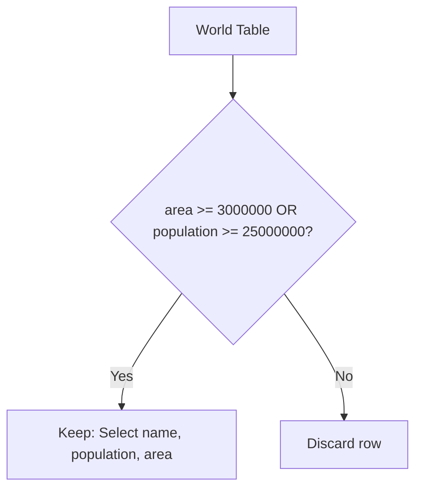

# 595. Big Countries

## Problem Statement

Table: `World`
```
+-------------+---------+
| Column Name | Type    |
+-------------+---------+
| name        | varchar |
| continent   | varchar |
| area        | int     |
| population  | int     |
| gdp         | bigint  |
+-------------+---------+
name is the primary key (column with unique values) for this table.
Each row of this table gives information about the name of a country, the continent to which it belongs, its area, the population, and its GDP value.
```

A country is **big** if:
- it has an area of at least three million (i.e., `3000000 km^2`), or
- it has a population of at least twenty-five million (i.e., `25000000`).

Write a solution to find the `name`, `population`, and `area` of the **big countries**.

Return the result table in **any order**.

### Example 1:
```
Input: 
World table:
+-------------+-----------+---------+------------+--------------+
| name        | continent | area    | population | gdp          |
+-------------+-----------+---------+------------+--------------+
| Afghanistan | Asia      | 652230  | 25500100   | 20343000000  |
| Albania     | Europe    | 28748   | 2831741    | 12960000000  |
| Algeria     | Africa    | 2381741 | 37100000   | 188681000000 |
| Andorra     | Europe    | 468     | 78115      | 3712000000   |
| Angola      | Africa    | 1246700 | 20609294   | 100990000000 |
+-------------+-----------+---------+------------+--------------+
Output: 
+-------------+------------+---------+
| name        | population | area    |
+-------------+------------+---------+
| Afghanistan | 25500100   | 652230  |
| Algeria     | 37100000   | 2381741 |
+-------------+------------+---------+
```

---

## Approach

1. A country qualifies if it satisfies either of the two conditions:
   - `area >= 3000000`
   - `population >= 25000000`
2. We filter rows using a simple `WHERE` clause with the logical `OR` operator:
   ```sql
   WHERE area >= 3000000 OR population >= 25000000
   ```
3. Project the requested columns in the required order: `name`, `population`, and `area`.
4. **Index Optimization Discussion:** In production systems without composite/merge indexing on both columns, an `OR` condition may trigger a full table scan. An equivalent query using `UNION` can leverage individual B-Tree indexes on `area` and `population`:
   ```sql
   SELECT name, population, area FROM World WHERE area >= 3000000
   UNION
   SELECT name, population, area FROM World WHERE population >= 25000000;
   ```



---

## Code Implementation

```sql
SELECT 
    name, 
    population, 
    area
FROM World
WHERE area >= 3000000 OR population >= 25000000;
```

---

## Complexity Analysis

- **Time Complexity**: $O(N)$ — where $N$ is the number of rows in the `World` table. Each row is checked against constant-time boolean comparison expressions.

- **Space Complexity**: $O(N)$ — To materialize and output qualifying rows ($O(1)$ auxiliary space).

---
