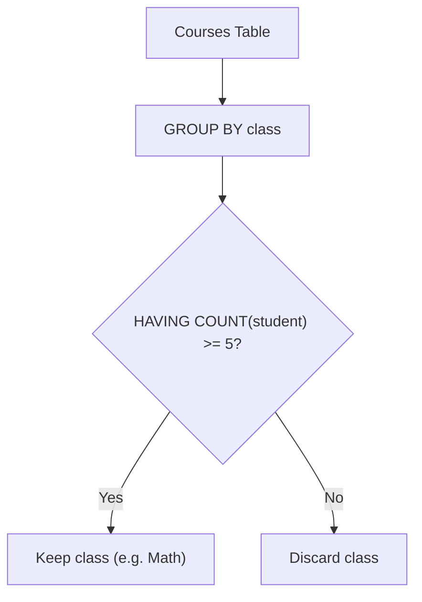

# 596. Classes More Than 5 Students

## Problem Statement

Table: `Courses`
```
+-------------+---------+
| Column Name | Type    |
+-------------+---------+
| student     | varchar |
| class       | varchar |
+-------------+---------+
(student, class) is the primary key (combination of columns with unique values) for this table.
Each row of this table indicates the name of a student and the class that they are enrolled in.
```

Write a solution to find all the classes that have **at least five students**.

Return the result table in **any order**.

### Example 1:
```
Input: 
Courses table:
+---------+----------+
| student | class    |
+---------+----------+
| A       | Math     |
| B       | English  |
| C       | Math     |
| D       | Biology  |
| E       | Math     |
| F       | Computer |
| G       | Math     |
| H       | Math     |
| I       | Math     |
+---------+----------+
Output: 
+---------+
| class   |
+---------+
| Math    |
+---------+
Explanation: 
- Math has 6 students, so we include it.
- English has 1 student, so we do not include it.
- Biology has 1 student, so we do not include it.
- Computer has 1 student, so we do not include it.
```

---

## Approach

1. We need to identify all courses having an enrollment count $\ge 5$.
2. The problem guarantees that `(student, class)` forms the composite primary key, meaning a student cannot be listed twice under the same class.
3. Group the dataset by class using `GROUP BY class`.
4. Filter aggregate groups using the `HAVING` clause:
   ```sql
   HAVING COUNT(student) >= 5
   ```
5. *(Note: If the primary key constraint were not present and duplicate student enrollments were possible, `COUNT(DISTINCT student) >= 5` would be required).*



---

## Code Implementation

```sql
SELECT 
    class
FROM Courses
GROUP BY class
HAVING COUNT(student) >= 5;
```

---

## Complexity Analysis

- **Time Complexity**: $O(N)$ — where $N$ is the total number of rows in the `Courses` table. Each row is read and hashed into its respective class bucket in a single pass.

- **Space Complexity**: $O(K)$ — where $K$ is the number of distinct classes stored in intermediate aggregation memory.

---
