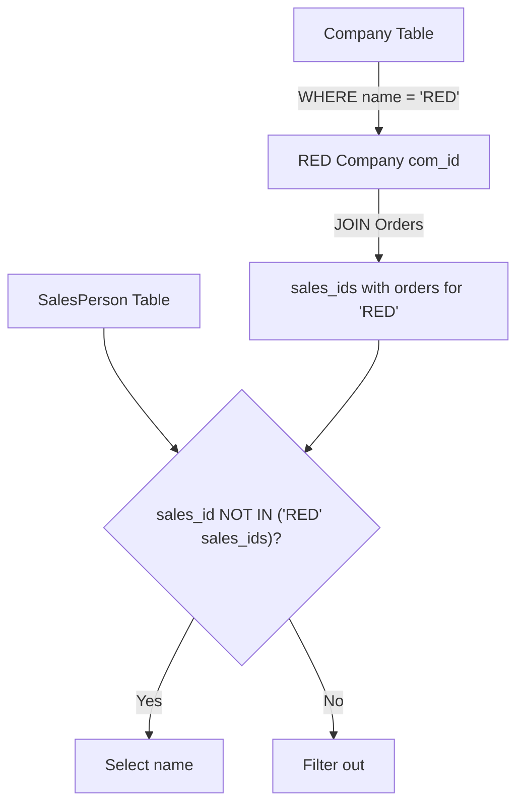

# 607. Sales Person

## Problem Statement

Table: `SalesPerson`
```
+-----------------+---------+
| Column Name     | Type    |
+-----------------+---------+
| sales_id        | int     |
| name            | varchar |
| salary          | int     |
| commission_rate | int     |
| hire_date       | date    |
+-----------------+---------+
sales_id is the primary key (column with unique values) for this table.
Each row of this table indicates the name and the ID of a salesperson, their salary, commission rate, and hire date.
```

Table: `Company`
```
+-------------+---------+
| Column Name | Type    |
+-------------+---------+
| com_id      | int     |
| name        | varchar |
| city        | varchar |
+-------------+---------+
com_id is the primary key (column with unique values) for this table.
Each row of this table indicates the name and the ID of a company and the city in which the company is located.
```

Table: `Orders`
```
+-------------+------+
| Column Name | Type |
+-------------+------+
| order_id    | int  |
| order_date  | date |
| com_id      | int  |
| sales_id    | int  |
| amount      | int  |
+-------------+------+
order_id is the primary key (column with unique values) for this table.
com_id is a foreign key (reference column) to com_id from the Company table.
sales_id is a foreign key (reference column) to sales_id from the SalesPerson table.
Each row of this table indicates the ID of an order, the date of that order, the ID of the company and salesperson that were involved in that order, and the amount of money paid.
```

Write a solution to find the names of all the salespersons who **did not have any orders related to the company with the name "RED"**.

Return the result table in **any order**.

### Example 1:
```
Input: 
SalesPerson table:
+----------+------+--------+-----------------+------------+
| sales_id | name | salary | commission_rate | hire_date  |
+----------+------+--------+-----------------+------------+
| 1        | John | 100000 | 6               | 4/1/2006   |
| 2        | Amy  | 12000  | 5               | 5/1/2010   |
| 3        | Mark | 65000  | 12              | 12/25/2008 |
| 4        | Pam  | 25000  | 25              | 1/1/2005   |
| 5        | Alex | 5000   | 10              | 2/3/2007   |
+----------+------+--------+-----------------+------------+
Company table:
+--------+--------+----------+
| com_id | name   | city     |
+--------+--------+----------+
| 1      | RED    | Boston   |
| 2      | ORANGE | New York |
| 3      | YELLOW | Austin   |
| 4      | GREEN  | Dallas   |
+--------+--------+----------+
Orders table:
+----------+------------+--------+----------+--------+
| order_id | order_date | com_id | sales_id | amount |
+----------+------------+--------+----------+--------+
| 1        | 1/1/2014   | 3      | 1        | 10000  |
| 2        | 2/1/2014   | 4      | 5        | 5000   |
| 3        | 3/1/2014   | 1      | 1        | 50000  |
| 4        | 4/1/2014   | 1      | 4        | 25000  |
+----------+------------+--------+----------+--------+
Output: 
+------+
| name |
+------+
| Amy  |
| Mark |
| Alex |
+------+
Explanation: 
According to orders 3 and 4 in the Orders table, easy to see that only salesperson 1 and 4 have orders with company 'RED'.
So the other salespeople (Amy, Mark, and Alex) do not have any orders with company 'RED'.
```

---

## Approach

1. **Subquery Identification:**
   - First, identify all salespersons who **did** have orders associated with company `'RED'`.
   - Join `Orders` with `Company` where `Company.name = 'RED'` to select `Orders.sales_id`.

2. **Exclusion Filtering:**
   - Filter `SalesPerson` rows where `sales_id` is **NOT IN** the set of salespersons obtained from the subquery.
   - Salespersons who placed no orders or placed orders exclusively with other companies are cleanly preserved.



---

## Code Implementation

```sql
SELECT 
    name
FROM SalesPerson
WHERE sales_id NOT IN (
    SELECT o.sales_id
    FROM Orders o
    JOIN Company c ON o.com_id = c.com_id
    WHERE c.name = 'RED'
);
```

---

## Complexity Analysis

- **Time Complexity**: $O(O + C + S)$ — where $O$ is the number of orders, $C$ is the number of companies, and $S$ is the number of salespersons. The inner join indexes matches efficiently, and the hash set lookup for `NOT IN` executes in linear time.

- **Space Complexity**: $O(U)$ — where $U$ is the number of unique `sales_id`s who dealt with company `'RED'` held in the subquery intermediate result set.

---
