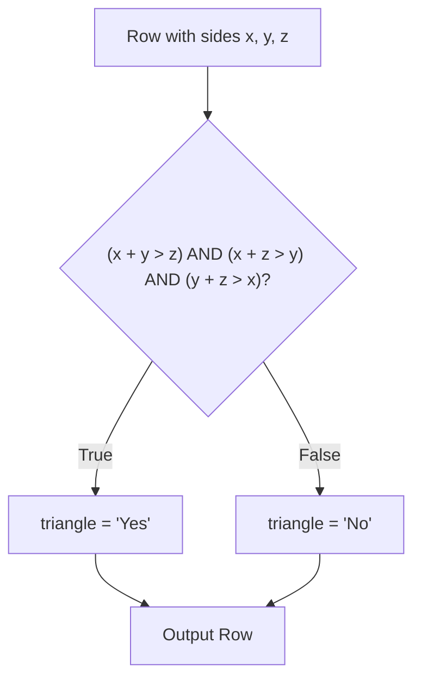

# 610. Triangle Judgement

## Problem Statement

Table: `Triangle`
```
+-------------+------+
| Column Name | Type |
+-------------+------+
| x           | int  |
| y           | int  |
| z           | int  |
+-------------+------+
In SQL, (x, y, z) is the primary key column for this table.
Each row of this table contains the lengths of three line segments x, y, and z.
```

Report for every three line segments whether they can form a triangle.

Return the result table in **any order**.

### Example 1:
```
Input: 
Triangle table:
+----+----+----+
| x  | y  | z  |
+----+----+----+
| 13 | 15 | 30 |
| 10 | 20 | 15 |
+----+----+----+
Output: 
+----+----+----+----------+
| x  | y  | z  | triangle |
+----+----+----+----------+
| 13 | 15 | 30 | No       |
| 10 | 20 | 15 | Yes      |
+----+----+----+----------+
Explanation: 
- 13 + 15 = 28 <= 30, so (13, 15, 30) cannot form a triangle.
- 10 + 20 > 15, 10 + 15 > 20, and 20 + 15 > 10, so (10, 20, 15) forms a valid triangle.
```

---

## Approach

1. **Triangle Inequality Theorem:**
   - Three line segments with lengths $x$, $y$, and $z$ can form a non-degenerate triangle if and only if the sum of lengths of any two segments is strictly greater than the third:
     $$x + y > z \quad\text{and}\quad x + z > y \quad\text{and}\quad y + z > x$$

2. **Conditional Evaluation in SQL:**
   - Use a standard `CASE` expression:
     - When all three conditions evaluate to true, label the row `'Yes'`.
     - Otherwise, label `'No'`.
   - This approach is portable and works across MySQL, PostgreSQL, SQL Server, and Oracle.



---

## Code Implementation

```sql
SELECT 
    x,
    y,
    z,
    CASE 
        WHEN x + y > z AND x + z > y AND y + z > x THEN 'Yes'
        ELSE 'No'
    END AS triangle
FROM Triangle;
```

---

## Complexity Analysis

- **Time Complexity**: $O(N)$ — where $N$ is the total number of rows in the `Triangle` table. Each row undergoes constant-time integer arithmetic and comparison checks.

- **Space Complexity**: $O(1)$ — No auxiliary data structures or joins are required; each row is streamed and evaluated in constant memory.

---
