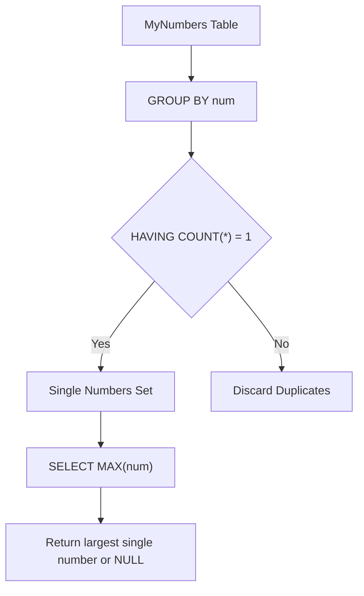

# 619. Biggest Single Number

## Problem Statement

Table: `MyNumbers`
```
+-------------+------+
| Column Name | Type |
+-------------+------+
| num         | int  |
+-------------+------+
This table may contain duplicates (it does not have a primary key).
Each row of this table contains an integer.
```

A **single number** is a number that appeared only once in the `MyNumbers` table.

Find the largest **single number**. If there is no single number, report `null`.

The result format is in the following example.

### Example 1:
```
Input: 
MyNumbers table:
+-----+
| num |
+-----+
| 8   |
| 8   |
| 3   |
| 3   |
| 1   |
| 4   |
| 5   |
| 6   |
+-----+
Output: 
+-----+
| num |
+-----+
| 6   |
+-----+
Explanation: 
The single numbers are 1, 4, 5, and 6.
Since 6 is the largest single number, we return it.
```

### Example 2:
```
Input: 
MyNumbers table:
+-----+
| num |
+-----+
| 8   |
| 8   |
| 7   |
| 7   |
| 3   |
| 3   |
| 3   |
+-----+
Output: 
+------+
| num  |
+------+
| null |
+------+
Explanation: There are no single numbers in the input table so we return null.
```

---

## Approach

1. **Identifying Single Numbers:**
   - Group the table by `num` using `GROUP BY num`.
   - Filter groups where the count is exactly 1 using `HAVING COUNT(*) = 1`.

2. **Selecting the Maximum and Handling NULL:**
   - Wrap the grouped single numbers in a subquery and apply the aggregate function `MAX(num)`.
   - In SQL, applying an aggregate function such as `MAX()` on an empty result set naturally returns `NULL`, cleanly fulfilling the requirement when no unique number exists without requiring special `COALESCE` or `IFNULL` logic.



---

## Code Implementation

```sql
SELECT 
    MAX(num) AS num
FROM (
    SELECT 
        num
    FROM MyNumbers
    GROUP BY num
    HAVING COUNT(*) = 1
) AS single_numbers;
```

---

## Complexity Analysis

- **Time Complexity**: $O(N \log N)$ or $O(N)$ — Scanning and grouping $N$ records in `MyNumbers` takes linear time using hash-based aggregation (or $O(N \log N)$ using sorting). Finding `MAX()` on the filtered unique numbers takes linear time with respect to the number of distinct values.

- **Space Complexity**: $O(U)$ — where $U$ is the number of distinct integers stored in intermediate aggregation memory.

---
