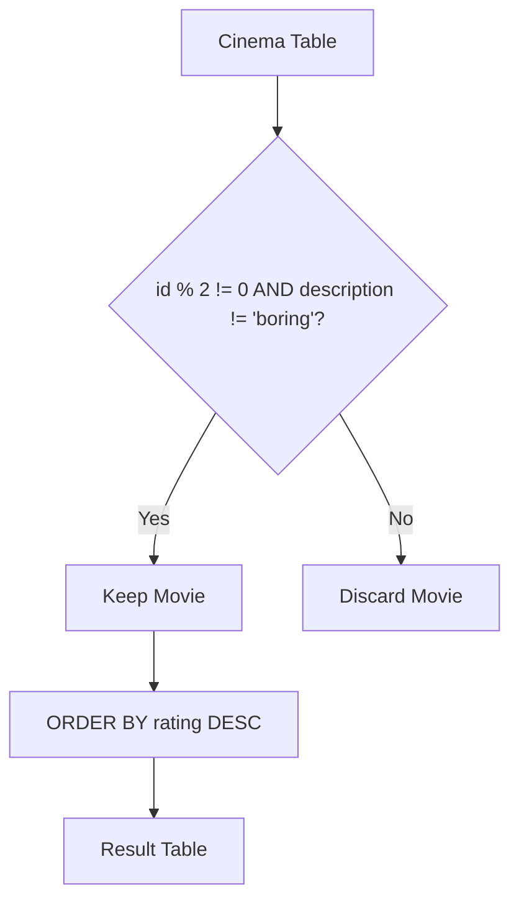

# 620. Not Boring Movies

## Problem Statement

Table: `Cinema`
```
+----------------+----------+
| Column Name    | Type     |
+----------------+----------+
| id             | int      |
| movie          | varchar  |
| description    | varchar  |
| rating         | float    |
+----------------+----------+
id is the primary key (column with unique values) for this table.
Each row contains information about the name of a movie, its genre/description, and its rating.
rating is a 2-decimal places float in the range [0, 10].
```

Write a solution to report the movies with an **odd-numbered ID** and a description that is **not `"boring"`**.

Return the result table ordered by `rating` in **descending order**.

The result format is in the following example.

### Example 1:
```
Input: 
Cinema table:
+----+------------+-------------+--------+
| id | movie      | description | rating |
+----+------------+-------------+--------+
| 1  | War        | great 3D    | 8.9    |
| 2  | Science    | fiction     | 8.5    |
| 3  | irish      | boring      | 6.2    |
| 4  | Ice song   | Fantacy     | 8.6    |
| 5  | House card | Interesting | 9.1    |
+----+------------+-------------+--------+
Output: 
+----+------------+-------------+--------+
| id | movie      | description | rating |
+----+------------+-------------+--------+
| 5  | House card | Interesting | 9.1    |
| 1  | War        | great 3D    | 8.9    |
+----+------------+-------------+--------+
Explanation: 
We have three movies with odd-numbered IDs: 1, 3, and 5. The movie with ID = 3 has a description of "boring", so we discard it.
The movie with ID = 5 has a rating of 9.1, and the movie with ID = 1 has a rating of 8.9.
We sort them in descending order by rating.
```

---

## Approach

1. **Filtering Conditions:**
   - Filter rows where the ID is odd using the modulo operator `id % 2 != 0` (or `MOD(id, 2) = 1`).
   - Filter rows where description is not boring: `description != 'boring'`.
   - Combine both conditions in the `WHERE` clause using `AND`.

2. **Sorting:**
   - Sort the output table in descending order of rating using `ORDER BY rating DESC`.



---

## Code Implementation

```sql
SELECT 
    id,
    movie,
    description,
    rating
FROM Cinema
WHERE id % 2 != 0 
  AND description != 'boring'
ORDER BY rating DESC;
```

---

## Complexity Analysis

- **Time Complexity**: $O(N \log N)$ — where $N$ is the number of rows in the `Cinema` table. Row filtering requires a linear scan $O(N)$, and sorting the qualifying movies by rating requires $O(K \log K)$ where $K \le N$.

- **Space Complexity**: $O(K)$ — where $K$ is the number of qualifying rows retained for sorting and returned in the result set.

---
