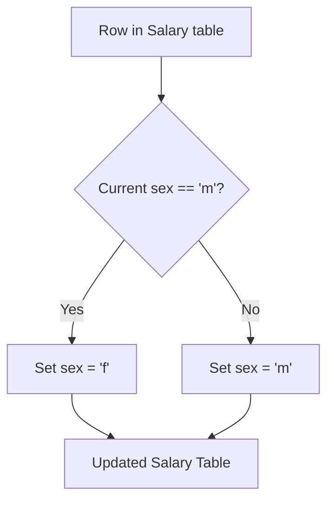

# 627. Swap Salary

## Problem Statement

Table: `Salary`
```
+-------------+----------+
| Column Name | Type     |
+-------------+----------+
| id          | int      |
| name        | varchar  |
| sex         | ENUM     |
| salary      | int      |
+-------------+----------+
id is the primary key (column with unique values) for this table.
The sex column is ENUM (category) value of type ('m', 'f').
The table contains information about an employee.
```

Write a single update statement to swap all `'f'` and `'m'` values (i.e., change all `'f'` values to `'m'` and vice versa) with **no intermediate temporary tables**.

Note that you must write a **single update statement**, do not write any select statement for this problem.

The result format is in the following example.

### Example 1:
```
Input: 
Salary table:
+----+------+-----+--------+
| id | name | sex | salary |
+----+------+-----+--------+
| 1  | A    | m   | 2500   |
| 2  | B    | f   | 1500   |
| 3  | C    | m   | 5500   |
| 4  | D    | f   | 500    |
+----+------+-----+--------+
Output: 
+----+------+-----+--------+
| id | name | sex | salary |
+----+------+-----+--------+
| 1  | A    | f   | 2500   |
| 2  | B    | m   | 1500   |
| 3  | C    | f   | 5500   |
| 4  | D    | m   | 500    |
+----+------+-----+--------+
Explanation: 
(1, A) and (3, C) were changed from 'm' to 'f'.
(2, B) and (4, D) were changed from 'f' to 'm'.
```

---

## Approach

1. **In-Place Conditional Update:**
   - The task strictly disallows intermediate tables or separate `SELECT` queries.
   - We execute an in-place `UPDATE` on the `Salary` table.
   - Using a conditional `CASE` expression (or MySQL's `IF()` function), we evaluate each row's `sex` value:
     - If `sex = 'm'`, update to `'f'`.
     - Otherwise (when `sex = 'f'`), update to `'m'`.



---

## Code Implementation

```sql
UPDATE Salary
SET sex = CASE 
    WHEN sex = 'm' THEN 'f'
    ELSE 'm'
END;
```

---

## Complexity Analysis

- **Time Complexity**: $O(N)$ — where $N$ is the total number of rows in the `Salary` table. Every row is scanned and updated in a single pass.

- **Space Complexity**: $O(1)$ — The update occurs entirely in-place with no temporary tables or auxiliary data structures allocated.

---
