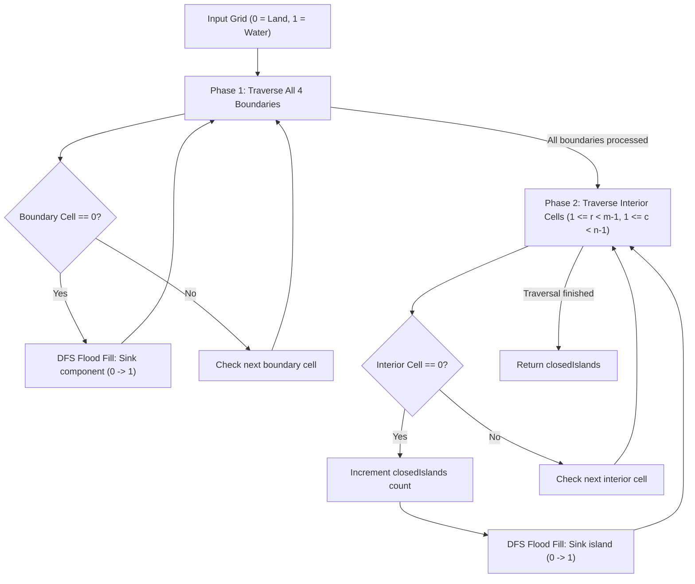

# 1254. Number of Closed Islands

## Problem Statement

Given a 2D `grid` consists of `0`s (land) and `1`s (water). An island is a maximal 4-directionally connected group of `0`s and a **closed island** is an island **totally** (all left, top, right, bottom) surrounded by `1`s.

Return the number of *closed islands*.

### Example 1:

```
Input: grid = [
  [1,1,1,1,1,1,1,0],
  [1,0,0,0,0,1,1,0],
  [1,0,1,0,1,1,1,0],
  [1,0,0,0,0,1,0,1],
  [1,1,1,1,1,1,1,0]
]
Output: 2
Explanation: 
Islands in the middle are closed because they are completely surrounded by water (1s).
The islands touching the right border are not closed because they touch the perimeter of the grid.
```

### Example 2:

```
Input: grid = [
  [0,0,1,0,0],
  [0,1,0,1,0],
  [0,1,1,1,0]
]
Output: 1
Explanation: 
Only the island at (1, 2) is totally surrounded by 1s. All other islands touch the borders.
```

### Example 3:

```
Input: grid = [
  [1,1,1,1,1,1,1],
  [1,0,0,0,0,0,1],
  [1,0,1,1,1,0,1],
  [1,0,1,0,1,0,1],
  [1,0,1,1,1,0,1],
  [1,0,0,0,0,0,1],
  [1,1,1,1,1,1,1]
]
Output: 2
```

### Constraints:
- $1 \le \text{grid.length}, \text{grid}[0].\text{length} \le 100$
- $0 \le \text{grid}[i][j] \le 1$

---

## Approach

### 1. The Perimeter Invariant
- `0` represents land and `1` represents water.
- A connected land component (`0`s) is **closed** if and only if **none** of its constituent cells touch the border of the grid ($r = 0$, $r = m - 1$, $c = 0$, or $c = n - 1$).
- Any land cell touching a perimeter cannot be enclosed by water on all four sides.

### 2. Two-Phase Flood Fill (DFS)
Instead of tracking complicated flags for each component, we can solve this in two clear phases:

1. **Phase 1 — Eliminate Open/Boundary-Connected Islands:**
   - Iterate over all cells along the 4 borders (first/last row and first/last column).
   - Whenever `grid[r][c] == 0` is found, initiate a DFS flood fill to "sink" (change `0` to `1`) the entire component connected to the boundary.
   - After this step, all remaining land cells in the grid belong to strictly interior, enclosed components.

2. **Phase 2 — Count Closed Islands:**
   - Iterate through the inner cells of the grid ($1 \le r < m - 1$ and $1 \le c < n - 1$).
   - Whenever an unvisited land cell (`grid[r][c] == 0`) is encountered:
     - Increment `closedIslands` by 1.
     - Run DFS flood fill starting at $(r, c)$ to sink the entire closed island (marking all its connected cells as `1`).



---

## Code Implementation

### C++

```cpp
class Solution {
private:
    int m, n;
    const int dr[4] = {-1, 1, 0, 0};
    const int dc[4] = {0, 0, -1, 1};

    void dfs(vector<vector<int>>& grid, int r, int c) {
        if (r < 0 || r >= m || c < 0 || c >= n || grid[r][c] != 0) {
            return;
        }
        // Mark cell as visited / water
        grid[r][c] = 1;

        for (int i = 0; i < 4; ++i) {
            dfs(grid, r + dr[i], c + dc[i]);
        }
    }

public:
    int closedIsland(vector<vector<int>>& grid) {
        m = grid.size();
        n = grid[0].size();

        // Phase 1: Sink all land connected to boundaries
        for (int r = 0; r < m; ++r) {
            if (grid[r][0] == 0) dfs(grid, r, 0);
            if (grid[r][n - 1] == 0) dfs(grid, r, n - 1);
        }
        for (int c = 0; c < n; ++c) {
            if (grid[0][c] == 0) dfs(grid, 0, c);
            if (grid[m - 1][c] == 0) dfs(grid, m - 1, c);
        }

        // Phase 2: Count and sink all remaining strictly interior closed islands
        int closedIslands = 0;
        for (int r = 1; r < m - 1; ++r) {
            for (int c = 1; c < n - 1; ++c) {
                if (grid[r][c] == 0) {
                    closedIslands++;
                    dfs(grid, r, c);
                }
            }
        }

        return closedIslands;
    }
};
```

### Python3

```python
class Solution:
    def closedIsland(self, grid: list[list[int]]) -> int:
        m, n = len(grid), len(grid[0])

        def dfs(r: int, c: int) -> None:
            if r < 0 or r >= m or c < 0 or c >= n or grid[r][c] != 0:
                return
            grid[r][c] = 1
            dfs(r + 1, c)
            dfs(r - 1, c)
            dfs(r, c + 1)
            dfs(r, c - 1)

        # Phase 1: Sink boundary-connected land
        for r in range(m):
            if grid[r][0] == 0:
                dfs(r, 0)
            if grid[r][n - 1] == 0:
                dfs(r, n - 1)

        for c in range(n):
            if grid[0][c] == 0:
                dfs(0, c)
            if grid[m - 1][c] == 0:
                dfs(m - 1, c)

        # Phase 2: Count remaining closed islands
        closed_islands = 0
        for r in range(1, m - 1):
            for c in range(1, n - 1):
                if grid[r][c] == 0:
                    closed_islands += 1
                    dfs(r, c)

        return closed_islands
```

---

## Complexity Analysis

- **Time Complexity**: $O(m \cdot n)$ — Every cell in the grid is visited and converted from `0` to `1` at most once across both phases.
- **Space Complexity**: $O(m \cdot n)$ — Recursion call stack in the worst case (for example, a snake/spiral land path covering the entire grid). In-place mutation of the grid avoids additional $O(m \cdot n)$ visited arrays.

---
