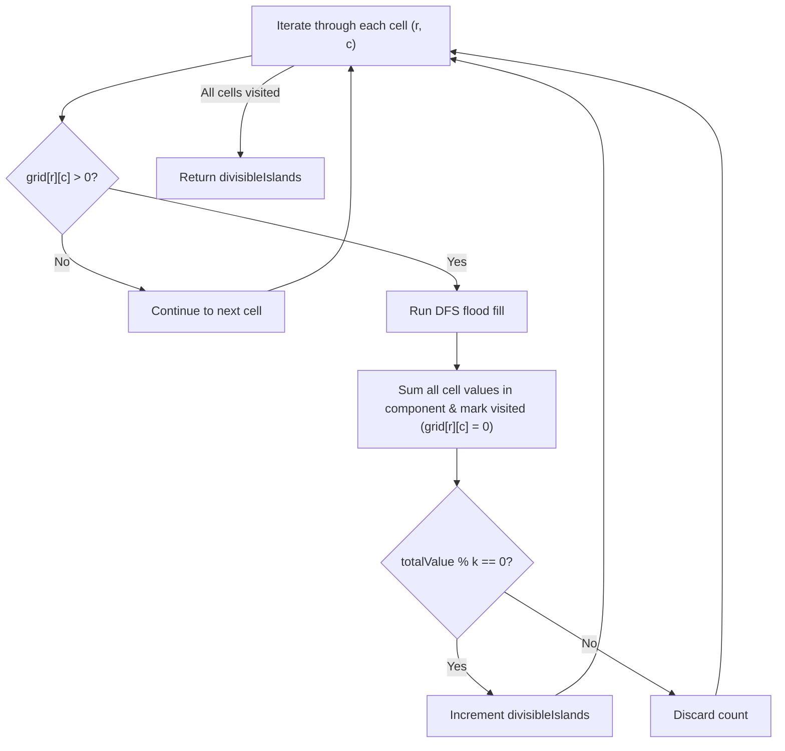

# 3619. Count Islands With Total Value Divisible by K

## Problem Statement

You are given an $m \times n$ matrix `grid` and a positive integer `k`.

An **island** is defined as a group of positive integers (representing land) that are 4-directionally connected (horizontally or vertically). Cells with a value of `0` represent water.

The **total value** of an island is the sum of the values of all cells belonging to that island.

Return the **number of islands** whose total value is **divisible by `k`**.

### Example 1:

```
Input: grid = [
  [1, 2, 0],
  [0, 3, 0],
  [0, 0, 4]
], k = 3
Output: 1
Explanation:
- Island 1: cells (0,0), (0,1), and (1,1) with values 1 + 2 + 3 = 6. 6 is divisible by 3 (6 % 3 == 0).
- Island 2: cell (2,2) with value 4. 4 is not divisible by 3 (4 % 3 != 0).
Only 1 island has a total value divisible by 3.
```

### Example 2:

```
Input: grid = [
  [0, 2, 1],
  [0, 0, 3],
  [5, 0, 0]
], k = 5
Output: 1
Explanation:
- Island 1: cells (0,1), (0,2), and (1,2) with values 2 + 1 + 3 = 6 (not divisible by 5).
- Island 2: cell (2,0) with value 5. 5 is divisible by 5 (5 % 5 == 0).
Only 1 island satisfies the condition.
```

### Example 3:

```
Input: grid = [
  [4, 0, 8],
  [0, 0, 0],
  [2, 2, 0]
], k = 4
Output: 3
Explanation:
- Island 1 at (0,0): value = 4 (4 % 4 == 0).
- Island 2 at (0,2): value = 8 (8 % 4 == 0).
- Island 3 at (2,0) and (2,1): value = 2 + 2 = 4 (4 % 4 == 0).
All 3 islands are divisible by 4.
```

### Constraints:
- $m == \text{grid.length}$
- $n == \text{grid}[i].\text{length}$
- $1 \le m, n \le 1000$
- $1 \le m \times n \le 10^5$
- $0 \le \text{grid}[i][j] \le 10^6$
- $1 \le k \le 10^9$

---

## Approach

1. **Connected Components Traversal (DFS / Flood Fill):**
   - Each island represents a connected component in an undirected grid graph where adjacent cells $(r, c)$ with $\text{grid}[r][c] > 0$ share an edge.
   - Cells with $\text{grid}[r][c] == 0$ represent water and cannot be traversed.

2. **Accumulating Island Value:**
   - When iterating over the grid, whenever a cell with $\text{grid}[r][c] > 0$ is found, we initiate a Depth-First Search (DFS) or Breadth-First Search (BFS).
   - In DFS, collect the cell's value into a 64-bit accumulator (`long long`) to prevent arithmetic overflow:
     $$\text{islandSum} = \text{grid}[r][c] + \sum_{(nr, nc) \in \text{neighbors}} \text{dfs}(nr, nc)$$
   - Mark visited cells by sinking them ($\text{grid}[r][c] = 0$) to ensure each cell is processed exactly once.

3. **Divisibility Check:**
   - Once traversal for the connected component finishes, check if:
     $$\text{islandSum} \pmod k == 0$$
   - If true, increment `divisibleIslands` count.



---

## Code Implementation

### C++

```cpp
class Solution {
private:
    int m, n;
    const int dr[4] = {-1, 1, 0, 0};
    const int dc[4] = {0, 0, -1, 1};

    long long dfs(vector<vector<int>>& grid, int r, int c) {
        if (r < 0 || r >= m || c < 0 || c >= n || grid[r][c] == 0) {
            return 0LL;
        }

        long long total = grid[r][c];
        grid[r][c] = 0; // Mark cell as visited / water

        for (int i = 0; i < 4; ++i) {
            total += dfs(grid, r + dr[i], c + dc[i]);
        }

        return total;
    }

public:
    int countIslands(vector<vector<int>>& grid, int k) {
        m = grid.size();
        n = grid[0].size();
        int divisibleIslands = 0;

        for (int i = 0; i < m; ++i) {
            for (int j = 0; j < n; ++j) {
                if (grid[i][j] > 0) {
                    long long islandValue = dfs(grid, i, j);
                    if (islandValue % k == 0) {
                        divisibleIslands++;
                    }
                }
            }
        }

        return divisibleIslands;
    }
};
```

### Python3

```python
class Solution:
    def countIslands(self, grid: list[list[int]], k: int) -> int:
        m, n = len(grid), len(grid[0])
        divisible_islands = 0

        def dfs(r: int, c: int) -> int:
            if r < 0 or r >= m or c < 0 or c >= n or grid[r][c] == 0:
                return 0
            
            total = grid[r][c]
            grid[r][c] = 0  # Mark visited
            
            total += dfs(r + 1, c)
            total += dfs(r - 1, c)
            total += dfs(r, c + 1)
            total += dfs(r, c - 1)
            
            return total

        for i in range(m):
            for j in range(n):
                if grid[i][j] > 0:
                    island_sum = dfs(i, j)
                    if island_sum % k == 0:
                        divisible_islands += 1

        return divisible_islands
```

---

## Complexity Analysis

- **Time Complexity**: $O(m \cdot n)$ — Each cell in the $m \times n$ grid is examined at most twice (once in the nested loop and at most once during DFS exploration).
- **Space Complexity**: $O(m \cdot n)$ — In the worst case (e.g. an island filling the entire grid), the recursive call stack uses up to $O(m \cdot n)$ memory. In-place modification of `grid` avoids allocating an additional visited matrix.

---
