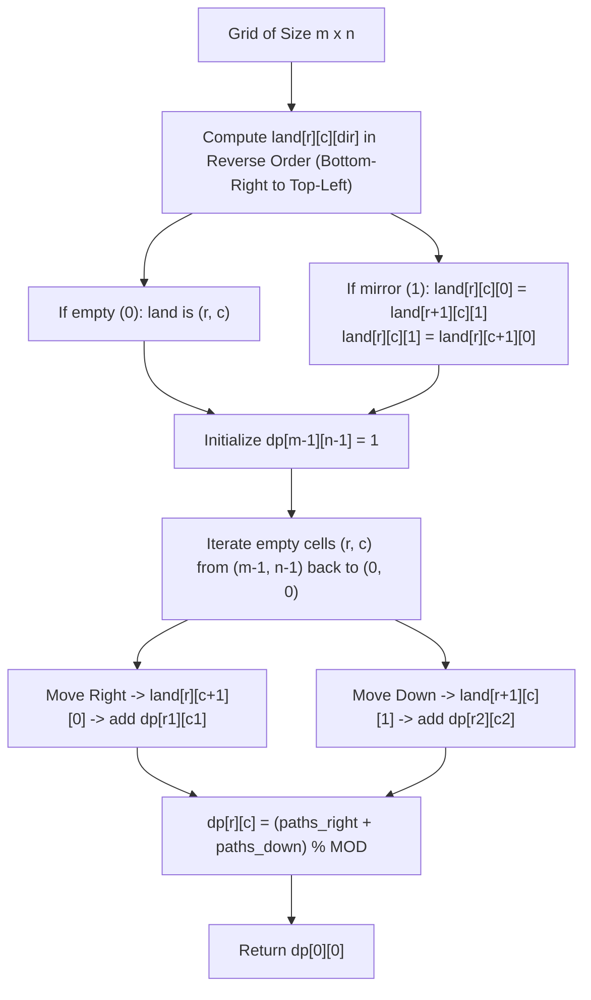

# 3665. Twisted Mirror Path Count

## Problem Statement

You are given an $m \times n$ binary grid `grid`, where:
- `grid[i][j] == 0` represents an empty cell.
- `grid[i][j] == 1` represents a mirror.

A robot starts at the top-left corner `(0, 0)` and wants to reach the bottom-right corner `(m - 1, n - 1)`.

From an empty cell, the robot can normally move **right** or **down**. However, if the robot attempts to move into a mirror cell (`1`), it is reflected before entering that cell:
- Trying to move **right** into a mirror cell reflects the robot **down** into the cell directly below the mirror.
- Trying to move **down** into a mirror cell reflects the robot **right** into the cell directly to the right of the mirror.

If a reflection pushes the robot outside the grid boundaries, that path becomes invalid and is discarded. If a reflection lands on another mirror cell, the reflection cascades repeatedly based on the direction used to enter that subsequent mirror, continuing until the robot lands on an empty cell, reaches the destination, or goes out of bounds.

Return the total number of unique valid paths from `(0, 0)` to `(m - 1, n - 1)` modulo $10^9 + 7$.

### Example 1:

```
Input: grid = [[0,1,0],[0,0,1],[1,0,0]]
Output: 5
Explanation:
There are 5 unique valid paths from (0, 0) to (2, 2):
1. (0, 0) -> (0, 1) [M] -> (1, 1) -> (1, 2) [M] -> (2, 2)
2. (0, 0) -> (0, 1) [M] -> (1, 1) -> (2, 1) -> (2, 2)
3. (0, 0) -> (1, 0) [M] -> (1, 1) -> (1, 2) [M] -> (2, 2)
4. (0, 0) -> (1, 0) [M] -> (1, 1) -> (2, 1) -> (2, 2)
5. (0, 0) -> (1, 0) -> (2, 0) [M] ... (5 valid paths in total)
```

### Example 2:

```
Input: grid = [[0,0],[0,0]]
Output: 2
Explanation:
With no mirrors, the robot has standard choices:
1. (0, 0) -> (0, 1) -> (1, 1)
2. (0, 0) -> (1, 0) -> (1, 1)
Total valid paths = 2.
```

### Example 3:

```
Input: grid = [[0,1,1],[1,1,0]]
Output: 1
Explanation:
- Moving right from (0, 0) hits (0, 1) [M], deflecting down to (1, 1) [M], deflecting right to (1, 2) [Empty / Destination]. Valid path.
- Moving down from (0, 0) hits (1, 0) [M], deflecting right to (1, 1) [M], deflecting down to (2, 1) [Out of bounds]. Invalid path.
Only 1 valid path exists.
```

### Constraints:

- $m == \text{grid.length}$
- $n == \text{grid}[i]\text{.length}$
- $2 \le m, n \le 500$
- $\text{grid}[i][j]$ is either `0` or `1`.
- $\text{grid}[0][0] == \text{grid}[m - 1][n - 1] == 0$.

---

## Approach

### 1. Directional Deflection Invariant
When attempting to enter a mirror cell $(r, c)$:
- Entering while moving **Right** ($\text{dir} = 0$) deflects the robot to $(r + 1, c)$ moving **Down** ($\text{dir} = 1$).
- Entering while moving **Down** ($\text{dir} = 1$) deflects the robot to $(r, c + 1)$ moving **Right** ($\text{dir} = 0$).

Notice an essential property: in every deflection, either the row coordinate $r$ increases by 1 or the column coordinate $c$ increases by 1. Consequently, the Manhattan coordinate sum $r + c$ **strictly increases** at every step. This guarantees that mirror reflections are strictly acyclic (a Directed Acyclic Graph / DAG) and must always terminate either at an empty cell, at the destination, or out of bounds.

### 2. Precomputing Reflection Cascades
Because cascading reflections depend only on downstream cells with larger $r + c$, we can precompute the eventual landing position for entering cell $(r, c)$ with direction $\text{dir} \in \{0, 1\}$ using dynamic programming in reverse order (from bottom-right to top-left):

Let $\text{land}[r][c][\text{dir}]$ denote the eventual empty cell $(r', c')$ reached:
- If $\text{grid}[r][c] == 0$: the cell is empty, so $\text{land}[r][c][\text{dir}] = (r, c)$.
- If $\text{grid}[r][c] == 1$:
  - Moving Right into mirror ($\text{dir} = 0$): $\text{land}[r][c][0] = \text{land}[r + 1][c][1]$ (if $r + 1 < m$, else $\text{None}$).
  - Moving Down into mirror ($\text{dir} = 1$): $\text{land}[r][c][1] = \text{land}[r][c + 1][0]$ (if $c + 1 < n$, else $\text{None}$).

### 3. Path Counting via Backward DP
Let $\text{dp}[r][c]$ be the number of valid paths from empty cell $(r, c)$ to the destination $(m - 1, n - 1)$:
- **Base Case:**
  $$\text{dp}[m - 1][n - 1] = 1$$
- **Transitions (for empty cells $(r, c) \neq (m - 1, n - 1)$):**
  From $(r, c)$, the robot can make two decisions:
  1. Move Right: enters $(r, c + 1)$ with $\text{dir} = 0$, landing at $(r_1, c_1) = \text{land}[r][c + 1][0]$. If valid, contributes $\text{dp}[r_1][c_1]$.
  2. Move Down: enters $(r + 1, c)$ with $\text{dir} = 1$, landing at $(r_2, c_2) = \text{land}[r + 1][c][1]$. If valid, contributes $\text{dp}[r_2][c_2]$.
  $$\text{dp}[r][c] = (\text{dp}[r_1][c_1] + \text{dp}[r_2][c_2]) \pmod{10^9 + 7}$$



---

## Code Implementation

### C++

```cpp
#include <vector>

using namespace std;

class Solution {
public:
    int uniquePaths(vector<vector<int>>& grid) {
        int m = grid.size();
        int n = grid[0].size();
        const int MOD = 1e9 + 7;

        // land[r][c][dir] stores encoded position: r * n + c, or -1 if out of bounds
        // dir 0: moving right, dir 1: moving down
        vector<vector<vector<int>>> land(m, vector<vector<int>>(n, vector<int>(2, -1)));

        // Precompute landing cells in reverse order
        for (int r = m - 1; r >= 0; --r) {
            for (int c = n - 1; c >= 0; --c) {
                if (grid[r][c] == 0) {
                    int pos = r * n + c;
                    land[r][c][0] = pos;
                    land[r][c][1] = pos;
                } else {
                    // Moving right into mirror deflects down to (r + 1, c) moving down (dir 1)
                    if (r + 1 < m) {
                        land[r][c][0] = land[r + 1][c][1];
                    }
                    // Moving down into mirror deflects right to (r, c + 1) moving right (dir 0)
                    if (c + 1 < n) {
                        land[r][c][1] = land[r][c + 1][0];
                    }
                }
            }
        }

        vector<vector<int>> dp(m, vector<int>(n, 0));
        dp[m - 1][n - 1] = 1;

        // Backward DP to accumulate path counts
        for (int r = m - 1; r >= 0; --r) {
            for (int c = n - 1; c >= 0; --c) {
                if (grid[r][c] == 1 || (r == m - 1 && c == n - 1)) {
                    continue;
                }

                long long total = 0;

                // Choice 1: move right into (r, c + 1)
                if (c + 1 < n && land[r][c + 1][0] != -1) {
                    int dest = land[r][c + 1][0];
                    total += dp[dest / n][dest % n];
                }

                // Choice 2: move down into (r + 1, c)
                if (r + 1 < m && land[r + 1][c][1] != -1) {
                    int dest = land[r + 1][c][1];
                    total += dp[dest / n][dest % n];
                }

                dp[r][c] = static_cast<int>(total % MOD);
            }
        }

        return dp[0][0];
    }
};
```

### Python3

```python
class Solution:
    def uniquePaths(self, grid: list[list[int]]) -> int:
        MOD = 10**9 + 7
        m = len(grid)
        n = len(grid[0])

        # land[r][c][dir]: dir 0 = moving right, dir 1 = moving down
        land = [[[None, None] for _ in range(n)] for _ in range(m)]

        # Precompute landing cells in reverse topological order
        for r in range(m - 1, -1, -1):
            for c in range(n - 1, -1, -1):
                if grid[r][c] == 0:
                    land[r][c][0] = (r, c)
                    land[r][c][1] = (r, c)
                else:
                    # Moving right into mirror deflects down to (r + 1, c) moving down (dir 1)
                    if r + 1 < m:
                        land[r][c][0] = land[r + 1][c][1]
                    # Moving down into mirror deflects right to (r, c + 1) moving right (dir 0)
                    if c + 1 < n:
                        land[r][c][1] = land[r][c + 1][0]

        dp = [[0] * n for _ in range(m)]
        dp[m - 1][n - 1] = 1

        # Backward DP
        for r in range(m - 1, -1, -1):
            for c in range(n - 1, -1, -1):
                if grid[r][c] == 1 or (r == m - 1 and c == n - 1):
                    continue

                total = 0

                # Choice 1: move right into (r, c + 1)
                if c + 1 < n and land[r][c + 1][0] is not None:
                    nr, nc = land[r][c + 1][0]
                    total += dp[nr][nc]

                # Choice 2: move down into (r + 1, c)
                if r + 1 < m and land[r + 1][c][1] is not None:
                    nr, nc = land[r + 1][c][1]
                    total += dp[nr][nc]

                dp[r][c] = total % MOD

        return dp[0][0]
```

---

## Complexity Analysis

- **Time Complexity**: $O(m \cdot n)$ — Initializing and populating the `land` array requires visiting each of the $m \times n$ cells once in $O(1)$ per cell. The backward DP table also visits each cell once with $O(1)$ transitions. Total time is linear with respect to the grid area, executing in well under $50\text{ ms}$ for $m, n \le 500$.

- **Space Complexity**: $O(m \cdot n)$ — Required to store the `land` table ($m \times n \times 2$) and the `dp` table ($m \times n$).

---
