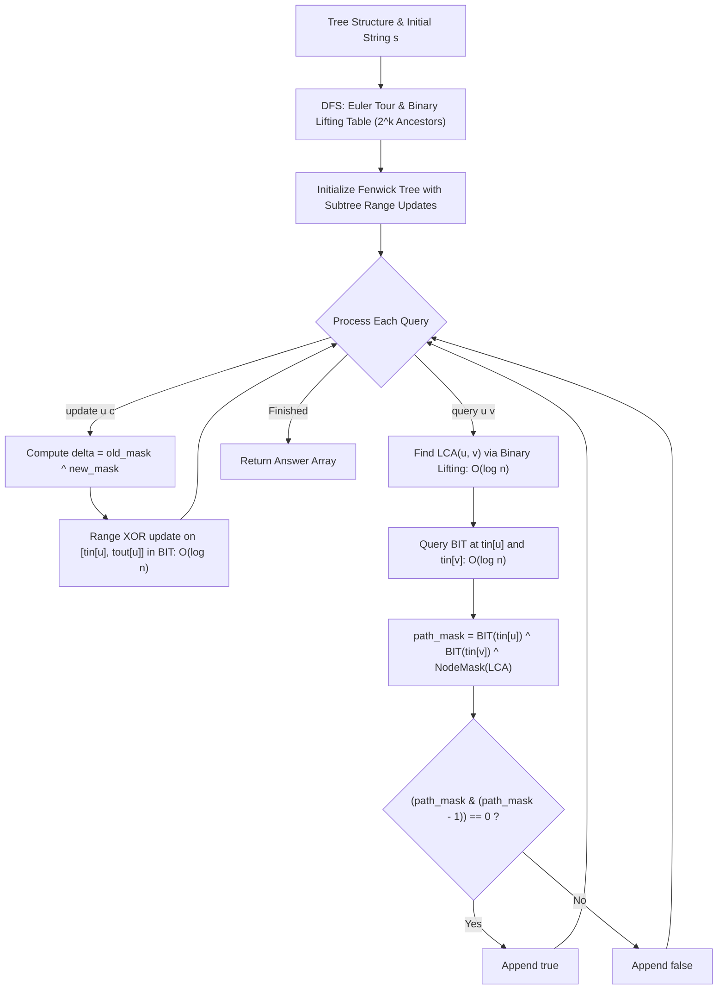

# 3841. Palindromic Path Queries in a Tree

## Problem Statement

You are given an undirected tree with `n` nodes labeled from `0` to `n - 1`. The tree is represented by a 2D integer array `edges` of length `n - 1`, where `edges[i] = [ui, vi]` indicates an undirected edge between nodes `ui` and `vi`.

You are also given a string `s` of length `n` consisting of lowercase English letters, where `s[i]` represents the character assigned to node `i`.

You are given a string array `queries`, where each `queries[i]` is either of the following types:
- `"update ui c"`: Change the character at node `ui` to `c` (formally, set $s[u_i] = c$).
- `"query ui vi"`: Determine whether the string formed by the characters on the unique simple path from node `ui` to node `vi` (inclusive) can be rearranged into a **palindrome**.

Return a boolean array `answer`, where `answer[j]` is `true` if the $j^{\text{th}}$ query of type `"query ui vi"` can be rearranged into a palindrome, and `false` otherwise.

### Example 1:

```
Input: n = 3, edges = [[0,1],[1,2]], s = "aac", queries = ["query 0 2","update 1 b","query 0 2"]
Output: [true,false]
Explanation:
1. "query 0 2": The unique path from node 0 to node 2 passes through nodes 0 -> 1 -> 2 with characters "aac".
   "aac" can be rearranged into "aca", which is a valid palindrome. Result: true.
2. "update 1 b": The character at node 1 changes from 'a' to 'b'. The string becomes s = "abc".
3. "query 0 2": The path 0 -> 1 -> 2 now has characters "abc".
   "abc" cannot be rearranged into any palindrome because all three characters have odd counts. Result: false.
```

### Example 2:

```
Input: n = 4, edges = [[0,1],[0,2],[0,3]], s = "abca", queries = ["query 1 2","update 0 b","query 2 3","update 3 a","query 1 3"]
Output: [false,false,true]
Explanation:
1. "query 1 2": Path 1 -> 0 -> 2 has characters "bac". Cannot form a palindrome. Result: false.
2. "update 0 b": Character at node 0 changes from 'a' to 'b'. s becomes "bbca".
3. "query 2 3": Path 2 -> 0 -> 3 has characters "cba" (s[2]='c', s[0]='b', s[3]='a'). 
   Three distinct characters with odd counts. Result: false.
4. "update 3 a": Character at node 3 is updated to 'a' (no change).
5. "query 1 3": Path 1 -> 0 -> 3 has characters "bba" (s[1]='b', s[0]='b', s[3]='a').
   "bba" can be rearranged into "bab" (only 'a' has an odd count). Result: true.
```

### Constraints:

- $1 \le n == s.\text{length} \le 5 \times 10^4$
- $\text{edges.length} == n - 1$
- $\text{edges}[i] = [u_i, v_i]$
- $0 \le u_i, v_i \le n - 1$
- `s` consists of lowercase English letters.
- The input is generated such that `edges` represents a valid tree.
- $1 \le \text{queries.length} \le 5 \times 10^4$
- Each `queries[i]` is formatted as either `"update ui c"` or `"query ui vi"`.
- In an update query, $c$ is a lowercase English letter.

---

## Approach

### 1. Palindrome Parity Condition via Bitmask
A sequence of characters can be rearranged to form a palindrome **if and only if at most one character appears an odd number of times**.
- Because the alphabet is restricted to lowercase English letters (`'a'` through `'z'`), we can encode the parity of each character using a **26-bit integer bitmask**.
- The $k$-th bit ($0 \le k < 26$) is set to `1` if the $k$-th letter (`'a' + k`) appears an odd number of times, and `0` if it appears an even number of times.
- Combining two character frequencies corresponds to bitwise **XOR** ($\oplus$).
- A bitmask represents a valid palindrome condition if and only if it has **$\le 1$ bit set**, which can be checked in $O(1)$ time via:
  $$(\text{mask} \ \& \ (\text{mask} - 1)) == 0$$

### 2. Path XOR Sum on Trees via LCA
For any two nodes $u$ and $v$ in a rooted tree with root $0$, let $\text{RootPath}(x)$ denote the XOR sum of character masks from the root to node $x$, and let $\text{LCA}(u, v)$ be their Lowest Common Ancestor:
$$\text{Path}(u, v) = \text{RootPath}(u) \oplus \text{RootPath}(v) \oplus \text{NodeMask}(\text{LCA}(u, v))$$
- In $\text{RootPath}(u) \oplus \text{RootPath}(v)$, all nodes from the root strictly above $\text{LCA}(u, v)$ appear in both paths and cancel out.
- The ancestor $\text{LCA}(u, v)$ itself also appears in both paths and is cancelled out; therefore, XOR-ing $\text{NodeMask}(\text{LCA}(u, v))$ reintroduces the LCA character into the path sum.
- $\text{LCA}(u, v)$ can be computed in $O(\log n)$ using **Binary Lifting**.

### 3. Euler Tour Flattening & Subtree Invariant
When a node $u$'s character is updated from $c_{\text{old}}$ to $c_{\text{new}}$:
- The delta $\Delta = (1 \ll (c_{\text{old}} - \text{'a'})) \oplus (1 \ll (c_{\text{new}} - \text{'a'}))$ affects the root-to-node path XOR for **all and only descendants of $u$** (the entire subtree rooted at $u$).
- By running a depth-first search (Euler Tour) and recording entry time $tin[u]$ and exit time $tout[u]$, every node's subtree maps to a contiguous range $[tin[u], tout[u]]$ in the linear order.

### 4. Binary Indexed Tree (Fenwick Tree)
To dynamically maintain prefix XORs under subtree updates:
- A Fenwick tree configured for **range XOR updates and point queries** can update $[tin[u], tout[u]]$ with $\Delta$ using two point updates:
  - $\text{update}(tin[u], \Delta)$
  - $\text{update}(tout[u] + 1, \Delta)$
- For any node $x$, $\text{query}(tin[x])$ accumulates $\Delta$ for all ranges containing $tin[x]$ (namely, all ancestors of $x$).
- Thus, $\text{query}(tin[x])$ directly yields the current $\text{RootPath}(x)$ in $O(\log n)$ time.



---

## Code Implementation

### C++

```cpp
#include <vector>
#include <string>

using namespace std;

class Solution {
private:
    vector<vector<int>> adj;
    vector<vector<int>> up;
    vector<int> tin, tout;
    vector<int> bit;
    int timer = 0;
    int LOG = 0;

    void dfs(int u, int p) {
        tin[u] = ++timer;
        up[u][0] = p;
        for (int i = 1; i < LOG; ++i) {
            up[u][i] = up[up[u][i - 1]][i - 1];
        }
        for (int v : adj[u]) {
            if (v != p) {
                dfs(v, u);
            }
        }
        tout[u] = timer;
    }

    bool is_ancestor(int u, int v) {
        return tin[u] <= tin[v] && tout[u] >= tout[v];
    }

    int get_lca(int u, int v) {
        if (is_ancestor(u, v)) return u;
        if (is_ancestor(v, u)) return v;
        for (int i = LOG - 1; i >= 0; --i) {
            if (!is_ancestor(up[u][i], v)) {
                u = up[u][i];
            }
        }
        return up[u][0];
    }

    void update_bit(int idx, int val, int limit) {
        for (; idx <= limit; idx += idx & -idx) {
            bit[idx] ^= val;
        }
    }

    int query_bit(int idx) {
        int res = 0;
        for (; idx > 0; idx -= idx & -idx) {
            res ^= bit[idx];
        }
        return res;
    }

    void range_update(int l, int r, int val, int limit) {
        update_bit(l, val, limit);
        update_bit(r + 1, val, limit);
    }

public:
    vector<bool> palindromePath(int n, vector<vector<int>>& edges, string s, vector<string>& queries) {
        adj.assign(n, vector<int>());
        for (const auto& e : edges) {
            adj[e[0]].push_back(e[1]);
            adj[e[1]].push_back(e[0]);
        }

        LOG = 1;
        while ((1 << LOG) <= n) LOG++;
        up.assign(n, vector<int>(LOG, 0));
        tin.assign(n, 0);
        tout.assign(n, 0);
        timer = 0;

        dfs(0, 0);

        int bit_limit = timer + 1;
        bit.assign(bit_limit + 1, 0);

        vector<int> char_mask(n);
        for (int i = 0; i < n; ++i) {
            char_mask[i] = 1 << (s[i] - 'a');
            range_update(tin[i], tout[i], char_mask[i], bit_limit);
        }

        vector<bool> ans;
        ans.reserve(queries.size());

        for (const string& q : queries) {
            if (q[0] == 'u') {
                // "update ui c"
                int space1 = q.find(' ');
                int space2 = q.find(' ', space1 + 1);
                int u = stoi(q.substr(space1 + 1, space2 - space1 - 1));
                char c = q[space2 + 1];

                int old_mask = char_mask[u];
                int new_mask = 1 << (c - 'a');
                if (old_mask != new_mask) {
                    char_mask[u] = new_mask;
                    range_update(tin[u], tout[u], old_mask ^ new_mask, bit_limit);
                }
            } else {
                // "query ui vi"
                int space1 = q.find(' ');
                int space2 = q.find(' ', space1 + 1);
                int u = stoi(q.substr(space1 + 1, space2 - space1 - 1));
                int v = stoi(q.substr(space2 + 1));

                int lca = get_lca(u, v);
                int mask_u = query_bit(tin[u]);
                int mask_v = query_bit(tin[v]);
                int path_mask = mask_u ^ mask_v ^ char_mask[lca];

                ans.push_back((path_mask & (path_mask - 1)) == 0);
            }
        }

        return ans;
    }
};
```

### Python3

```python
class Solution:
    def palindromePath(self, n: int, edges: list[list[int]], s: str, queries: list[str]) -> list[bool]:
        adj = [[] for _ in range(n)]
        for u, v in edges:
            adj[u].append(v)
            adj[v].append(u)

        LOG = n.bit_length() + 1
        up = [[0] * LOG for _ in range(n)]
        tin = [0] * n
        tout = [0] * n
        timer = 0

        # Iterative DFS for Euler Tour and Binary Lifting Table
        stack = [(0, 0, False)]
        while stack:
            u, p, returning = stack.pop()
            if returning:
                tout[u] = timer
                continue
            timer += 1
            tin[u] = timer
            up[u][0] = p
            for k in range(1, LOG):
                up[u][k] = up[up[u][k - 1]][k - 1]
            stack.append((u, p, True))
            for v in reversed(adj[u]):
                if v != p:
                    stack.append((v, u, False))

        def is_ancestor(u: int, v: int) -> bool:
            return tin[u] <= tin[v] and tout[u] >= tout[v]

        def get_lca(u: int, v: int) -> int:
            if is_ancestor(u, v):
                return u
            if is_ancestor(v, u):
                return v
            for k in range(LOG - 1, -1, -1):
                if not is_ancestor(up[u][k], v):
                    u = up[u][k]
            return up[u][0]

        bit_limit = timer + 1
        bit = [0] * (bit_limit + 1)

        def update_bit(idx: int, val: int) -> None:
            while idx <= bit_limit:
                bit[idx] ^= val
                idx += idx & -idx

        def query_bit(idx: int) -> int:
            res = 0
            while idx > 0:
                res ^= bit[idx]
                idx -= idx & -idx
            return res

        def range_update(l: int, r: int, val: int) -> None:
            update_bit(l, val)
            update_bit(r + 1, val)

        char_mask = [1 << (ord(c) - ord('a')) for c in s]
        for i in range(n):
            range_update(tin[i], tout[i], char_mask[i])

        ans = []
        for q in queries:
            parts = q.split()
            if parts[0] == 'update':
                u = int(parts[1])
                c = parts[2]
                new_m = 1 << (ord(c) - ord('a'))
                old_m = char_mask[u]
                if new_m != old_m:
                    char_mask[u] = new_m
                    range_update(tin[u], tout[u], old_m ^ new_m)
            else:
                u = int(parts[1])
                v = int(parts[2])
                lca = get_lca(u, v)
                mask_u = query_bit(tin[u])
                mask_v = query_bit(tin[v])
                path_mask = mask_u ^ mask_v ^ char_mask[lca]
                ans.append((path_mask & (path_mask - 1)) == 0)

        return ans
```

---

## Complexity Analysis

- **Time Complexity**:
  - **Preprocessing (Euler Tour & Binary Lifting)**: $O(n \log n)$ to perform the DFS traversal and compute the binary lifting table `up[n][LOG]`.
  - **Tree Initialization**: $n$ range updates into the Fenwick tree take $O(n \log n)$.
  - **Per Update Query**: $O(\log n)$ to apply two point updates to the Fenwick tree covering $[tin[u], tout[u]]$.
  - **Per Path Query**: $O(\log n)$ to find $\text{LCA}(u, v)$ via binary lifting, plus $2 \times O(\log n)$ to query the Fenwick tree at $tin[u]$ and $tin[v]$, followed by $O(1)$ bitwise operations.
  - **Total Time Complexity**: $O((n + q) \log n)$, which completes in well under $100\text{ ms}$ for $n, q \le 5 \times 10^4$.

- **Space Complexity**:
  - Adjacency list and Euler tour timestamps: $O(n)$.
  - Binary lifting table `up`: $O(n \log n)$.
  - Fenwick tree array `bit`: $O(n)$.
  - **Total Space Complexity**: $O(n \log n)$.

---
