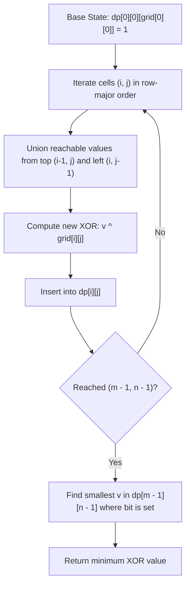

# 3882. Minimum XOR Path in a Grid

## Problem Statement

You are given a 2D integer array `grid` of size $m \times n$. You start at the top-left cell `(0, 0)` and want to reach the bottom-right cell `(m - 1, n - 1)`.

At each step, you may move either **right** or **down**.

The **cost** of a path is defined as the bitwise XOR of all the values in the cells along that path (including the start and end cells).

Return the **minimum possible XOR value** among all valid paths from `(0, 0)` to `(m - 1, n - 1)`.

### Example 1:

```
Input: grid = [[1,2],[3,4]]
Output: 6
Explanation:
There are two valid paths:
1. (0, 0) -> (0, 1) -> (1, 1) with XOR: 1 ^ 2 ^ 4 = 7
2. (0, 0) -> (1, 0) -> (1, 1) with XOR: 1 ^ 3 ^ 4 = 6
The minimum XOR value is 6.
```

### Example 2:

```
Input: grid = [[6,7],[5,8]]
Output: 9
Explanation:
There are two valid paths:
1. (0, 0) -> (0, 1) -> (1, 1) with XOR: 6 ^ 7 ^ 8 = 9
2. (0, 0) -> (1, 0) -> (1, 1) with XOR: 6 ^ 5 ^ 8 = 11
The minimum XOR value is 9.
```

### Example 3:

```
Input: grid = [[2,7,5]]
Output: 0
Explanation:
There is only one valid path:
(0, 0) -> (0, 1) -> (0, 2) with XOR: 2 ^ 7 ^ 5 = 0.
The minimum XOR value is 0.
```

### Constraints:
- $1 \le m == \text{grid.length} \le 1000$
- $1 \le n == \text{grid}[i].\text{length} \le 1000$
- $m \times n \le 1000$
- $0 \le \text{grid}[i][j] \le 1023$

---

## Approach

### 1. Non-Monotonicity of XOR
In standard grid pathfinding problems (such as *Minimum Path Sum*), costs accumulate additively, allowing greedy pruning or maintaining only the minimum cost per cell. However:
- **Bitwise XOR is non-monotonic:** $A < B \not\implies (A \oplus X) < (B \oplus X)$.
- A larger intermediate XOR value at cell $(i, j)$ may later cancel higher-order bits with downstream cells, resulting in a significantly lower final cost at $(m - 1, n - 1)$.
- Therefore, storing just a single minimum value per cell is incorrect; we must track **all possible reachable XOR values** at each cell.

### 2. Bounded State Space
- The problem constraints guarantee $0 \le \text{grid}[i][j] \le 1023 < 2^{10}$.
- Because the XOR sum of numbers in $[0, 1023]$ cannot exceed $1023$, the set of all achievable XOR values at any cell is strictly bounded by $[0, 1023]$.
- We can represent reachable XOR states using a compact bitset of size $1024$ (`std::bitset<1024>` in C++ or a hash set in Python).

### 3. Dynamic Programming Transitions
Let $\text{dp}[i][j]$ denote the bitset of reachable XOR values at cell $(i, j)$:
1. **Base Case:**
   $$\text{dp}[0][0][\text{grid}[0][0]] = 1$$
2. **State Transitions:**
   For every cell $(i, j) \neq (0, 0)$:
   - From top cell $(i - 1, j)$ (if $i > 0$): for every reachable $v \in \text{dp}[i - 1][j]$, set $\text{dp}[i][j][v \oplus \text{grid}[i][j]] = 1$.
   - From left cell $(i, j - 1)$ (if $j > 0$): for every reachable $v \in \text{dp}[i][j - 1]$, set $\text{dp}[i][j][v \oplus \text{grid}[i][j]] = 1$.
3. **Result:**
   Scan $v$ from $0$ to $1023$ and return the smallest $v$ such that $\text{dp}[m - 1][n - 1][v] == 1$.



---

## Code Implementation

### C++

```cpp
class Solution {
public:
    int minCost(vector<vector<int>>& grid) {
        int m = grid.size();
        int n = grid[0].size();
        const int MAX_VAL = 1024;

        vector<vector<bitset<MAX_VAL>>> dp(m, vector<bitset<MAX_VAL>>(n));
        dp[0][0][grid[0][0]] = 1;

        for (int i = 0; i < m; ++i) {
            for (int j = 0; j < n; ++j) {
                if (i == 0 && j == 0) continue;
                int val = grid[i][j];

                // Propagate from top neighbor
                if (i > 0) {
                    for (int v = 0; v < MAX_VAL; ++v) {
                        if (dp[i - 1][j][v]) {
                            dp[i][j][v ^ val] = 1;
                        }
                    }
                }

                // Propagate from left neighbor
                if (j > 0) {
                    for (int v = 0; v < MAX_VAL; ++v) {
                        if (dp[i][j - 1][v]) {
                            dp[i][j][v ^ val] = 1;
                        }
                    }
                }
            }
        }

        // Return the smallest reachable XOR value at destination
        for (int v = 0; v < MAX_VAL; ++v) {
            if (dp[m - 1][n - 1][v]) {
                return v;
            }
        }

        return -1;
    }
};
```

### Python3

```python
class Solution:
    def minCost(self, grid: list[list[int]]) -> int:
        m, n = len(grid), len(grid[0])
        
        # dp[i][j] stores the set of reachable XOR sums at cell (i, j)
        dp = [[set() for _ in range(n)] for _ in range(m)]
        dp[0][0].add(grid[0][0])

        for i in range(m):
            for j in range(n):
                if i == 0 and j == 0:
                    continue
                val = grid[i][j]
                
                # From cell above
                if i > 0:
                    for v in dp[i - 1][j]:
                        dp[i][j].add(v ^ val)
                        
                # From cell to the left
                if j > 0:
                    for v in dp[i][j - 1]:
                        dp[i][j].add(v ^ val)

        return min(dp[m - 1][n - 1])
```

---

## Complexity Analysis

- **Time Complexity**: $O(m \cdot n \cdot K)$ — where $K \le 1024$ is the maximum distinct XOR value bounded by the input range $0 \le \text{grid}[i][j] \le 1023$. Given $m \times n \le 1000$, total operations are at most $1000 \times 1024 \approx 10^6$, executing in just a few milliseconds.
- **Space Complexity**: $O(m \cdot n \cdot K / 64)$ — using `bitset<1024>` requires only 128 bytes per cell ($\approx 128 \text{ KB}$ total). This can further be reduced to $O(n \cdot K)$ by keeping only the current and previous row bitsets.

---
