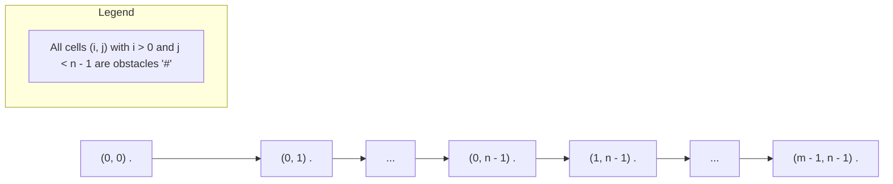

# 3963. Create Grid With Exactly One Path

## Problem Statement

You are given two integers `m` and `n`, representing the number of rows and columns of a grid.

You need to construct an $m \times n$ grid consisting of:
- `'.'` representing a free cell.
- `'#'` representing an obstacle cell.

The grid must be constructed such that there is **exactly one valid path** from the top-left cell `(0, 0)` to the bottom-right cell `(m - 1, n - 1)` by moving only **Right** or **Down**.

Return the constructed grid as a list/array of strings. If there are multiple answers, return any of them.

### Example 1:

```
Input: m = 3, n = 3
Output: [
  "...",
  "##.",
  "##."
]
Explanation:
The only valid path from (0, 0) to (2, 2) is:
(0, 0) -> (0, 1) -> (0, 2) -> (1, 2) -> (2, 2).
Any other path is blocked by '#'.
```

### Example 2:

```
Input: m = 2, n = 2
Output: [
  "..",
  "#."
]
Explanation:
The unique valid path is (0, 0) -> (0, 1) -> (1, 1).
Moving down from (0, 0) is blocked by '#'.
```

### Constraints:
- $1 \le m, n \le 25$

---

## Approach

1. **Uniqueness via Edge-Constrained Path (L-Shaped Route):**
   - We are allowed to return any valid grid that yields strictly one path from `(0, 0)` to `(m - 1, n - 1)`.
   - The simplest deterministic layout that guarantees zero alternative branching is an **L-shaped path** hugging the grid boundary:
     1. Move exclusively **Right** along the top row: $(0, 0) \to (0, 1) \to \dots \to (0, n - 1)$.
     2. Move exclusively **Down** along the rightmost column: $(0, n - 1) \to (1, n - 1) \to \dots \to (m - 1, n - 1)$.

2. **Obstacle Placement:**
   - Set all cells in row $0$ to free cells: `'.'`.
   - For all subsequent rows $i$ ($1 \le i < m$), fill all columns $j < n - 1$ with obstacles `'#'` and keep only the rightmost column cell $(i, n - 1)$ as `'.'`.
   - **Why this guarantees exactly one path:**
     - From any cell $(0, j)$ where $j < n - 1$, moving **Down** is blocked by `'#'` at $(1, j)$.
     - Therefore, the only available move is **Right** until reaching $(0, n - 1)$.
     - From $(0, n - 1)$, moving **Right** is out of bounds, so the only legal move is **Down** along column $n - 1$.
     - Hence, no branch points exist, yielding strictly **one** path.



---

## Code Implementation

### C++

```cpp
class Solution {
public:
    vector<string> createGrid(int m, int n) {
        vector<string> grid;
        grid.reserve(m);

        // Row 0 is entirely free
        grid.push_back(string(n, '.'));

        // Subsequent rows have obstacles everywhere except the last column
        string remainingRow = string(n - 1, '#') + ".";
        for (int i = 1; i < m; ++i) {
            grid.push_back(remainingRow);
        }

        return grid;
    }
};
```

### Python3

```python
class Solution:
    def createGrid(self, m: int, n: int) -> list[str]:
        grid = []
        
        # Row 0 is entirely free
        grid.append("." * n)
        
        # Remaining rows have obstacles except the rightmost column
        remaining_row = "#" * (n - 1) + "."
        for _ in range(m - 1):
            grid.append(remaining_row)
            
        return grid
```

---

## Complexity Analysis

- **Time Complexity**: $O(m \cdot n)$ — Constructing $m$ strings of length $n$ takes linear time proportional to the total number of grid cells.
- **Space Complexity**: $O(m \cdot n)$ — Required to store and return the generated $m \times n$ grid of characters. No auxiliary dynamic memory is used.

---
