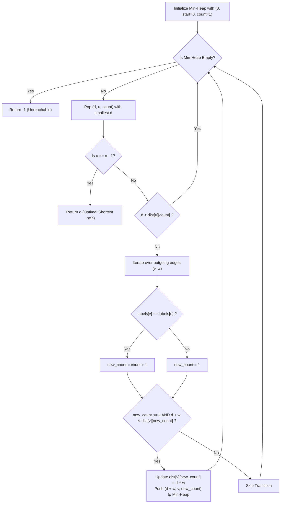

# 3970. Shortest Path With At Most K Consecutive Identical Characters

## Problem Statement

You are given an integer `n` representing the number of nodes in a directed weighted graph, numbered from `0` to `n - 1`. The graph is represented by a 2D integer array `edges`, where `edges[i] = [ui, vi, wi]` represents a directed edge from node `ui` to node `vi` with weight `wi`.

You are also given a string `labels` of length `n`, where `labels[i]` represents the lowercase English character assigned to node `i`, and an integer `k`.

Return the **minimum total edge weight** of a path from node `0` to node `n - 1` such that the concatenation of the labels of the nodes along the path contains **at most $k$ consecutive identical characters**. If no valid path exists, return `-1`.

### Example 1:

```
Input: n = 3, edges = [[0,1,1],[1,2,1],[0,2,3]], labels = "aab", k = 1
Output: 3
Explanation:
- The path 0 -> 1 -> 2 has labels labels[0] + labels[1] + labels[2] = "aab", which contains 2 consecutive 'a's. Since k = 1, this path violates the condition.
- The path 0 -> 2 uses edges[2] = [0, 2, 3] with total weight 3. Its concatenated labels are "ab", which contains at most k = 1 consecutive identical characters.
Thus, the minimum total edge weight is 3.
```

### Example 2:

```
Input: n = 3, edges = [[0,1,1],[1,2,1],[0,2,3]], labels = "aab", k = 2
Output: 2
Explanation:
- Path 0 -> 1 -> 2 has total weight 1 + 1 = 2.
- The concatenated labels are "aab", which contains at most 2 consecutive identical characters (satisfying k = 2).
Thus, the minimum weight is 2.
```

### Example 3:

```
Input: n = 3, edges = [[0,1,1],[1,2,1]], labels = "aaa", k = 2
Output: -1
Explanation:
The only path from node 0 to node 2 is 0 -> 1 -> 2 with labels "aaa". It contains 3 consecutive 'a's, violating k = 2.
Since no valid path exists, return -1.
```

### Constraints:

- $1 \le n == \text{labels.length} \le 5 \times 10^4$
- $0 \le \text{edges.length} \le 5 \times 10^4$
- $\text{edges}[i] == [u_i, v_i, w_i]$
- $0 \le u_i, v_i \le n - 1$
- $u_i \neq v_i$
- $1 \le w_i \le 10^4$
- `labels` consists of lowercase English letters.
- $1 \le k \le 50$

---

## Approach

### 1. State-Space Graph Expansion
In standard Dijkstra's algorithm, we track only the minimum distance to each vertex $u$. However, here each valid move depends on history: how many times the current label character has appeared consecutively along the prefix of the path.

To satisfy the Markov property required for dynamic programming and shortest path algorithms, we augment each vertex with the streak length of the current character:
$$\text{State} = (u, \text{consecutive\_count})$$
- $u \in [0, n - 1]$: the current node.
- $\text{consecutive\_count} \in [1, k]$: the number of consecutive occurrences of character `labels[u]` up to node $u$.

Because $k \le 50$, the expanded state space contains at most $n \times k \approx 5 \times 10^4 \times 50 = 2.5 \times 10^6$ reachable states, which fits well within standard memory and execution limits.

### 2. State Transitions
- **Initialization:** We start at node `0`. The first character `labels[0]` establishes an initial streak of $1$. The initial state is $(0, 1)$ with distance $0$.
- **Edge Transition $(u \to v, w)$:**
  - If $\text{labels}[v] == \text{labels}[u]$:
    $$\text{new\_count} = \text{consecutive\_count} + 1$$
  - If $\text{labels}[v] \neq \text{labels}[u]$:
    $$\text{new\_count} = 1$$
  - **Pruning:** If $\text{new\_count} > k$, this transition is invalid and discarded.
  - If $\text{new\_count} \le k$ and $d + w < \text{dist}[v][\text{new\_count}]$, update the distance and push $(d + w, v, \text{new\_count})$ into the min-heap.

### 3. Dijkstra's Algorithm
Because all edge weights $w_i > 0$, Dijkstra's greedy priority queue property guarantees that the first time any state with $u = n - 1$ is popped from the min-heap, its associated distance is optimal.



---

## Code Implementation

### C++

```cpp
#include <vector>
#include <string>
#include <queue>
#include <tuple>

using namespace std;

class Solution {
public:
    int shortestPath(int n, vector<vector<int>>& edges, string labels, int k) {
        // Build adjacency list: graph[u] -> vector of pairs (v, weight)
        vector<vector<pair<int, int>>> graph(n);
        for (const auto& edge : edges) {
            graph[edge[0]].emplace_back(edge[1], edge[2]);
        }

        // dist[u][count] = minimum weight to reach node u with `count` consecutive identical labels
        const long long INF = 1e18;
        vector<vector<long long>> dist(n, vector<long long>(k + 1, INF));

        // Min-heap priority queue storing: tuple(distance, node, consecutive_count)
        using State = tuple<long long, int, int>;
        priority_queue<State, vector<State>, greater<State>> pq;

        dist[0][1] = 0;
        pq.emplace(0, 0, 1);

        while (!pq.empty()) {
            auto [d, u, count] = pq.top();
            pq.pop();

            // Destination reached with optimal weight
            if (u == n - 1) {
                return static_cast<int>(d);
            }

            // Stale state check
            if (d > dist[u][count]) {
                continue;
            }

            for (const auto& [v, w] : graph[u]) {
                int new_count = (labels[v] == labels[u]) ? count + 1 : 1;
                if (new_count <= k && d + w < dist[v][new_count]) {
                    dist[v][new_count] = d + w;
                    pq.emplace(d + w, v, new_count);
                }
            }
        }

        return -1;
    }
};
```

### Python3

```python
import heapq

class Solution:
    def shortestPath(self, n: int, edges: list[list[int]], labels: str, k: int) -> int:
        # Build adjacency list: graph[u] -> [(v, weight), ...]
        graph = [[] for _ in range(n)]
        for u, v, w in edges:
            graph[u].append((v, w))

        # Priority queue stores tuples of: (distance, node, consecutive_count)
        pq = [(0, 0, 1)]

        # Distance table: dist[(node, count)] = minimum weight
        dist = {}
        dist[(0, 1)] = 0

        while pq:
            d, u, count = heapq.heappop(pq)

            # Destination reached
            if u == n - 1:
                return d

            if d > dist.get((u, count), float('inf')):
                continue

            for v, w in graph[u]:
                new_count = count + 1 if labels[v] == labels[u] else 1
                if new_count <= k:
                    new_d = d + w
                    if new_d < dist.get((v, new_count), float('inf')):
                        dist[(v, new_count)] = new_d
                        heapq.heappush(pq, (new_d, v, new_count))

        return -1
```

---

## Complexity Analysis

- **Time Complexity**: $O((E \cdot k) \log (V \cdot k))$ — where $V = n \le 5 \times 10^4$, $E = |\text{edges}| \le 5 \times 10^4$, and $k \le 50$. The augmented state-space graph contains at most $V \cdot k$ vertices and $E \cdot k$ transitions. In the worst case, each transition is pushed and popped from the priority queue in $O(\log(V \cdot k))$ time.

- **Space Complexity**: $O(V \cdot k)$ — to store the distance table and priority queue entries for all reachable $(u, \text{consecutive\_count})$ state pairs.

---
