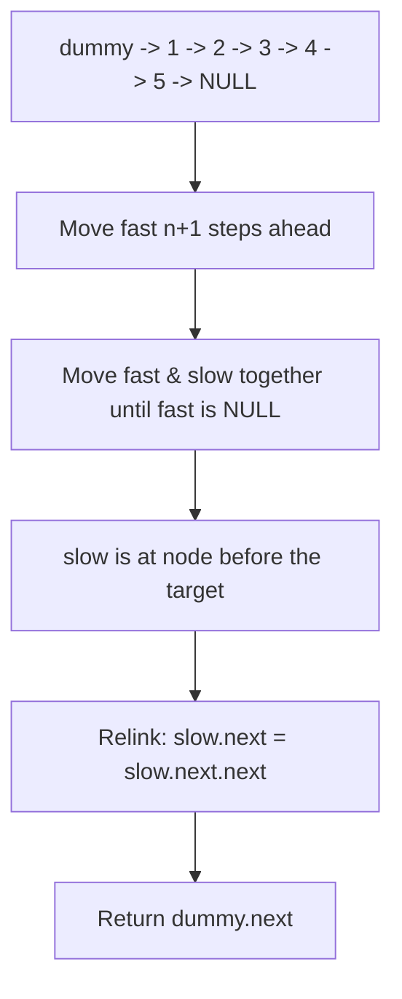

# 19. Remove Nth Node From End of List

## Problem Statement

Given the head of a linked list, remove the $n^{\text{th}}$ node from the end of the list and return its head.

### Example 1:
```
Input: head = [1,2,3,4,5], n = 2
Output: [1,2,3,5]
Explanation: The 2nd node from the end is 4, which is removed.
```

### Example 2:
```
Input: head = [1], n = 1
Output: []
```

### Example 3:
```
Input: head = [1,2], n = 1
Output: [1]
```

---

## Approach

We can solve this problem in **one pass** using the **Two Pointers (Fast & Slow)** technique with a **Dummy Node**:

1. Create a `dummy` node before `head` (`dummy.next = head`) to seamlessly handle the case where the head itself needs to be removed.
2. Initialize two pointers: `fast = &dummy` and `slow = &dummy`.
3. Advance `fast` pointer by $n + 1$ steps ahead so that the distance between `fast` and `slow` is exactly $n$ nodes.
4. Move both `fast` and `slow` forward together one node at a time until `fast` reaches `nullptr`.
5. At this moment, `slow` is positioned directly before the node to be removed.
6. Bypass the target node: `slow->next = slow->next->next` and free its memory.
7. Return `dummy.next`.



---

## Code Implementation

```cpp
/**
 * Definition for singly-linked list.
 * struct ListNode {
 *     int val;
 *     ListNode *next;
 *     ListNode() : val(0), next(nullptr) {}
 *     ListNode(int x) : val(x), next(nullptr) {}
 *     ListNode(int x, ListNode *next) : val(x), next(next) {}
 * };
 */

class Solution {
public:
    ListNode* removeNthFromEnd(ListNode* head, int n) {
        ListNode dummy(0);
        dummy.next = head;
        
        ListNode* fast = &dummy;
        ListNode* slow = &dummy;
        
        // Move fast pointer ahead by n + 1 steps
        for (int i = 0; i <= n; ++i) {
            fast = fast->next;
        }
        
        // Advance both pointers until fast reaches nullptr
        while (fast != nullptr) {
            fast = fast->next;
            slow = slow->next;
        }
        
        // Remove target node
        ListNode* nodeToDelete = slow->next;
        slow->next = slow->next->next;
        delete nodeToDelete;
        
        return dummy.next;
    }
};
```

---

## Complexity Analysis

- **Time Complexity**: $O(L)$ — where $L$ is the number of nodes in the linked list. We only traverse the list once.

- **Space Complexity**: $O(1)$ — Only dummy node and two pointer variables are used.

---
