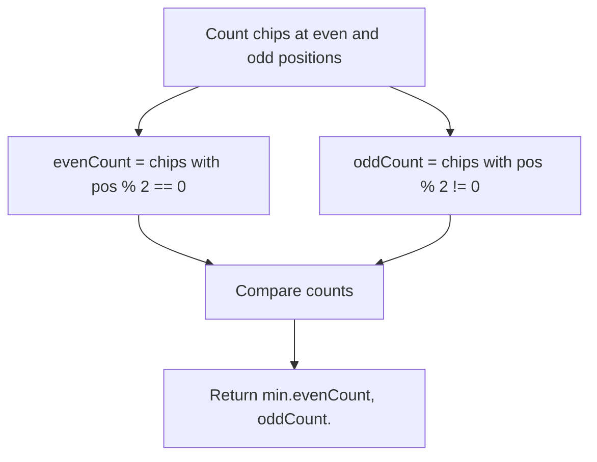

# 1217. Minimum Cost to Move Chips to The Same Position

## Problem Statement

We have `n` chips. The position of the $i^{\text{th}}$ chip is `position[i]`.

We want to move all the chips to **the same position**. In one step, we can change the position of the $i^{\text{th}}$ chip from `position[i]` to:
- `position[i] + 2` or `position[i] - 2` with `cost = 0`.
- `position[i] + 1` or `position[i] - 1` with `cost = 1`.

Return the *minimum cost* needed to move all the chips to the same position.

### Example 1:
```
Input: position = [1,2,3]
Output: 1
Explanation: First step: Move the chip at position 3 to position 1 with cost = 0.
Second step: Move the chip at position 2 to position 1 with cost = 1.
Total cost is 1.
```

### Example 2:
```
Input: position = [2,2,2,3,3]
Output: 2
Explanation: We can move the two chips at 3 to 2. Each will cost 1. Total minimum cost = 2.
```

### Example 3:
```
Input: position = [1,1000000000]
Output: 1
```

---

## Approach

Notice the movement rules:
- Moving by `2` positions costs `0`. This means all chips at **even** positions can move to any other even position (e.g. position `0`) for **free**!
- Similarly, all chips at **odd** positions can move to any other odd position (e.g. position `1`) for **free**!
- Therefore, we can group all chips into two clusters with zero cost:
  - Cluster 1: All even-positioned chips.
  - Cluster 2: All odd-positioned chips.
- To combine these two clusters into a single position, moving from even to odd (or odd to even) costs `1` per chip.
- To minimize the cost, we move whichever group has fewer chips into the other group's position:
  $$\text{Minimum Cost} = \min(\text{evenCount}, \text{oddCount})$$



---

## Code Implementation

```cpp
#include <vector>
#include <algorithm>

class Solution {
public:
    int minCostToMoveChips(std::vector<int>& position) {
        int evenCount = 0;
        int oddCount = 0;
        
        for (int pos : position) {
            if (pos % 2 == 0) {
                evenCount++;
            } else {
                oddCount++;
            }
        }
        
        return std::min(evenCount, oddCount);
    }
};
```

---

## Complexity Analysis

- **Time Complexity**: $O(n)$ — Single linear pass over the `position` array of size $n$.

- **Space Complexity**: $O(1)$ — Only two scalar counters (`evenCount` and `oddCount`) are used.

---
