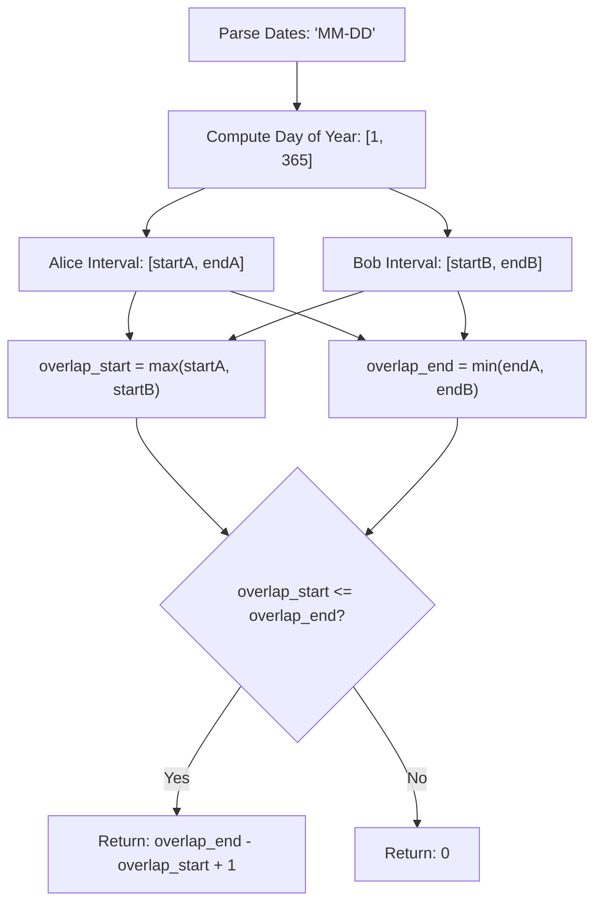

# 2409. Count Days Spent Together

## Problem Statement

Alice and Bob are traveling to Rome for vacations. You are given four strings `arriveAlice`, `leaveAlice`, `arriveBob`, and `leaveBob`. The strings represent the dates of arrival and departure of Alice and Bob in the format `"MM-DD"`.

Alice arrives on date `arriveAlice` and leaves on date `leaveAlice`. Bob arrives on date `arriveBob` and leaves on date `leaveBob`.

All dates are from the same calendar year, which is not a leap year (that is, it has 365 days).

Calculate the number of days that Alice and Bob are in Rome together.

You can assume that all dates exist in the calendar year, and that Alice's and Bob's vacation dates are valid (arrival is at or before departure).

### Example 1:
```
Input: arriveAlice = "08-15", leaveAlice = "08-18", arriveBob = "08-16", leaveBob = "08-19"
Output: 3
Explanation: Alice is in Rome from August 15 to August 18. Bob is in Rome from August 16 to August 19. They are both in Rome on August 16, 17, and 18, so the answer is 3.
```

### Example 2:
```
Input: arriveAlice = "10-01", leaveAlice = "10-31", arriveBob = "11-01", leaveBob = "12-31"
Output: 0
Explanation: There is no day when Alice and Bob are in Rome together, so we return 0.
```

### Constraints:
- All dates are provided in the format `"MM-DD"`.
- Alice and Bob's arrival dates are earlier than or equal to their leaving dates.
- The given dates are valid dates of a non-leap year.

---

## Approach

1. **Mapping Dates to 1D Timeline (Day of Year):**
   - Each calendar date `"MM-DD"` maps to a unique sequential day index $D \in [1, 365]$ from January 1st to December 31st.
   - Using the standard month lengths for a non-leap year:
     $$\text{days} = [31, 28, 31, 30, 31, 30, 31, 31, 30, 31, 30, 31]$$
   - The day of the year for a given date is:
     $$\text{dayOfYear}(\text{MM}, \text{DD}) = \sum_{m=1}^{\text{MM}-1} \text{days}[m] + \text{DD}$$

2. **Interval Intersection:**
   - Alice's stay forms the interval $[A_{start}, A_{end}]$ and Bob's stay forms $[B_{start}, B_{end}]$.
   - The mutual overlapping interval is:
     $$\text{start} = \max(A_{start}, B_{start})$$
     $$\text{end} = \min(A_{end}, B_{end})$$

3. **Calculating Mutual Days:**
   - If $\text{start} \le \text{end}$, the number of overlapping days is:
     $$\text{days} = \text{end} - \text{start} + 1$$
   - If $\text{start} > \text{end}$, there is no overlap, yielding $0$ days.
   - In compact form:
     $$\max(0, \min(A_{end}, B_{end}) - \max(A_{start}, B_{start}) + 1)$$



---

## Code Implementation

### C++
```cpp
class Solution {
private:
    const int daysPerMonth[12] = {31, 28, 31, 30, 31, 30, 31, 31, 30, 31, 30, 31};

    int toDayOfYear(const string& date) {
        int month = stoi(date.substr(0, 2));
        int day = stoi(date.substr(3, 2));
        int totalDays = 0;
        for (int i = 0; i < month - 1; ++i) {
            totalDays += daysPerMonth[i];
        }
        return totalDays + day;
    }

public:
    int countDaysTogether(string arriveAlice, string leaveAlice, string arriveBob, string leaveBob) {
        int startA = toDayOfYear(arriveAlice);
        int endA = toDayOfYear(leaveAlice);
        int startB = toDayOfYear(arriveBob);
        int endB = toDayOfYear(leaveBob);

        int overlapStart = max(startA, startB);
        int overlapEnd = min(endA, endB);

        return max(0, overlapEnd - overlapStart + 1);
    }
};
```

### Python3
```python
class Solution:
    def countDaysTogether(self, arriveAlice: str, leaveAlice: str, arriveBob: str, leaveBob: str) -> int:
        days_per_month = [31, 28, 31, 30, 31, 30, 31, 31, 30, 31, 30, 31]

        def to_day_of_year(date_str: str) -> int:
            month, day = map(int, date_str.split('-'))
            return sum(days_per_month[:month - 1]) + day

        start_a = to_day_of_year(arriveAlice)
        end_a = to_day_of_year(leaveAlice)
        start_b = to_day_of_year(arriveBob)
        end_b = to_day_of_year(leaveBob)

        overlap_start = max(start_a, start_b)
        overlap_end = min(end_a, end_b)

        return max(0, overlap_end - overlap_start + 1) if overlap_end >= overlap_start else 0
```

---

## Complexity Analysis

- **Time Complexity**: $O(1)$ — Parsing fixed-length 5-character strings and summing up to 12 constant month lengths takes constant time.
- **Space Complexity**: $O(1)$ — Only a few primitive integers for day bounds are stored.

---
