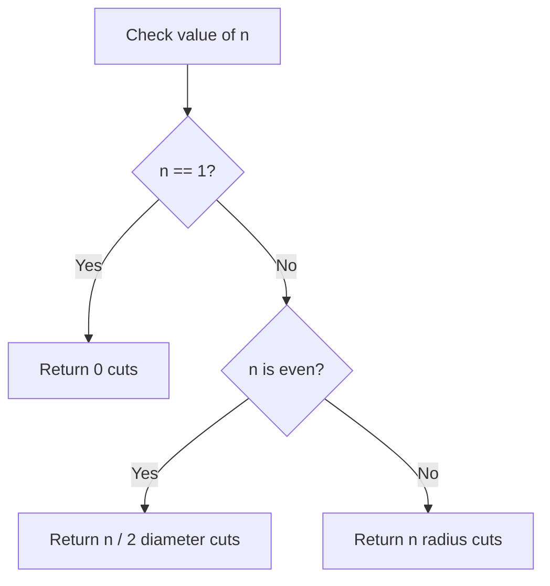

# 2481. Minimum Cuts to Divide a Circle

## Problem Statement

A **valid cut** in a circle can be:
- A cut that is represented by a straight line that touches two points on the edge of the circle and passes through the center, or
- A cut that is represented by a straight line segment that connects the center of the circle to an edge of the circle.

Given the integer `n`, return the **minimum number of cuts** needed to divide a circle into `n` equal slices.

### Example 1:
```
Input: n = 4
Output: 2
Explanation: A diameter cut passes straight through the center, cutting the circle into 2 equal parts. 2 diameter cuts make 4 equal parts.
```

### Example 2:
```
Input: n = 3
Output: 3
Explanation: Since 3 is odd, diameter cuts cannot be used without creating symmetric opposite pairs. 3 radius cuts from the center are needed.
```

### Example 3:
```
Input: n = 1
Output: 0
Explanation: The circle already consists of 1 whole slice, so 0 cuts are needed.
```

---

## Approach

We can analyze the geometry of dividing a circle into equal sectors:

1. **Edge Case ($n = 1$):**
   - The circle is already 1 slice. No cuts are needed. Return `0`.
2. **Even Case ($n \% 2 == 0$):**
   - A single diameter cut passing through the center divides the circle into 2 symmetric sectors.
   - Therefore, $\frac{n}{2}$ diameter cuts will yield exactly $n$ equal slices.
3. **Odd Case ($n \% 2 \neq 0$):**
   - A line passing straight through the center creates symmetric opposing sectors, which is impossible when dividing into an odd number of slices.
   - We must make $n$ radius cuts extending from the center to the circle's boundary.



---

## Code Implementation

```cpp
class Solution {
public:
    int numberOfCuts(int n) {
        if (n == 1) {
            return 0;
        }
        return (n % 2 == 0) ? (n / 2) : n;
    }
};
```

---

## Complexity Analysis

- **Time Complexity**: $O(1)$ — Only a parity and equality check.

- **Space Complexity**: $O(1)$ — No additional memory required.

---
