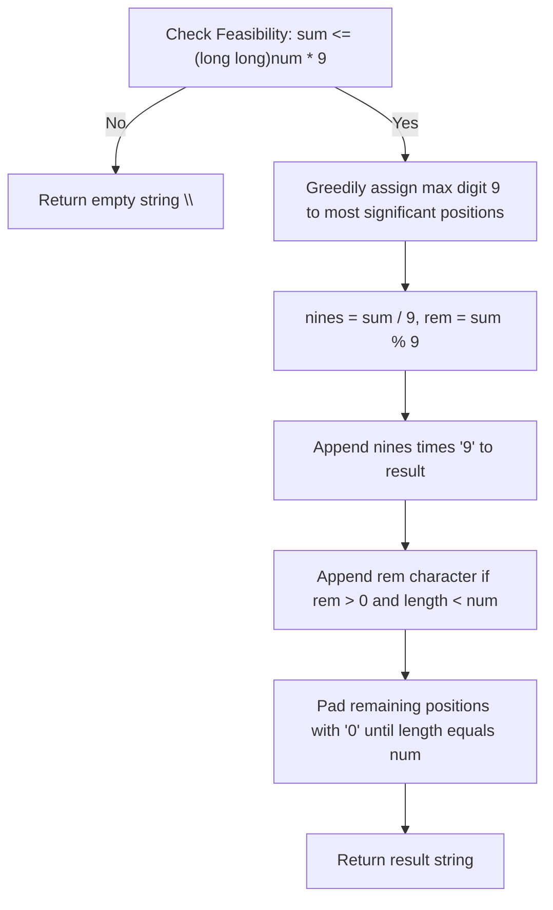

# 3723. Maximize Sum of Squares of Digits

## Problem Statement

You are given two positive integers, `num` and `sum`. A positive integer `n` is considered **good** if:
1. The number of digits in `n` is exactly `num`.
2. The sum of the digits of `n` is exactly `sum`.

The **score** of a good integer `n` is defined as the sum of the squares of its digits.

Return a string denoting the good integer `n` that achieves the **maximum possible score**. If multiple good integers achieve the maximum score, return the **largest** one numerically. If no such integer exists, return an empty string `""`.

### Example 1:
```
Input: num = 2, sum = 3
Output: "30"
Explanation: 
There are 3 good integers whose digits have a count of 2 and sum to 3: 12, 21, and 30.
- The score of 12 is 1^2 + 2^2 = 5
- The score of 21 is 2^2 + 1^2 = 5
- The score of 30 is 3^2 + 0^2 = 9
The maximum score is 9, achieved by 30.
```

### Example 2:
```
Input: num = 2, sum = 17
Output: "98"
Explanation: 
There are 2 good integers whose digits sum to 17: 89 and 98.
- The score of 89 is 8^2 + 9^2 = 64 + 81 = 145
- The score of 98 is 9^2 + 8^2 = 81 + 64 = 145
Both share the maximum score of 145, and the largest numerically among them is "98".
```

### Example 3:
```
Input: num = 1, sum = 10
Output: ""
Explanation: 
There are no integers that have exactly 1 digit and whose digits sum to 10. Therefore, the answer is an empty string.
```

### Constraints:
- `1 <= num <= 2 * 10^5`
- `1 <= sum <= 2 * 10^6`

---

## Approach

1. **Convexity of Squares (Lopsided Distribution):**
   - The square function $f(x) = x^2$ is strictly convex.
   - For any two digits $a \ge b$ and a transfer unit $\delta > 0$:
     $$(a + \delta)^2 + (b - \delta)^2 - (a^2 + b^2) = 2\delta(a - b) + 2\delta^2 > 0$$
   - This means concentrating the sum into as few large digits as possible always strictly increases the sum of squares compared to spreading the sum evenly.
   - To maximize the total score, each digit should be as close to `9` as possible.

2. **Feasibility Check:**
   - The maximum digit sum achievable with `num` digits is $9 \times \text{num}$.
   - If $\text{sum} > 9 \times \text{num}$, it is impossible to satisfy the condition, so we return `""`.

3. **Greedy Placement for Numerical Maximization:**
   - To break ties by selecting the **largest** numerical string, higher-value digits must be placed at the most significant positions (from left to right).
   - Place as many `9`s as possible: $\lfloor \text{sum} / 9 \rfloor$.
   - Place the remaining modulo digit $\text{sum} \pmod 9$ right after the `9`s (if $\text{sum} \pmod 9 > 0$).
   - Fill all remaining positions up to `num` digits with `0`s.
   - Since $\text{sum} \ge 1$, the first digit will always be non-zero ($\ge 1$), satisfying the positive integer condition.



---

## Code Implementation

```cpp
#include <string>

class Solution {
public:
    std::string maximumSumOfSquares(int num, int sum) {
        // Feasibility check: maximum possible sum with 'num' digits is num * 9
        if ((long long)num * 9 < sum) {
            return "";
        }
        
        int nines = sum / 9;
        int rem = sum % 9;
        
        std::string result = "";
        result.reserve(num);
        
        // Greedily append the maximum digits (9)
        result.append(nines, '9');
        
        // Append the remainder digit if applicable
        if (nines < num && rem > 0) {
            result += std::to_string(rem);
        }
        
        // Pad the remaining lower-order positions with '0'
        if ((int)result.size() < num) {
            result.append(num - result.size(), '0');
        }
        
        return result;
    }
};
```

---

## Complexity Analysis

- **Time Complexity**: $O(\text{num})$ — Constructing and appending characters to the result string takes linear time proportional to the number of digits `num` ($1 \le \text{num} \le 2 \times 10^5$).

- **Space Complexity**: $O(\text{num})$ — Memory required to store and return the resulting number string of length `num`.

---
