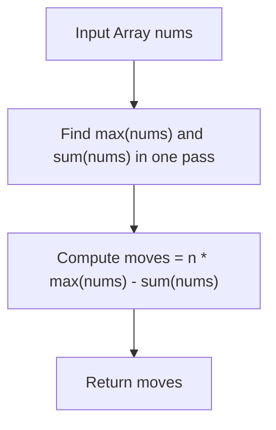

# 3736. Minimum Moves to Equal Array Elements III

## Problem Statement

You are given an integer array `nums`. In one move, you may increase the value of any single element `nums[i]` by `1`.

Return the *minimum total number of moves* required so that all elements in `nums` become equal.

### Example 1:

```
Input: nums = [2,1,3]
Output: 3
Explanation:
To make all elements equal:
- Increase nums[1] = 1 by 1 twice to make it 3 (2 moves).
- Increase nums[0] = 2 by 1 once to make it 3 (1 move).
Total moves = 2 + 1 = 3.
```

### Example 2:

```
Input: nums = [4,4,5]
Output: 2
Explanation:
To make all elements equal:
- Increase nums[0] = 4 by 1 to make it 5 (1 move).
- Increase nums[1] = 4 by 1 to make it 5 (1 move).
Total moves = 1 + 1 = 2.
```

### Constraints:

- $1 \le \text{nums.length} \le 100$
- $1 \le \text{nums}[i] \le 100$

---

## Approach

### 1. Monotonic Increment Invariant
- We are only permitted to **increment** elements by $1$. No decrement operations are allowed.
- Therefore, no element can end up smaller than its initial value.
- To make all elements equal, the common target value must be at least as large as the initial maximum element in the array:
  $$\text{target} \ge \max(\text{nums})$$

### 2. Optimal Target Value
- Every increase of the target beyond $\max(\text{nums})$ would add $1$ extra move to every single element in the array ($n$ additional moves per $+1$).
- Thus, the unique optimal target that minimizes total moves is:
  $$\text{target} = \max(\text{nums})$$

### 3. Closed-Form Calculation
The number of moves needed to raise element $\text{nums}[i]$ to $\max(\text{nums})$ is $\max(\text{nums}) - \text{nums}[i]$.
Summing over all elements:
$$\text{Total Moves} = \sum_{i=0}^{n-1} (\max(\text{nums}) - \text{nums}[i]) = n \cdot \max(\text{nums}) - \sum_{i=0}^{n-1} \text{nums}[i]$$



---

## Code Implementation

### C++

```cpp
#include <vector>
#include <algorithm>
#include <numeric>

using namespace std;

class Solution {
public:
    int minMoves(vector<int>& nums) {
        int max_val = *max_element(nums.begin(), nums.end());
        int moves = 0;
        for (int x : nums) {
            moves += max_val - x;
        }
        return moves;
    }
};
```

### Python3

```python
class Solution:
    def minMoves(self, nums: list[int]) -> int:
        max_val = max(nums)
        return sum(max_val - x for x in nums)
```

---

## Complexity Analysis

- **Time Complexity**: $O(n)$ — A single pass to find the maximum element and compute the sum of differences across $n$ elements.
- **Space Complexity**: $O(1)$ — Only scalar variables are used.

---
