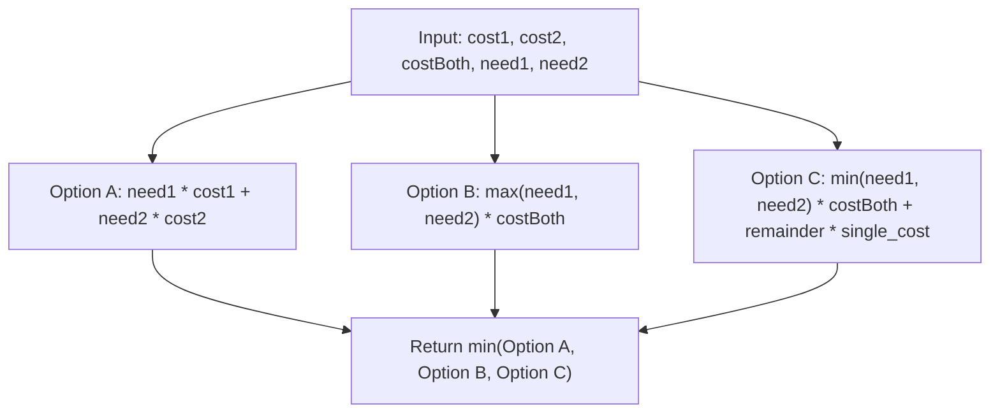

# 3789. Minimum Cost to Acquire Required Items

## Problem Statement

You are given five integers: `cost1`, `cost2`, `costBoth`, `need1`, and `need2`. There are three types of items available:

- **Type 1 item**: Costs `cost1` and contributes `1` unit toward the type 1 requirement only.
- **Type 2 item**: Costs `cost2` and contributes `1` unit toward the type 2 requirement only.
- **Type 3 item (Both)**: Costs `costBoth` and contributes `1` unit toward **both** the type 1 and type 2 requirements.

You must collect enough items such that your total contribution toward type 1 is at least `need1` and toward type 2 is at least `need2`.

Return the **minimum possible total cost** to satisfy both requirements.

### Example 1:

```
Input: cost1 = 3, cost2 = 2, costBoth = 1, need1 = 3, need2 = 2
Output: 3
Explanation:
Buy 3 items of Type 3 (Both):
- Cost = 3 * 1 = 3
- Contribution to type 1 = 3 >= need1 (3)
- Contribution to type 2 = 3 >= need2 (2)
Any other combination would cost more, so 3 is the minimum total cost.
```

### Example 2:

```
Input: cost1 = 5, cost2 = 4, costBoth = 15, need1 = 2, need2 = 3
Output: 22
Explanation:
Buy 2 items of Type 1 and 3 items of Type 2:
- Cost = 2 * 5 + 3 * 4 = 10 + 12 = 22
Using Type 3 items is too expensive (costBoth = 15), so 22 is the minimum total cost.
```

### Example 3:

```
Input: cost1 = 5, cost2 = 4, costBoth = 15, need1 = 0, need2 = 0
Output: 0
Explanation:
No items are required (need1 = 0 and need2 = 0), so we buy nothing and pay 0.
```

### Constraints:

- $1 \le \text{cost1}, \text{cost2}, \text{costBoth} \le 10^6$
- $0 \le \text{need1}, \text{need2} \le 10^9$

---

## Approach

### 1. Mathematical & Greedy Strategy Decomposition
Since `need1` and `need2` can be up to $10^9$, an iterative simulation would lead to Time Limit Exceeded (TLE). We can solve this problem in $O(1)$ by analyzing the possible optimal purchasing strategies:

1. **Option A: Pure Individual Items (No Bundles)**
   - We purchase individual items separately for each requirement:
     $$\text{Cost}_A = \text{need1} \times \text{cost1} + \text{need2} \times \text{cost2}$$
   - This is optimal when bundles are overpriced compared to the sum of individual components ($\text{costBoth} \ge \text{cost1} + \text{cost2}$).

2. **Option B: Pure Bundle Purchases (Covering Maximum Requirement)**
   - We satisfy both needs exclusively using Type 3 (Both) items:
     $$\text{Cost}_B = \max(\text{need1}, \text{need2}) \times \text{costBoth}$$
   - This also satisfies any leftover amount of the smaller requirement since each bundle supplies both types. This is optimal when $\text{costBoth}$ is cheaper than either $\text{cost1}$ or $\text{cost2}$ individually.

3. **Option C: Hybrid Strategy (Shared Overlap + Individual Remainder)**
   - We purchase $mn = \min(\text{need1}, \text{need2})$ bundles of Type 3, which fully covers the smaller requirement and reduces the larger requirement by $mn$:
     $$\text{Cost}_C = mn \times \text{costBoth} + (\text{need1} - mn) \times \text{cost1} + (\text{need2} - mn) \times \text{cost2}$$
   - This is optimal when bundles are cost-effective for shared units ($\text{costBoth} < \text{cost1} + \text{cost2}$), but single items are cheaper for the unshared remainder than buying additional unused bundle capacity ($\min(\text{cost1}, \text{cost2}) < \text{costBoth}$).

### 2. Optimality
The three candidate strategies partition the space of all optimal solutions:
$$\text{Minimum Cost} = \min(\text{Cost}_A, \text{Cost}_B, \text{Cost}_C)$$

### 3. Integer Overflow Prevention
Since `need1` and `need2` can be up to $10^9$ and costs can be up to $10^6$, total cost can reach $10^{15}$. In C++, 64-bit integer arithmetic (`long long`) must be used for all multiplications to prevent 32-bit signed integer overflow.



---

## Code Implementation

### C++

```cpp
#include <algorithm>

using namespace std;

class Solution {
public:
    long long minimumCost(int cost1, int cost2, int costBoth, int need1, int need2) {
        // Option A: Purchase only individual items
        long long optionA = 1LL * need1 * cost1 + 1LL * need2 * cost2;

        // Option B: Purchase only Type 3 bundles to cover the maximum need
        long long optionB = 1LL * max(need1, need2) * costBoth;

        // Option C: Use Type 3 bundles for the common overlap, individual items for remainder
        int mn = min(need1, need2);
        long long optionC = 1LL * mn * costBoth + 
                            1LL * (need1 - mn) * cost1 + 
                            1LL * (need2 - mn) * cost2;

        return min({optionA, optionB, optionC});
    }
};
```

### Python3

```python
class Solution:
    def minimumCost(self, cost1: int, cost2: int, costBoth: int, need1: int, need2: int) -> int:
        # Option A: Only individual items
        option_a = need1 * cost1 + need2 * cost2
        
        # Option B: Only Type 3 bundles
        option_b = max(need1, need2) * costBoth
        
        # Option C: Bundles for common overlap, individual items for the remainder
        mn = min(need1, need2)
        option_c = mn * costBoth + (need1 - mn) * cost1 + (need2 - mn) * cost2
        
        return min(option_a, option_b, option_c)
```

---

## Complexity Analysis

- **Time Complexity**: $O(1)$ — Consists of a constant number of arithmetic operations (`+`, `*`, `min`, `max`), executing in $O(1)$ time regardless of input size.
- **Space Complexity**: $O(1)$ — Only scalar variables are used.

---